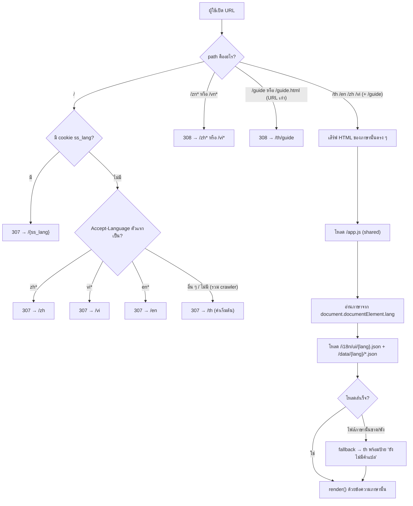
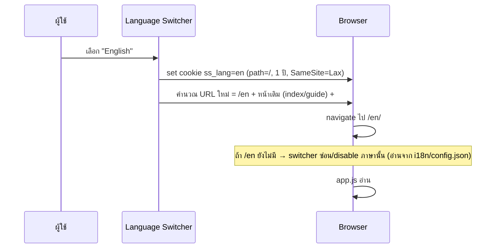
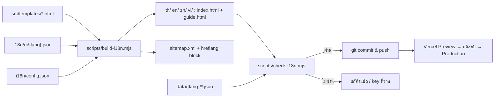
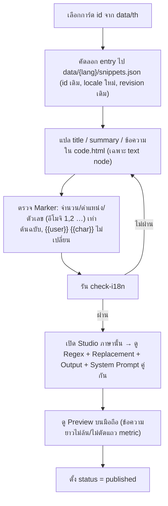

# 🌏 แผนทำ Snippet Studio หลายภาษา (Path-based i18n)

> **สถานะ:** กำลังดำเนินการ (2026-10-14) — ไทยเปิดใช้งานที่ `/th`; EN และ VI แปลครบ 100% และเจ้าของอนุมัติแล้ว (การ์ด 101 ใบต่อภาษาเป็น `published`, 9 หมวด, UI, คู่มือ); ทั้งสองภาษายัง `enabled: false` ระหว่างรอตรวจ Preview บนมือถือและคำสั่งเปิดใช้จริง; จีนสองชุดยังไม่ครบและปิดใช้งาน
> **เป้าหมาย:** แยกแต่ละภาษาด้วย path ที่ไม่ปนกัน: `/th` · `/en` · `/zh` · `/vi`
> **ที่มาของข้อมูล:** ตรวจจากโค้ดจริงใน repo เมื่อ 2026-10-14 (ข้อมูลส่วนที่ "ยังไม่ยืนยัน" ระบุไว้ชัดเจนในตัวเอกสาร)

---

## 0. สรุปสั้น (TL;DR)

1. โปรเจกต์เป็น **Static Site ล้วน** (ไม่มี Backend, ไม่มี Build step) deploy บน Vercel → ทำ path แยกภาษาได้ด้วย `vercel.json` + โฟลเดอร์ต่อภาษา
2. **ปัญหาแรกที่จะเจอถ้าย้ายไป `/th/` ทันที:** asset และ data ใช้ path แบบ relative (`./styles.css`, `./app.js`, `fetch("./data/...")`) → จะ **404 ทั้งหมด** เมื่อหน้าอยู่ใต้ `/th/` ต้องแก้เป็น root-absolute ก่อน (Phase 1)
3. งานแปลมี **3 ชั้น** ที่ความเสี่ยงต่างกันมาก: (A) UI, (B) ชื่อ/สรุปของการ์ด+หมวด, (C) **เนื้อหา HTML ในการ์ด + Marker/Regex** ← ชั้นนี้ใหญ่และเสี่ยงที่สุด
4. ข้อมูลการ์ดมีฟิลด์ `locale`, `schemaVersion`, `revision` อยู่แล้ว → ต่อยอดเป็นระบบหลายภาษาได้เลย ไม่ต้องออกแบบ schema ใหม่
5. แนะนำเริ่มจาก **ไทยย้ายเข้า `/th` ให้เสถียรก่อน → ต่อด้วย `/en` เป็นภาษานำร่อง → ค่อยเพิ่ม `/vi`, `/zh`**

---

## 0.1 ✅ การตัดสินใจที่ยืนยันแล้ว (2026-10-14)

| # | หัวข้อ | ผลตัดสิน |
| :-- | :-- | :-- |
| 1 | วิธีสร้างหน้า | **Option A** — build script สร้างหน้าแยกต่อภาษา |
| 2 | รหัส path | **`/zh` `/vi` เป็นหลัก** (`/zn` `/vn` เป็น alias redirect) |
| 3 | ภาษาจีน | **ตัวย่อ + ตัวเต็ม** → `/zh` (`zh-Hans`) และ `/zh-hant` (`zh-Hant`) ✅ |
| 4 | การ์ดที่ยังไม่แปล | **ซ่อน** (ไม่ fallback เป็นไทยในรายการการ์ด) **และต้องมีรายงาน** — ดูกฎด้านล่าง |
| 5 | ชื่อ path จีนตัวเต็ม | **`/zh-hant`** ✅ ยืนยันแล้ว |
| 6 | ภาษาที่ไม่รองรับ (เช่น `ja`, `ko`) | **→ `/en`** — แต่ระหว่างที่ `/en` ยังไม่เปิด (`enabled: false`) ให้ตกไป `/th` อยู่ก่อน |
| 7 | ผู้แปล | **AI แปล และคุณตรวจทุกภาษา** — คำแปลจะไม่ถูกตั้งเป็น `published` จนกว่าคุณจะอนุมัติ (ผ่านไฟล์ approve ตามกฎด้านล่าง) |

**กฎ "ซ่อน + รายงานก่อนตัดสินใจ":**
- `check-i18n` ต้องสร้างรายงาน `reports/i18n-missing-{lang}.md` ระบุ: การ์ด/หมวด/UI key/หน้า guide ที่ยังไม่มีคำแปล, จำนวน/เปอร์เซ็นต์ที่ครบ
- **ห้าม deploy ภาษาใหม่หรือเปิด `enabled: true` ใน `i18n/config.json` จนกว่าคุณจะอ่านรายงานและสั่งเอง** (สคริปต์จะ exit code ≠ 0 เมื่อมีของขาดและยังไม่มีไฟล์ approve เช่น `i18n/approved/{lang}.json`)
- การ์ดที่ขาดคำแปลจะถูกซ่อนจากรายการและจากตัวนับ "ทั้งหมด N รายการ" ของภาษานั้น; ข้อความ UI ที่ขาด **ไม่ fallback เงียบๆ** แต่ถูกนับเป็นความล้มเหลวของ test
- ผลของข้อ 3: จีนตัวย่อ/ตัวเต็มเป็นสองชุดข้อมูลแยกกัน (`data/zh/`, `data/zh-hant/`) ไม่แปลงอัตโนมัติ เพื่อคุมศัพท์เฉพาะ

**เรื่อง "รับรองการแสดงผล":** ผมรับรองได้เฉพาะสิ่งที่ตรวจได้จริง — โครงสร้าง HTML ของการ์ดเท่าต้นฉบับ (structure hash), ไม่มี 404, glyph ไม่เป็นกล่อง, ข้อความไม่ล้นใน Preview เบราว์เซอร์ (screenshot) ส่วนการแสดงผลใน Rubii app จริง (React Native) ผมตรวจแทนไม่ได้ ต้องให้คุณดูบนมือถือตามกฎใน AGENTS.md; แผนจึงมีขั้น "ตรวจบนมือถือ" เป็น gate ของแต่ละภาษา

---

## 1. ผลการตรวจสอบสถานะปัจจุบัน

### 1.1 ข้อเท็จจริงจากโค้ด

| หัวข้อ | สิ่งที่พบ | ผลกระทบต่อ Multi-language |
| :-- | :-- | :-- |
| รูปแบบแอป | Static, `vercel.json` มีแค่ `"cleanUrls": true`, `npm run dev` = `npx serve .` | ใช้ routing ระดับ Vercel ได้เลย ไม่ต้องมี server |
| Asset ใน `index.html` / `guide.html` | `href="./styles.css"`, `src="./app.js"`, `href="./favicon.png"`, ลิงก์ `./` และ `./guide.html` | 🔴 พังเมื่อหน้าอยู่ที่ `/th/…` ต้องเปลี่ยนเป็น `/styles.css` ฯลฯ |
| การโหลดข้อมูล (`app.js` ~L3812–3841) | `fetch("./data/snippet-categories.json")`, `fetch("./data/snippets.json")` → ถ้าล้มเหลวจะ fallback ไป `fetch("/v1/snippets")` | 🔴 `./` อิงกับ URL ของ **เอกสาร** (ไม่ใช่ไฟล์ JS) จึงกลายเป็น `/th/data/…` → 404; ส่วน `/v1/snippets` ไม่มี endpoint บน static host (เป็น dead code ที่จะเด้ง error state) |
| `<html lang>` | ฮาร์ดโค้ด `th` ทั้ง `index.html` และ `guide.html` | ต้องกำหนดตามภาษา |
| Meta / SEO | `title`, `description`, `og:*`, `twitter:*` เป็นภาษาไทยและชี้ `https://snippet-studio-swart.vercel.app/` ตายตัว; ไม่มี canonical / hreflang / sitemap | ต้องทำต่อภาษา |
| ข้อความไทยที่ต้องแยกออก | `app.js` ≈ **475** บรรทัด, `index.html` ≈ **144** บรรทัด, `guide.html` ≈ **46** บรรทัด, `styles.css` = 0 | เป็นขอบเขตงานชั้น (A) |
| ข้อมูลการ์ด | `data/snippets.json` = **101** รายการ (ทุกรายการ `locale: "th-TH"`, `status: "published"`), ฟิลด์: `id, categoryId, title, summary, status, schemaVersion, revision, locale, code.html` | ชั้น (B)(C); HTML ของการ์ดมีข้อความไทยประมาณ **12,000+ ช่วง** |
| State ของผู้ใช้ | ไม่พบการใช้ `localStorage` / `location` / `history` ใน `app.js`; การแก้โค้ดเก็บใน `Map` ในหน่วยความจำ (`customCodeBySnippet`) | ไม่มี deep-link ต่อการ์ด และ **สลับภาษา = โหลดหน้าใหม่ = งานที่แก้ค้างหาย** (ดู §6.3) |
| เอกสารเก่า | `ARCHITECTURE.md` ระบุ "75 แม่แบบ" แต่ข้อมูลจริงคือ 101 | ควรอัปเดตตอนปิดงาน (นอกขอบเขตแผนนี้) |

### 1.2 สิ่งที่ยังไม่ยืนยัน (ต้องตรวจก่อน/ระหว่างทำ)

- การโหลดฟอนต์จริงของหน้าเว็บ: `styles.css` ระบุ `"DM Sans", "Noto Sans Thai"` แต่ผมยังไม่ได้ยืนยันว่ามีการโหลด webfont จริงหรือใช้ฟอนต์ระบบ → ต้องตรวจ glyph ภาษาจีน/เวียดนามบน Windows/Android/iOS
- พฤติกรรม `cleanUrls` + `/th` กับ `/th/` บน Vercel (redirect ไป trailing slash หรือไม่) → ต้องทดสอบบน **Preview Deployment** ก่อนตัดสินใจเรื่อง `trailingSlash`
- **Rubii เองรองรับภาษา UI/เอกสารอะไรบ้าง** — มีผลต่อคุณค่าของการแปล `guide.html` ที่อ้างชื่อเมนูในแอป Rubii (ดู §10 คำถามที่ต้องตัดสินใจ)

---

## 2. หลักการออกแบบ

1. **หนึ่งภาษา = หนึ่ง path = หนึ่งชุด URL** ไม่ปนกัน ไม่ใช้ `?lang=` เป็นหลัก
2. **Asset ใช้ร่วมกัน** (`/styles.css`, `/app.js`, รูป, favicon) อยู่ที่ root ไม่ copy ซ้ำต่อภาษา
3. **ภาษาไทยคือ "ต้นฉบับ" (source of truth)** ภาษาอื่นตรวจเทียบกับไทยด้วยสคริปต์
4. **ไม่แตะโครงสร้างโค้ด/สไตล์ของการ์ดเดิม** — แปลเฉพาะข้อความ; โครงสร้าง (tag/inline style) ต้องเหมือนต้นฉบับ 100% (บังคับด้วย structure hash §7.3)
5. **ทำทีละเฟส แต่ละเฟส deploy/rollback ได้อิสระ** และเฟส 1 ต้องไม่เปลี่ยนพฤติกรรมของผู้ใช้ไทยเลย

---

## 3. โครงสร้าง URL และรหัสภาษา

### 3.1 รหัส path ที่แนะนำ

| ภาษา | Path (canonical) | `<html lang>` / hreflang | Alias ที่ redirect ให้ | หมายเหตุ |
| :-- | :-- | :-- | :-- | :-- |
| ไทย | `/th` | `th` | — | ต้นฉบับ |
| อังกฤษ | `/en` | `en` | — | ภาษานำร่อง |
| จีน | `/zh` | `zh-Hans` | **`/zn` → `/zh`** | ⚠️ รหัสมาตรฐานคือ `zh` ไม่ใช่ `zn` |
| จีนตัวเต็ม | `/zh-hant` | `zh-Hant` | `/zh-tw` → `/zh-hant` (ถ้ายืนยันใช้) | ชุดข้อมูลแยกจากตัวย่อ; `/zh-hant` ต้องเพิ่มใน redirect, hreflang, sitemap, cookie regex, config |
| เวียดนาม | `/vi` | `vi` | **`/vn` → `/vi`** | ⚠️ รหัสมาตรฐานคือ `vi` (`vn` คือรหัสประเทศ) |

**เหตุผล:** ใช้รหัส ISO 639-1 (`zh`, `vi`) เป็น canonical เพื่อให้ตรงกับ `lang`, `hreflang` และ `Accept-Language` ของเบราว์เซอร์ ส่วน `/zn` และ `/vn` ที่คุณต้องการยังใช้ได้ด้วย redirect 308 (ลิงก์ที่เผลอพิมพ์ไม่พัง) — ถ้าคุณยืนยันจะใช้ `/zn` `/vn` เป็น canonical จริง ๆ ก็ทำได้ แต่ต้องเขียน mapping เองใน hreflang และ detection (ดู §10 ข้อ 2)

### 3.2 แผนผัง URL

```
/                      → ตัวเลือกภาษา (redirect ตาม cookie > Accept-Language > th)
/th   /th/guide        ← ไทย
/en   /en/guide        ← อังกฤษ
/zh   /zh/guide        ← จีนตัวย่อ
/vi   /vi/guide        ← เวียดนาม
/zn*  → 308 → /zh*     (alias)
/vn*  → 308 → /vi*     (alias)
/guide, /guide.html    → 308 → /th/guide   (URL เก่าที่เคยแชร์)
/styles.css /app.js /favicon.png /og-image.png /data/** /i18n/**   ← shared, อยู่ที่ root
```

> ❗ URL เดิม (`/` และ `/guide`) เคยเป็นหน้าไทย และอาจถูกแชร์/index ไปแล้ว → ต้องมี redirect ถาวรไป `/th/…` เพื่อไม่ให้ลิงก์เก่าตายและไม่สูญ SEO

---

## 4. โครงสร้างไฟล์เป้าหมาย

```
Snippet Studio/
├─ index.html                  ← (ใหม่บทบาท) หน้า language gate ที่ "/" : ลิงก์ 4 ภาษา + JS fallback redirect
├─ app.js, styles.css, *.png   ← shared (แก้เฉพาะ path → absolute และผูก t())
├─ i18n/
│  ├─ config.json              ← รายชื่อภาษา, default, slug/alias, hreflang map
│  ├─ glossary.md              ← ศัพท์เฉพาะ (Style Tag, Regex, Moment, Global CSS, System Prompt …) ต่อภาษา
│  └─ ui/
│     ├─ th.json  en.json  zh.json  vi.json     ← ข้อความ UI ที่ app.js ใช้ (key → text)
├─ src/templates/
│  ├─ index.html               ← template หน้า Studio (ใช้ data-i18n / {{placeholder}})
│  └─ guide.html               ← template หน้าคู่มือ
├─ th/  en/  zh/  vi/          ← generated: index.html + guide.html ต่อภาษา (commit เข้า git)
├─ data/
│  ├─ th/ snippet-categories.json, snippets.json     ← ย้ายจาก data/ เดิม
│  ├─ en/ …   zh/ …   vi/ …
│  └─ (ไฟล์เดิม data/*.json เก็บไว้เป็น redirect/compat ชั่วคราวใน Phase 1–2)
├─ scripts/
│  ├─ build-i18n.mjs           ← สร้าง th/en/zh/vi จาก src/templates + i18n/ui
│  └─ check-i18n.mjs           ← validate ข้อมูล/คำแปล (ดู §7.3)
└─ vercel.json                 ← redirects/rewrites
```

### 4.1 เหตุผลที่เลือก "สร้าง HTML ต่อภาษาตอน build" (Option A)

| ตัวเลือก | วิธี | ข้อดี | ข้อเสีย |
| :-- | :-- | :-- | :-- |
| **A (แนะนำ)** | สคริปต์ Node เล็ก ๆ สร้าง `th/ en/ zh/ vi/` ต่อภาษา, commit ผลลัพธ์ | `<title>`, description, OG, hreflang, `lang` ถูกต้องตั้งแต่ HTML แรก (แชร์ลิงก์/SEO ดี); `npx serve .` ใช้งานได้ปกติเพราะเป็นไฟล์จริง; ไม่ต้องมี build บน Vercel | เพิ่มสคริปต์ 1 ตัว ต้องรัน build ทุกครั้งที่แก้ template |
| B | ไฟล์ HTML เดียว + `rewrites` ให้ `/th /en /zh /vi` ชี้ไฟล์เดียว แล้ว JS ใส่ข้อความตาม path | ง่ายสุด ไม่มี build | meta/OG/title เป็นภาษาเดียวตอนแชร์ (crawler ส่วนใหญ่ไม่รัน JS); `npx serve .` ไม่รู้จัก rewrites เว้นแต่เพิ่ม `serve.json` |
| C | Framework (Next.js ฯลฯ) | i18n routing ครบ | เกินความจำเป็น ต้องเขียนโปรเจกต์ใหม่ ขัดกับหลัก "ไม่แก้ส่วนอื่น" |

> ถ้าคุณอยากให้ "ง่ายและเร็ว" มากกว่า SEO/การแชร์ลิงก์ ให้เลือก B ได้ — แผนส่วนที่เหลือ (data, translation workflow, QA) ใช้ร่วมกันได้ทั้ง A และ B

---

## 5. Flow ทั้งระบบ

### 5.1 Flow ตอนผู้ใช้เปิดเว็บ (Routing)



**ข้อกำหนดของ redirect `/`:** ใช้ **307 (ชั่วคราว)** เท่านั้น ห้ามใช้ 301/308 เพราะผลขึ้นกับตัวผู้ใช้ ไม่งั้นเบราว์เซอร์/CDN จะ cache ภาษาผิดค้างไว้

### 5.2 Flow ตอนผู้ใช้สลับภาษา



- ใช้ `id` ของการ์ด (`snippet-07`) เป็นตัวเชื่อมข้ามภาษา เพราะ id ไม่ขึ้นกับภาษา
- **ข้อจำกัดที่ต้องรู้:** งานที่ผู้ใช้แก้ในช่องโค้ดอยู่ใน memory → สลับภาษาแล้วหาย → ต้องมี `confirm()` เตือนถ้ามีการแก้ค้าง หรือเก็บใน `sessionStorage` (เป็น nice-to-have ใน Phase 5)

### 5.3 Flow การ build



---

## 6. รายละเอียดเทคนิคต่อชั้นงาน

### 6.1 ชั้น (A) — UI strings

- เพิ่มฟังก์ชัน `t(key, params)` ใน `app.js` (หรือแยกโมดูล `i18n.js`) อ่านพจนานุกรมจาก `/i18n/ui/{lang}.json`
- ข้อความ static ใน HTML ใช้ `data-i18n="key"` และให้ build script เติมข้อความลงไป (ไม่พึ่ง JS ตอน render แรก)
- **ขั้นตอนสกัดข้อความจาก `app.js`:** ไล่หาสตริงไทย ~475 บรรทัด → ตั้ง key เป็นกลุ่ม (`nav.*`, `filters.*`, `code.tabs.*`, `toast.*`, `empty.*`, `error.*`) → `th.json` ต้องผลิต UI **เหมือนเดิมทุกตัวอักษร** ก่อนเริ่มแปลภาษาอื่น (เกณฑ์ผ่าน Phase 2)
- ข้อความที่มีตัวเลข/พหูพจน์ (เช่น "พบ N รายการ") → ใช้ placeholder `{count}` และตรวจรูปพหูพจน์ของอังกฤษ (`1 item` / `2 items`); ไทย/จีน/เวียดนามไม่แยกพหูพจน์

### 6.2 ชั้น (B) — ชื่อ/สรุปของการ์ดและหมวดหมู่

- ใช้ไฟล์แยกต่อภาษา `data/{lang}/snippets.json` และ `snippet-categories.json` โดย **`id` ต้องตรงกับไทย** และ `locale` เป็น `th-TH` / `en-US` / `zh-CN` / `vi-VN`
- โค้ดโหลดข้อมูลเปลี่ยนเป็น `fetch("/data/" + lang + "/snippets.json")` (absolute) และ **ลบ/แทนที่ fallback `/v1/snippets`** ที่ไม่มีอยู่จริง ด้วย fallback ไปภาษาไทยแทน
- การ์ดที่ยังไม่แปล: ใช้ `status: "draft"` ในไฟล์ภาษานั้น แล้วเลือกพฤติกรรม **(ตัดสินใจใน §10 ข้อ 4)**: (ก) แสดงการ์ดไทยพร้อมป้าย หรือ (ข) ซ่อนจนกว่าจะแปลเสร็จ

### 6.3 ชั้น (C) — เนื้อหา HTML ในการ์ด + Marker/Regex ⚠️ เสี่ยงสุด

การ์ดแต่ละใบมีข้อความไทยฝังใน HTML (label, ชื่อเมตริก, ข้อความตัวอย่าง) และมี **Marker** วงเล็บ `(…)` ที่ Regex builder แปลงเป็น `$1…$n` ตามกฎใน [AGENTS.md](./AGENTS.md) การแปลต้องรักษากฎเหล่านี้ทั้งหมด:

| กฎ | สิ่งที่ต้องทำตอนแปล |
| :-- | :-- |
| วงเล็บ = ตัวเลือก capture | แปลข้อความ **ภายใน** วงเล็บได้ แต่ **จำนวนวงเล็บและตำแหน่งต้องเท่าต้นฉบับ** (เช่น `(วันที่)` → `(Date)`) |
| `{{user}}` / `{{char}}` | **ห้ามแปล ห้ามแก้** และห้ามสร้าง `$` แยก |
| ห้ามใส่ `$` ตรง ๆ ใน HTML ต้นทาง | ตรวจด้วยสคริปต์ว่าไม่มี `$` หลุด |
| Label/ชื่อแบรนด์/ชื่อเมตริกคงที่ | แปลได้ แต่ต้องอยู่ **นอก** วงเล็บ |
| Marker ซ้ำกันถูก dedupe เป็นช่องเดียว | ถ้าต้นฉบับใช้ `(อีโมจิ 1)` / `(อีโมจิ 2)` ต้องคงตัวเลขแยกใน `(Emoji 1)` / `(Emoji 2)` |
| จำกัด 33 capture/rule | จำนวน capture ต่อการ์ดต้องเท่าต้นฉบับ |
| Layout สำหรับ Rubii (React Native renderer) | **ห้ามแตะ** โครงสร้าง/สไตล์ — แปลเฉพาะ text node; ตรวจว่าข้อความอังกฤษ/เวียดนามที่ยาวกว่าไม่ทำให้แถว metric ล้น (ถ้าล้น ให้ย่อคำแปล ไม่ใช่แก้ CSS) |

**ผลที่ตามมาที่ต้องออกแบบให้ดี:**

1. **Regex และ System Prompt ถูกสร้างจาก Marker ของแต่ละภาษา** → ภาษาต่างกันจะได้ Regex คนละชุด; แต่ละภาษาต้อง **ตรวจ Regex + Replacement คู่กัน** (ตามกฎ "Before finishing a Library change") ไม่ใช่แค่แปลแล้วจบ
2. **ภาษา UI ≠ ภาษาที่แชตบอทตอบ** ในเฟสแรกผูกกัน (เลือก `/en` = การ์ดเวอร์ชันอังกฤษ) แต่ให้ระบุไว้ในเอกสารว่าอนาคตอาจแยก "ภาษา UI" ออกจาก "ภาษาของการ์ด"
3. การแปล Output #6 (System Prompt) ต้องสอดคล้องกับภาษาที่โมเดลจะตอบจริง

---

## 7. แผนงานทีละเฟส

### Phase 0 — เตรียมการและตัดสินใจ (ไม่แตะโค้ด)
- [ ] ตอบคำถามใน §10 (รหัส path, จีนตัวย่อ/ตัวเต็ม, ภาษา default, นโยบายการ์ดยังไม่แปล, ขอบเขตการแปลชั้น C)
- [ ] `git tag` baseline ของเวอร์ชันไทยปัจจุบัน (จุดย้อนกลับ)
- [ ] ทำ **Baseline screenshot** หน้าไทย + การ์ดตัวแทน ไว้เทียบหลังย้าย (มี `scratch/render-preview.ps1` และ `scratch/verify_granular_typography.mjs` เป็นฐานต่อยอดได้ — ต้องอ่านก่อนว่าครอบคลุมอะไร)

### Phase 1 — ย้ายไทยเข้า `/th` แบบไม่เปลี่ยนเนื้อหา (ปลอดภัยที่สุด)
**เป้าหมาย:** ผู้ใช้ไทยเห็นเหมือนเดิม 100% แต่ URL เป็น `/th`
- [ ] แก้ path ทั้งหมดใน HTML/JS เป็น root-absolute: `/styles.css`, `/app.js`, `/favicon.png`, `/jellyfish-logo.png`, `fetch("/data/...")`
- [ ] สร้าง `th/index.html`, `th/guide.html` (ยังไม่ต้องใช้ build script — คัดลอกเปลี่ยนเฉพาะ path/ลิงก์ก็พอ)
- [ ] ปรับ `vercel.json`: redirect `/guide`, `/guide.html` → `/th/guide` (308); `/` → `/th` (307 ชั่วคราวก่อน)
- [ ] ตรวจ `/th` และ `/th/` บน Preview แล้วกำหนด `trailingSlash` ให้ชัด
- **เกณฑ์ผ่าน:** Network ไม่มี 404; screenshot เท่าฐาน; `/guide` เก่ายัง redirect ถูก; `npx serve .` ใช้งานได้

### Phase 2 — ระบบ i18n (UI strings)
- [ ] สร้าง `i18n/config.json`, `i18n/ui/th.json`
- [ ] เขียน `t()` และอ่านภาษาจาก `<html lang>`
- [ ] สกัดสตริงไทยของ `app.js`, `index.html`, `guide.html` → `th.json`
- [ ] สร้าง `scripts/build-i18n.mjs` (Option A) สร้าง `th/*.html` จาก template
- **เกณฑ์ผ่าน:** หน้า `/th` เหมือนก่อนเฟสนี้ทุกพิกเซล/ทุกข้อความ (diff ข้อความ UI = ว่าง)

### Phase 3 — ชั้นข้อมูลหลายภาษา
- [ ] ย้าย `data/*.json` → `data/th/*.json` (คงไฟล์เก่าไว้ชั่วคราวเพื่อไม่ให้เวอร์ชัน cache เก่าพัง)
- [ ] เปลี่ยน loader เป็นตามภาษา + fallback → `th` + ลบ dead fallback `/v1/snippets`
- [ ] เขียน `scripts/check-i18n.mjs` (ดู §7.3)
- **เกณฑ์ผ่าน:** `/th` ทำงานเหมือนเดิม; จำลองลบไฟล์ภาษาอื่นแล้ว fallback ทำงาน

### Phase 4 — เพิ่มภาษา (ทำทีละภาษา)
ลำดับแนะนำ (ปรับตามข้อมูลว่า Rubii รองรับจีน/เวียดนาม และฐานผู้ใช้ใหญ่กว่าไทย): **`/vi` และ `/zh` เป็นเป้าหมายหลัก → `/zh-hant` → `/en`** — ทำ `/en` เป็นภาษานำร่องของ pipeline ได้ถ้าต้องการทดสอบระบบเร็ว (ต้นทุนแปลต่ำและตรวจผลง่าย) แต่ไม่ถือเป็นภาษาสำคัญที่สุด
ต่อภาษาให้ทำตามนี้:
1. แปล `i18n/ui/{lang}.json`
2. แปล `data/{lang}/snippet-categories.json` (9 หมวด)
3. แปลการ์ดทีละกลุ่มตามหมวด (เริ่มจากกลุ่มที่ใช้บ่อย) ตาม Workflow §7.2
4. แปล `guide` (ถ้าตัดสินใจว่าจะแปล)
5. รัน `check-i18n` + ตรวจ Preview บนหน้าจอมือถือ
6. เปิดภาษานั้นใน `i18n/config.json` (`enabled: true`) → switcher จึงโผล่

### Phase 5 — Switcher, Detection, SEO
- [ ] Language switcher ใน header (ดู Flow §5.2) + cookie `ss_lang`
- [ ] Deep-link `#snippet-id` เพื่อคงการ์ดเดิมตอนสลับภาษา
- [ ] redirect `/` ตาม cookie > Accept-Language > th (ตัวอย่าง §8)
- [ ] ใส่ใน `<head>` ทุกหน้า: `canonical`, `hreflang` ครบทุกภาษา + `x-default`, `og:locale` / `og:locale:alternate`, `og:url` ตามภาษา
- [ ] `sitemap.xml` (ใส่ `xhtml:link` alternates) และ `robots.txt`
- [ ] ตรวจฟอนต์: เพิ่ม fallback ฟอนต์จีน (เช่น Noto Sans SC / ระบบ) ด้วย selector `:lang(zh)`; ยืนยัน glyph เวียดนาม; ใช้ `:lang()` ปรับ `line-height`/`word-break` ถ้าจำเป็น

### Phase 6 — QA, เปิดใช้จริง, ปิดงาน
- [ ] ผ่าน Test matrix §9 ทั้งหมด
- [ ] เปลี่ยน `/` จาก redirect ธรรมดาเป็น logic ตาม §8 (ถ้ายังไม่ได้ทำ)
- [ ] อัปเดต `README.md`, `ARCHITECTURE.md` (จำนวนการ์ด 101, โครงสร้างใหม่), `AGENTS.md` (เพิ่มกฎ marker หลายภาษา)
- [ ] Deploy Production ตาม flow เดิม (`git push` + `npx vercel --prod --yes`)

### 7.2 Workflow การแปลการ์ด 1 ใบ



### 7.3 สิ่งที่ `check-i18n.mjs` ต้องตรวจอัตโนมัติ

| ตรวจ | วิธี | จุดประสงค์ |
| :-- | :-- | :-- |
| ชุด `id` ตรงกับ `th` | เทียบ set | ไม่มีการ์ดเกิน/ขาด |
| `locale` ถูกต้องต่อโฟลเดอร์ | เทียบ config | กันคัดลอกแล้วลืมเปลี่ยน |
| **Structure hash** ของ HTML | ตัดข้อความออก เหลือแท็ก+attribute+inline style แล้ว hash เทียบกับ `th` | **ยืนยันว่าแปลแล้วไม่เผลอแก้ layout/สไตล์** |
| จำนวน marker `( … )` เท่ากัน | นับแบบเดียวกับ scanner | Regex slot ไม่เพี้ยน |
| `{{user}}` / `{{char}}` ครบและไม่ถูกแปล | นับ/เทียบ | กฎ macro |
| ไม่มีอักษร `$` ใน HTML ต้นทาง | regex | กฎ AGENTS.md |
| key ใน `ui/{lang}.json` ครบเท่า `th.json` | เทียบ key | ไม่มี UI ว่าง |
| placeholder `{count}` ฯลฯ ตรงกัน | เทียบ | ไม่ crash |
| **รายงานคำแปลที่ขาด** (การ์ด, หมวด, UI key, guide) ต่อภาษา | เทียบกับ `th` แล้วเขียน `reports/i18n-missing-{lang}.md` | ตามข้อ 4: ซ่อนของที่ขาด + ส่งรายงานให้ผู้ตัดสินใจก่อนเปิดภาษา; fail ถ้าไม่มีไฟล์ approve |
| จีนตัวย่อ/ตัวเต็มต่างกันจริง | ตรวจว่า `zh` กับ `zh-hant` ไม่ใช่ข้อความเดียวกันทั้งหมด และ `locale` เป็น `zh-CN`/`zh-TW` | กันคัดลอกตัวย่อไปใส่ตัวเต็มโดยไม่แปลง |
| ไม่มีอักษรไทยหลงในไฟล์ภาษาอื่น (ยกเว้นที่อนุญาต) | regex `[\u0E00-\u0E7F]` | หา "ลืมแปล" |
| JSON valid + encoding UTF-8 | parse | กัน mojibake (พบแล้วว่าคอนโซล Windows แสดงไทยเพี้ยนได้ ต้องอ่านไฟล์เป็น UTF-8 เสมอ) |

---

## 8. ตัวอย่างโครง `vercel.json` (ร่าง — ยังไม่ใช้งาน)

> ต้องทดสอบบน Preview ก่อนใช้จริง โดยเฉพาะ `cleanUrls`/`trailingSlash` และลำดับ rule (Vercel ประมวลผล redirect ตามลำดับที่เขียน)

```json
{
  "cleanUrls": true,
  "trailingSlash": false,
  "redirects": [
    { "source": "/zn",        "destination": "/zh",        "statusCode": 308 },
    { "source": "/zn/:path*", "destination": "/zh/:path*", "statusCode": 308 },
    { "source": "/vn",        "destination": "/vi",        "statusCode": 308 },
    { "source": "/vn/:path*", "destination": "/vi/:path*", "statusCode": 308 },

    { "source": "/guide",      "destination": "/th/guide", "statusCode": 308 },
    { "source": "/guide.html", "destination": "/th/guide", "statusCode": 308 },

    { "source": "/", "has": [{ "type": "cookie", "key": "ss_lang", "value": "(?<lang>th|en|zh|vi)" }],
      "destination": "/:lang", "statusCode": 307 },
    { "source": "/", "has": [{ "type": "header", "key": "accept-language", "value": "^zh.*" }],
      "destination": "/zh", "statusCode": 307 },
    { "source": "/", "has": [{ "type": "header", "key": "accept-language", "value": "^vi.*" }],
      "destination": "/vi", "statusCode": 307 },
    { "source": "/", "has": [{ "type": "header", "key": "accept-language", "value": "^en.*" }],
      "destination": "/en", "statusCode": 307 },
    { "source": "/", "destination": "/th", "statusCode": 307 }
  ]
}
```

**ข้อจำกัดที่ยอมรับได้ / ต้องรู้:**
- ตรวจ Accept-Language เฉพาะภาษา **ตัวแรก** ที่เบราว์เซอร์ส่ง ไม่ได้คำนวณ q-value ทั้งหมด
- ภาษาอื่นนอกเหนือ 4 ภาษา (เช่น `ja`) จะตกไป `/th` — อาจอยากให้ตกไป `/en` แทน (ดู §10 ข้อ 3)
- Crawler ไม่ส่ง Accept-Language → ไป `/th` ซึ่งเหมาะกับ `x-default`
- redirect แบบ `has: cookie` ทำให้ผล `/` ต่างกันต่อผู้ใช้ จึงต้องเป็น 307 ตามข้างบน

### 8.1 ตัวอย่าง `<head>` ต่อหน้า (สร้างโดย build script)

```html
<html lang="en">
<link rel="canonical" href="https://snippet-studio-swart.vercel.app/en">
<link rel="alternate" hreflang="th"      href="https://snippet-studio-swart.vercel.app/th">
<link rel="alternate" hreflang="en"      href="https://snippet-studio-swart.vercel.app/en">
<link rel="alternate" hreflang="zh-Hans" href="https://snippet-studio-swart.vercel.app/zh">
<link rel="alternate" hreflang="vi"      href="https://snippet-studio-swart.vercel.app/vi">
<link rel="alternate" hreflang="x-default" href="https://snippet-studio-swart.vercel.app/th">
<meta property="og:locale" content="en_US">
<meta property="og:locale:alternate" content="th_TH">
<meta property="og:url" content="https://snippet-studio-swart.vercel.app/en">
```
> `hreflang` ต้องเป็นแบบ **สองทาง** (ทุกหน้าลิงก์ครบทุกภาษารวมตัวเอง) ไม่งั้นถูกเมินได้

---

## 9. Test Matrix (ต้องผ่านก่อนเปิดจริง)

| # | กรณี | ผลที่คาดหวัง |
| :-- | :-- | :-- |
| 1 | เปิด `/th` `/en` `/zh` `/vi` ตรง ๆ | โหลดได้, `lang`/title/meta ถูกภาษา, Network ไม่มี 404 |
| 2 | เปิด `/th/guide` ฯลฯ ทุกภาษา | asset + ลิงก์กลับหน้า Studio ภายในภาษาเดียวกัน |
| 3 | `/zn`, `/vn`, `/zn/guide` | 308 ไป `/zh`, `/vi`, `/zh/guide` |
| 4 | `/guide`, `/guide.html` (ลิงก์เก่า) | 308 → `/th/guide` |
| 5 | `/` ไม่มี cookie, Accept-Language `en-US,en` | 307 → `/en` |
| 6 | `/` มี cookie `ss_lang=vi` + Accept-Language `en` | 307 → `/vi` (cookie ชนะ) |
| 7 | `/` Accept-Language `ja` หรือไม่มี header | 307 → `/th` |
| 8 | สลับภาษาในหน้า `/th#snippet-07` → English | ไป `/en#snippet-07` เลือกการ์ดเดิม, cookie ถูกตั้ง |
| 9 | ลบ `data/vi/` ชั่วคราว | `/vi` fallback เป็นไทยพร้อมป้าย ไม่ขึ้น error |
| 10 | การ์ดทุกใบ ทุกภาษา | `check-i18n` ผ่าน (structure hash, marker, macro, `$`) |
| 11 | สุ่มการ์ดต่อหมวด ต่อภาษา | Regex + Replacement + Output + System Prompt สอดคล้องกัน |
| 12 | Preview หน้าจอมือถือ (ภาษาข้อความยาวสุด = en/vi) | แถว metric ไม่ล้น/ไม่ซ้อน |
| 13 | ตัวอักษรจีน / เวียดนามมีวรรณยุกต์ซ้อน | แสดงถูก ไม่เป็นกล่อง `□` และไม่โดนตัดบรรทัดบน/ล่าง |
| 14 | ตรวจ hreflang / canonical / sitemap | ครบทุกภาษา ลิงก์สองทางถูกต้อง |
| 15 | `npx serve .` ในเครื่อง | เปิดแต่ละ path ได้ (ไฟล์จริง ไม่พึ่ง rewrites) |
| 16 | ลิงก์แชร์ (OG preview) แต่ละภาษา | title/description/รูปถูกภาษา |

---

## 10. ความเสี่ยง และการย้อนกลับ

| ความเสี่ยง | ระดับ | การรับมือ |
| :-- | :-- | :-- |
| Path relative พังหลังย้าย `/th` | 🔴 สูง (แน่นอนถ้าไม่แก้) | Phase 1 แก้เป็น absolute + Network 404 check |
| ลิงก์เก่า `/`, `/guide` ตาย / เสีย SEO | 🟠 กลาง | 308 redirect ถาวร |
| คำแปลทำ Marker/Regex เพี้ยน | 🔴 สูง | `check-i18n` + ตรวจ Regex คู่กับ Replacement ต่อภาษา |
| โครงสร้างการ์ดถูกแก้โดยไม่ตั้งใจระหว่างแปล | 🟠 กลาง | Structure hash เทียบต้นฉบับ |
| ข้อความยาวกว่า (EN/VI) ทำ layout Rubii พัง | 🟠 กลาง | ย่อคำแปล + ทดสอบมือถือ; ห้ามแก้ CSS เพื่อรับข้อความ |
| ฟอนต์จีน/เวียดนามไม่ครบ | 🟡 ต่ำ–กลาง | ตรวจจริงบนอุปกรณ์ + `:lang()` font stack |
| Cache เก่าของ `data/*.json` | 🟡 ต่ำ | คงไฟล์เก่าชั่วคราว 1–2 รอบ deploy |
| Redirect `/` cache ผิดภาษา | 🟡 ต่ำ | ใช้ 307 + ทดสอบ cookie/header |
| งานแปลชั้น (C) ใหญ่ (101 การ์ด × 3 ภาษา) | 🟠 กลาง | แปลทีละหมวด เปิดภาษาให้ใช้เมื่อ UI + หมวดครบก่อน; การ์ดที่เหลือใช้ fallback |
| บั๊กขณะย้าย | — | **Rollback:** แต่ละเฟสเป็น commit แยก; `git revert` + redeploy; tag baseline จาก Phase 0 |

---

## 11. ❓ คำถามที่ต้องตัดสินใจก่อนเริ่ม (Phase 0)

> **อัปเดต:** ข้อ 1–4 ตอบแล้ว ดู §0.1 (ข้อ 3 เพิ่มจีนตัวเต็ม — ยังรอยืนยันชื่อ path `/zh-hant`) ที่ยังค้าง: ข้อ 5–7 และชื่อ path ตัวเต็ม ไม่บล็อก Phase 1–3

1. **วิธีสร้างหน้า:** เลือก Option **A** (build script, SEO ดี — แนะนำ) หรือ **B** (ไฟล์เดียว + rewrites, ง่ายกว่า)
2. **รหัส path:** ใช้ `/zh` `/vi` เป็น canonical (+ alias `/zn` `/vn`) ตามแนะนำ หรือยืนยันจะใช้ `/zn` `/vn` เป็นหลัก?
3. **ภาษาจีน:** ตัวย่อ (`zh-Hans`) อย่างเดียว หรือต้องการตัวเต็ม (`zh-Hant`, ไต้หวัน/ฮ่องกง) ด้วย? และภาษาที่ไม่รองรับ (เช่น `ja`) ให้ตกไป `/th` หรือ `/en`?
4. **การ์ดที่ยังไม่แปล:** แสดงการ์ดไทยพร้อมป้าย "ยังไม่มีคำแปล" หรือซ่อนไว้ก่อน?
5. **ขอบเขตการแปลชั้น (C):** ✅ ยืนยันแล้วว่า Rubii รองรับจีน/เวียดนามและมีฐานผู้ใช้ใหญ่กว่าไทย → การแปลการ์ดและ guide ของสองภาษานี้คุ้มค่า จึงควรแปลเนื้อหา HTML ในการ์ดด้วย (เริ่มจากหมวดที่ใช้บ่อย) ที่ยังต้องยืนยัน: ชื่อเมนู/ปุ่มใน Rubii app เวอร์ชันภาษาจีนและเวียดนามที่ใช้ใน guide (ผมเดาจากข้อมูลภายนอกไม่ได้ ต้องขอข้อความหรือ screenshot จากแอปจริง)
6. **`guide.html`** แปลทุกภาษาหรือไม่ (มีการอ้างชื่อเมนูในแอป Rubii ซึ่งต้องตรวจกับ UI จริงของแอป)
7. **ใครแปล:** คุณเอง / AI ช่วยร่างแล้วคุณตรวจ / ให้เจ้าของภาษาตรวจ — มีผลต่อการทำ `glossary.md` และเกณฑ์ `status: published`

---

## 12. ขั้นถัดไปที่แนะนำ

การตัดสินใจใน §0.1 ครบแล้ว พร้อมเริ่ม **Phase 1** ได้ทันที — เป็นเฟสที่เสี่ยงต่ำสุดและให้ผลชัดสุด: ย้ายไทยเข้า `/th` โดยไม่เปลี่ยนเนื้อหา และจะไม่แตะโค้ดส่วนอื่นนอกเหนือจาก path ที่จำเป็น
