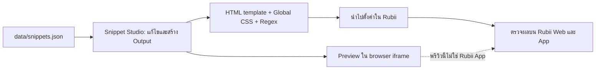
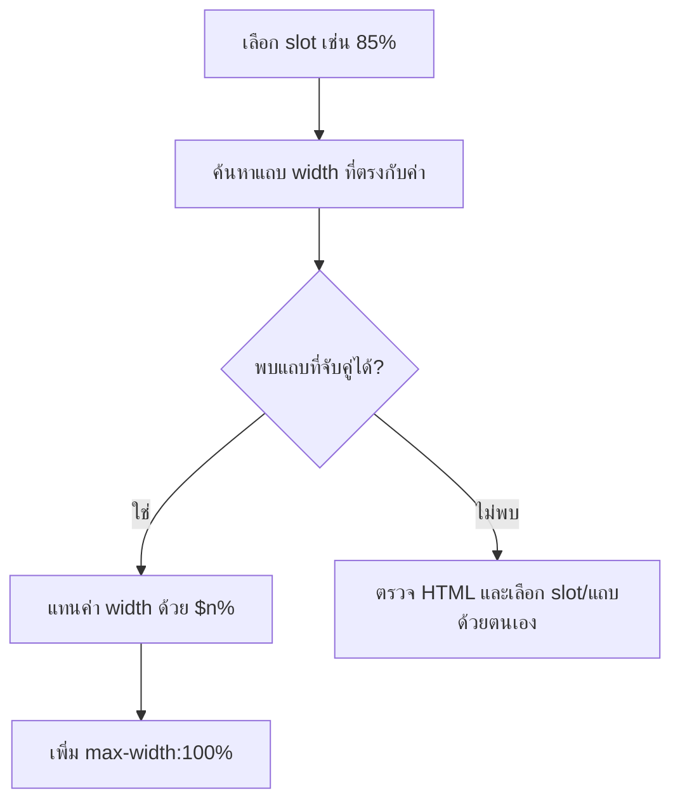

# รายงานตรวจสอบพื้นหลัง ภาพ และหลอดสถานะของ Rubii

**วันที่ตรวจข้อมูลใน repository:** 2026-10-09  
**กลุ่มเป้าหมาย:** ผู้พัฒนาการ์ดและผู้ดูแล Snippet Studio  
**สถานะ:** ตรวจโค้ดและข้อมูลใน repository แล้ว; ยังไม่มีผลทดสอบข้ามอุปกรณ์จาก Rubii จริง

> **สรุปสั้น:** Snippet Studio สร้าง HTML/CSS และพรีวิวใน browser iframe ส่วนการแสดงผลสุดท้ายเกิดใน Rubii การใช้ CSS แบบเจาะจงและการจับคู่ slot กับหลอดช่วยให้ตรวจและแก้ได้ง่าย แต่ไม่ใช่หลักฐานว่าแสดงเหมือนกันทุกอุปกรณ์

## วิธีอ่านและระดับหลักฐาน

- **ตรวจใน repository** — ยืนยันจาก app.js, data/snippets.json หรือ data/snippet-categories.json
- **เอกสาร Rubii** — ข้อมูลที่ Rubii เผยแพร่เกี่ยวกับฟีเจอร์
- **แนวทาง** — ข้อแนะนำสำหรับออกแบบการ์ด ควรลองกับข้อความและอุปกรณ์เป้าหมาย
- **ต้องทดสอบ** — ยังไม่มีหลักฐานใน repository ที่สรุปผลได้



Rubii ระบุว่า Styles & Regex ใช้ได้บนเว็บและแอปเวอร์ชัน 2.4.2 ขึ้นไป และการแสดงผลในแอปใกล้เคียงกับเว็บในเกือบทุกกรณี เอกสารเดียวกันยังแนะนำให้ตรวจผลจริง เพราะอาจมีความต่างหรือปัญหาเฉพาะอุปกรณ์ ([Rubii: Styles & regex](https://rubii.ai/blog/styles-and-regex))

## 1. ข้อมูลที่ตรวจนับได้จากชุดการ์ด

พบ 75 รายการ หมายเลข snippet-01 ถึง snippet-76 โดยไม่มี snippet-37 รวม 9 หมวดหมู่:

| หมวด | จำนวน | สัดส่วน |
| --- | ---: | ---: |
| ชีวิตประจำวันและสถานะ (date-time) | 15 | 20.0% |
| แชตและข้อความ (chat-interfaces) | 6 | 8.0% |
| โซเชียลมีเดียและโพสต์ (social-interfaces) | 16 | 21.3% |
| การเงินและใบเสร็จ (bank-transfers) | 17 | 22.7% |
| ค้นหาและเว็บ (search-interfaces) | 5 | 6.7% |
| อารมณ์และความสัมพันธ์ (emotion-stats) | 4 | 5.3% |
| เพลงและเครื่องเล่น (music-players) | 4 | 5.3% |
| เกมและเรโทร (retro-gaming) | 3 | 4.0% |
| ไซเบอร์พังก์และ Y2K (cyber-y2k) | 5 | 6.7% |
| **รวม** | **75** | **100%** |

จากการนับข้อความ HTML ใน data/snippets.json พบ 48 จาก 75 snippets ที่มีแท็ก img อย่างน้อยหนึ่งแท็ก ตัวเลขนี้นับการมีแท็กเท่านั้น ไม่ได้บอกว่ารูปเป็นแบนเนอร์หรือยืนยันว่า URL เปิดได้

## 2. พื้นหลังการ์ด

### สิ่งที่ทำใน Snippet Studio

เมื่อเปิดตัวเลือกพื้นหลัง htmlWithBackground() จะเพิ่ม background-image, background-size:cover, background-position:center และ background-repeat:no-repeat ลงใน style ของ element ราก หากใช้ Text Shadow ก็เพิ่ม style นั้นด้วย จากนั้นตัวสร้างจะนำ style ไปแสดงในผลลัพธ์ CSS ตามกระบวนการของ Studio

ข้อเท็จจริงนี้ยืนยันรูปแบบ Output ของ Studio เท่านั้น ยังไม่ยืนยันการรองรับ CSS หรือการเรนเดอร์บน Rubii ทุกเวอร์ชัน

### แนวทาง CSS

ใช้ property ที่ต้องการโดยตรงเพื่อให้เห็นค่าชัดและหลีกเลี่ยงการเขียนทับค่าอื่นโดยไม่ตั้งใจ:

`background-image:url('https://example.com/image.jpg');background-size:cover;background-position:center;background-repeat:no-repeat;`

CSS background เป็น shorthand ที่กำหนดค่าเริ่มต้นให้ sub-properties อื่นด้วย หากต้องผสมสีพื้นกับภาพ ให้ตรวจว่าการประกาศ shorthand ภายหลังไม่ได้เขียนทับภาพหรือการจัดวางที่ตั้งไว้ ([W3C CSS Backgrounds and Borders](https://www.w3.org/TR/css-backgrounds-3/#background))

| ต้องการ | ตัวเลือกเริ่มต้น | ข้อควรสังเกต |
| --- | --- | --- |
| ภาพตกแต่งเต็มพื้นการ์ด | background-size:cover; background-position:center; | ภาพบางส่วนอาจถูกครอป |
| สีพื้นสำรองเมื่อรูปโหลดไม่ได้ | กำหนด background-color แยก | ทดสอบ URL รูปและพื้นหลังบน Rubii จริง |
| ภาพที่เป็นเนื้อหาหลัก | ใช้ img | เลือกสัดส่วนและคำอธิบาย alt ให้เหมาะ |

ไม่พบหลักฐานใน repository นี้ที่ยืนยันว่า Rubii มี CSS sanitizer ซึ่งตัด background-image หรือทำให้ gradient ทึบ จึงไม่สรุปพฤติกรรมดังกล่าวเป็นข้อเท็จจริงของแพลตฟอร์ม

## 3. Progress Bar และค่าเปอร์เซ็นต์

### ตัวอย่างที่ตรวจได้: snippet-52

HTML ปัจจุบันของ Cafe Life & Energy Meter มีค่าที่แสดงเป็น 85% และ 100% และมีแถบที่ตั้งความกว้างเริ่มต้นตรงกัน (85% และ 100%) ไม่พบข้อความ MAX ใน HTML ของ snippet นี้ จึงไม่มีหลักฐานรองรับกรณีศึกษาเดิมที่กล่าวว่า snippet-52 เคยแก้ MAX เป็น 100%

### กลไกในตัวสร้าง

เมื่อเลือก slot เปอร์เซ็นต์ buildRubiiTemplate() จะพยายามจับคู่กับ element แถบที่มี inline width ตรงกับค่าเริ่มต้น แล้วแทนความกว้างเดิมด้วยตัวแปร เช่น width:$1%;max-width:100% ส่วน pattern ของเปอร์เซ็นต์ยอมรับตัวเลข 1–3 หลักและทศนิยมได้



ตัวอย่างที่อ่านง่าย:

```html
<div style="width:100%;height:8px;overflow:hidden;">
  <div style="width:85%;max-width:100%;height:100%;"></div>
</div>
```

**ข้อควรตรวจ:** จับคู่ตัวเลขกับแถบให้ถูกช่อง, กำหนดตัวคั่นและลำดับ Regex ให้ตรงกับข้อมูลที่ AI ส่ง และลองค่าต่ำสุด/สูงสุดรวมถึงข้อความที่ไม่ใช่ตัวเลข การตั้ง max-width:100% ช่วยจำกัดความกว้างใน CSS แต่ไม่ได้ทดแทนการตรวจรูปแบบ input

## 4. ภาพและแบนเนอร์

การเลือก object-fit ขึ้นกับบทบาทของรูป:

| ประเภทภาพ | การตั้งค่าที่แนะนำ | ผลที่ได้ |
| --- | --- | --- |
| แบนเนอร์/ภาพปกในกรอบคงที่ | width:100%;height:100%;object-fit:cover;object-position:center;display:block; | เติมกรอบ แต่ขอบภาพอาจถูกครอป |
| ภาพโพสต์หรือภาพเนื้อหาหลัก | width:100%;height:auto;display:block; | รักษาสัดส่วนธรรมชาติ |
| ไอคอน/โลโก้ | กำหนดความกว้างและสูงชัดเจน ใช้ object-fit:contain | เห็นภาพครบ ไม่บังคับครอป |

พื้นที่ว่างจาก object-fit:contain ไม่จำเป็นต้องเป็นสีดำเสมอไป; สีที่เห็นขึ้นกับพื้นหลังของกรอบ การใช้ cover กำจัดพื้นที่ว่างด้วยการครอปภาพ จึงควรดูว่ารายละเอียดสำคัญยังอยู่ครบหรือไม่

## 5. การเลือกช่องข้อความและความหมายของตัวแปร

rubiiTextSlots() สแกนข้อความใน HTML เพื่อหา marker ในวงเล็บ, macro เช่น {{char}}/{{user}}, เปอร์เซ็นต์ และข้อความที่อาจเปลี่ยนแปลง ระบบให้คะแนนเพื่อจัดลำดับช่องแนะนำ แต่คะแนนเป็น heuristic ไม่ได้เข้าใจความหมายของการ์ดอย่างสมบูรณ์

- ค่าเริ่มต้นของ Style Tag เลือกข้อความที่ไม่ใช่ macro ก่อน แล้วจัดอันดับด้วยคะแนน
- ตัวสร้างเก็บตำแหน่ง slot และแทนเฉพาะตำแหน่งที่เลือก ไม่แทนทุกคำที่มีข้อความเหมือนกัน
- การสร้าง HTML template ใช้ preserveMacros เพื่อคง macro ของ Rubii ไว้
- Regex หลายช่องเรียง $1, $2, … ตามลำดับ slot ที่เลือก; Snippet Studio จำกัด UI ไว้สูงสุด 33 ช่อง
- เอกสาร Rubii อธิบาย Style Tag ด้วย $1 หนึ่งช่องและ Regex ที่ใช้แทนส่วนของข้อความ ([Rubii: Styles & regex](https://rubii.ai/blog/styles-and-regex))

**เช็กลิสต์ก่อนคัดลอก:** ตรวจว่า $1 คือเนื้อหาหลัก, macro ไม่ถูกเลือกแทนค่าหลัก, ลำดับ capture ตรงกับลำดับค่าที่ AI จะส่ง และไม่มีตัวคั่นเดียวกันอยู่ในค่าข้อมูล

## 6. Text Shadow, ความอ่านง่าย และไอคอนฟิลด์

Snippet Studio มีตัวเลือก Text Shadow ได้แก่ None, Soft Dark, Sharp Outline และ Neon Glow รวมถึงตัวช่วยไอคอน SVG สำหรับชนิดฟิลด์ในหน้าต่างแก้ไข สิ่งเหล่านี้ช่วยให้ปรับแต่งและแยกประเภทช่องได้เร็วขึ้น แต่ไม่ได้หมายความว่าข้อความบนการ์ดผ่านการตรวจ accessibility แล้ว

WCAG 2.2 กำหนดอัตราส่วนคอนทราสต์ขั้นต่ำสำหรับข้อความทั่วไปที่ 4.5:1 ระดับ AA และ 7:1 ระดับ AAA; ข้อความขนาดใหญ่ใช้ 3:1 และ 4.5:1 ตามลำดับ ([W3C WCAG 2.2](https://www.w3.org/TR/wcag/)). Text Shadow อาจช่วยแยกตัวอักษร แต่ไม่รับประกันอัตราส่วนดังกล่าว โดยเฉพาะเมื่อใช้ภาพที่สว่างหรือมีรายละเอียดเปลี่ยนไป

## 7. สิ่งที่ต้องทดสอบก่อนอ้างผลข้ามอุปกรณ์

| รายการ | หลักฐานที่ควรบันทึก |
| --- | --- |
| Rubii Web และ App | รุ่นแอป, OS, รุ่นอุปกรณ์, วันที่ทดสอบ |
| CSS พื้นหลัง/gradient/blur | URL รูป, ค่าที่ใช้, ภาพหน้าจอผลจริง |
| Regex | ข้อความ input, Pattern, Replacement และผลที่แสดง |
| Progress Bar | ค่า 0, ค่ากลาง, 100, เกิน 100 และค่าที่ไม่ใช่ตัวเลข |
| Accessibility | สีข้อความ/พื้นหลังจริงและวิธีคำนวณ contrast |
| สรุปผลเชิงปริมาณ | จำนวนตัวอย่าง, นิยาม pass/fail, วิธีทำซ้ำ |

## การแก้ไขจากฉบับก่อน

- แทนข้อความ “Peer-Reviewed & Empirically Verified” ด้วยสถานะที่ตรงกับหลักฐาน: ตรวจ repository แล้ว แต่ยังไม่มีผลทดสอบข้ามอุปกรณ์
- แก้จำนวนและช่วง ID: มี 75 รายการในช่วง snippet-01–snippet-76 โดยเว้น snippet-37
- แทนจำนวนหมวดและสัดส่วนเดิมด้วยจำนวนที่นับจาก data/snippets.json
- นำอัตราความเข้ากันได้ 100%, ผล benchmark ภาพ และค่า contrast เฉพาะของ preset ออก เพราะไม่มีวิธีวัด/ข้อมูลดิบให้ตรวจซ้ำ
- แก้กรณี snippet-52: ข้อมูลปัจจุบันมี 85% และ 100%; ไม่พบ MAX

## แหล่งอ้างอิง

- [Rubii — Styles & regex](https://rubii.ai/blog/styles-and-regex)
- [W3C — CSS Backgrounds and Borders: background shorthand](https://www.w3.org/TR/css-backgrounds-3/#background)
- [W3C — Web Content Accessibility Guidelines 2.2](https://www.w3.org/TR/wcag/)

