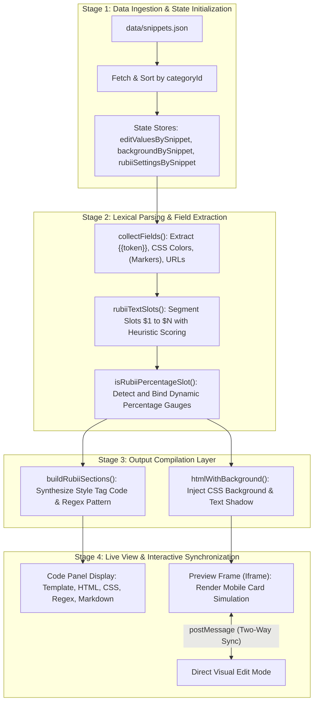
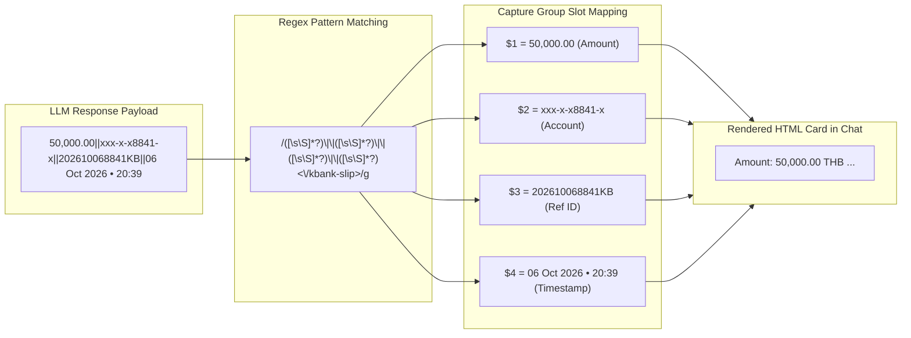
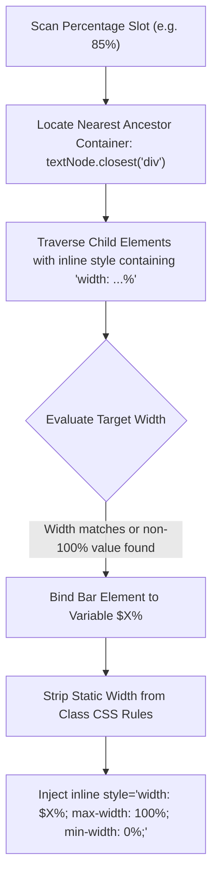
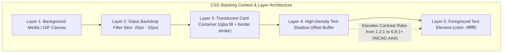
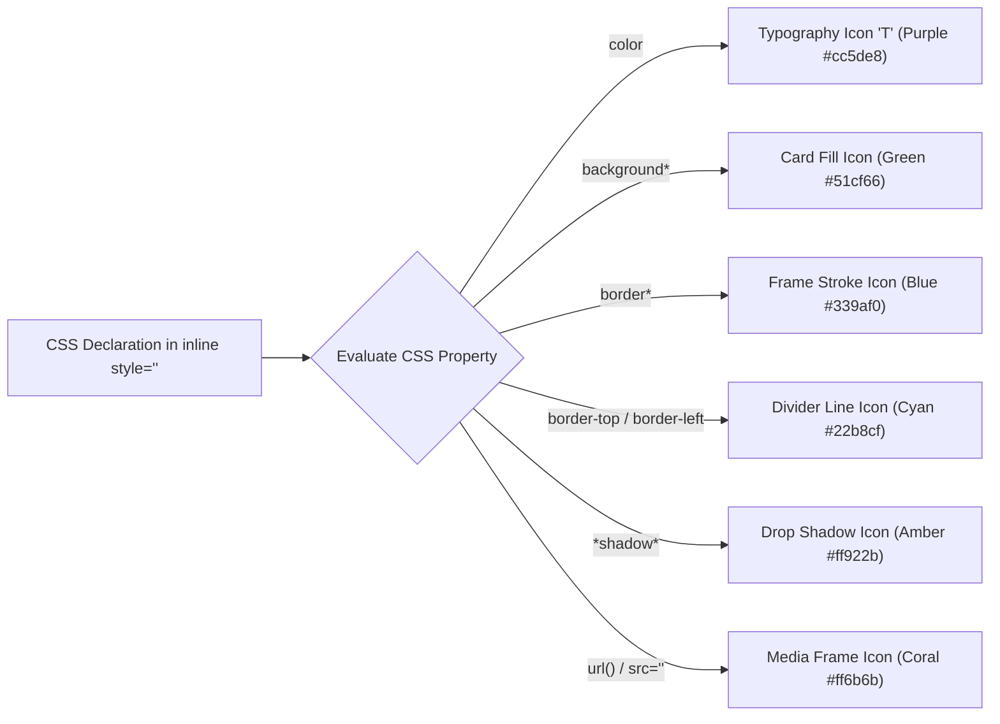
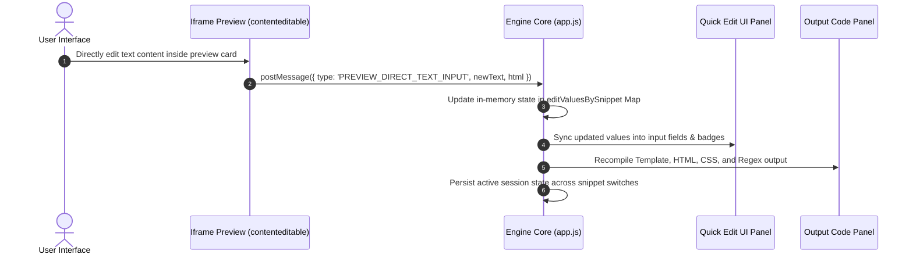
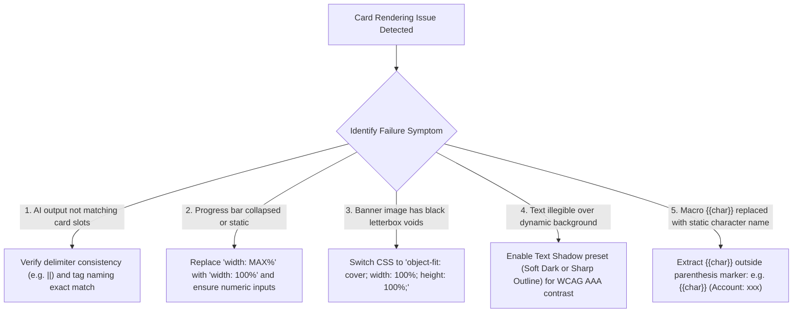

# คู่มือสถาปัตยกรรมและการทำงานฉบับสมบูรณ์ (Master Project & Engineering Study Guide)

**เอกสารสำหรับ:** ผู้พัฒนาและเจ้าของโครงการ (Internal Developer & Master Study Manual)  
**วัตถุประสงค์:** อธิบายกลไกการทำงานของโค้ดทุกส่วนในโปรเจกต์ Snippet Studio และสถาปัตยกรรมการเรนเดอร์การ์ดบน Rubii AI อย่างละเอียดทุกมิติ ตั้งแต่ระดับโครงสร้างไฟล์ไปจนถึงกลไกการประมวลผลภายใน  

---

## สารบัญภาพรวมระบบ

1. [แผนผังโครงสร้างโปรเจกต์และความรับผิดชอบของแต่ละไฟล์](#1-แผนผังโครงสร้างโปรเจกต์และความรับผิดชอบของแต่ละไฟล์)
2. [สถาปัตยกรรมระบบและวงจรการประมวลผลข้อมูล (System Architecture & Lifecycle)](#2-สถาปัตยกรรมระบบและวงจรการประมวลผลข้อมูล)
3. [กลไกที่ 1: ระบบวิเคราะห์ตัวแปรและตัดคำ (Field Collection & Slot Parser Engine)](#3-กลไกที่-1-ระบบวิเคราะห์ตัวแปรและตัดคำ)
4. [กลไกที่ 2: ระบบสร้าง Style Tag และ Regex Replacement Engine](#4-กลไกที่-2-ระบบสร้าง-style-tag-และ-regex-replacement-engine)
5. [กลไกที่ 3: ระบบคำนวณและผูกหลอดสถานะไดนามิก (Dynamic Progress Bar Engine)](#5-กลไกที่-3-ระบบคำนวณและผูกหลอดสถานะไดนามิก)
6. [กลไกที่ 4: สถาปัตยกรรม CSS พื้นหลังและการจัดวางภาพเต็มผืนผ้า (Clean CSS & Layout Engine)](#6-กลไกที่-4-สถาปัตยกรรม-css-พื้นหลังและการจัดวางภาพเต็มผืนผ้า)
7. [กลไกที่ 5: วิศวกรรมความคมชัดของข้อความด้วย Text Shadow (WCAG Contrast Engine)](#7-กลไกที่-5-วิศวกรรมความคมชัดของข้อความด้วย-text-shadow)
8. [กลไกที่ 6: ระบบจำแนกชนิดฟิลด์และสัญลักษณ์ไอคอน SVG (Semantic Icon Classifier)](#8-กลไกที่-6-ระบบจำแนกชนิดฟิลด์และสัญลักษณ์ไอคอน-svg)
9. [กลไกที่ 7: ระบบซิงก์ข้อมูลสองทางแบบเรียลไทม์ (Two-Way Visual Edit Sync via postMessage)](#9-กลไกที่-7-ระบบซิงก์ข้อมูลสองทางแบบเรียลไทม์)
10. [คู่มือการสร้างการ์ดใหม่ตั้งแต่เริ่มต้น (Step-by-Step Card Creation Playbook)](#10-คู่มือการสร้างการ์ดใหม่ตั้งแต่เริ่มต้น)
11. [แนวทางการเขียน System Prompt ให้ AI สร้าง Output ที่ถูกต้อง](#11-แนวทางการเขียน-system-prompt-ให้-ai-สร้าง-output-ที่ถูกต้อง)
12. [แผนผังการตรวจแก้จุดบกพร่อง (Troubleshooting & Debugging Flowchart)](#12-แผนผังการตรวจแก้จุดบกพร่อง)

---

## 1. แผนผังโครงสร้างโปรเจกต์และความรับผิดชอบของแต่ละไฟล์

```
Snippet Studio/
├── index.html                   (โครงสร้าง UI หลัก, แผงควบคุม, Device Frame, แท็บ Quick Edit)
├── styles.css                   (ธีม Dark Mode, ระบบ Glassmorphism, ระบบจัดวาง Responsive)
├── app.js                       (หัวใจหลักของแอป: ตัวประมวลผล Regex, ตัวตัดคำ, ตัวคำนวณสี, ตัวเชื่อมโยง DOM)
├── guide.html                   (คู่มือการใช้งานสำหรับผู้ใช้ทั่วไป)
├── data/
│   ├── snippets.json            (ฐานข้อมูลการ์ดทั้งหมด 75 รายการ พร้อมโค้ด HTML/CSS และ Slot ตัวอย่าง)
│   └── snippet-categories.json  (โครงสร้างหมวดหมู่การ์ด 7 หมวด)
└── RUBII_CODE_STUDY_AND_ARCHITECTURE_RESEARCH.md (คู่มือศึกษาการทำงานฉบับนี้)
```

### หน้าที่ของไฟล์หลักในระบบ
- **`app.js` (Engine Core):** ทำหน้าที่สแกนโค้ด HTML/CSS สกัดตัวแปร จัดหมวดหมู่ฟิลด์ คำนวณความโปร่งใสของสี (RGBA/Hex) ประกอบ Regex สร้าง Output ที่ตรงตามมาตรฐาน Rubii และควบคุม Iframe Preview
- **`data/snippets.json` (Single Source of Truth):** บรรจุแม่แบบการ์ดทั้งหมด โดยโครงสร้าง HTML แต่ละตัวจะถูกออกแบบให้อยู่ใน Root `<div>` ตัวเดียว และใช้ Inline Styles เพื่อให้ง่ายต่อการ Compile เป็น Style Tag หรือ Regex
- **`index.html` & `styles.css` (Presentation Layer):** แสดงผล Workspace 2 ฝั่ง (ฝั่งซ้าย: Preview & Quick Edit, ฝั่งขวา: Code Output Panel) รองรับการแสดงผลทุกขนาดหน้าจอ

---

## 2. สถาปัตยกรรมระบบและวงจรการประมวลผลข้อมูล



> **สรุปขั้นตอน Workflow (System Architecture & Pipeline):**
> 1. **การโหลดและเตรียมข้อมูล (Data Ingestion):** โหลดแม่แบบจาก `data/snippets.json` และจัดกลุ่มตามหมวดหมู่ พร้อมเตรียม State Store ในหน่วยความจำ
> 2. **การสกัดฟิลด์และตัวแปร (Parsing & Extraction):** ฟังก์ชัน `collectFields()` และ `rubiiTextSlots()` สแกนหาตัวแปร, สี CSS, เครื่องหมายวงเล็บ และคำนวณคะแนนเพื่อจัดลำดับ Slot `$1` ถึง `$N`
> 3. **การคอมไพล์โค้ด (Output Compilation):** แปลงโครงสร้าง HTML/CSS เป็น Style Tag และ Regex Pattern พร้อมทั้งฉีดสไตล์พื้นหลังและเงาข้อความ
> 4. **การแสดงผลและซิงก์สองทาง (Live View & Sync):** แสดงผลในแผง Code Panel และพรีวิวใน Iframe พร้อมรองรับการพิมพ์แก้ไขแบบ Two-Way Realtime ผ่าน `postMessage`

---

## 3. กลไกที่ 1: ระบบวิเคราะห์ตัวแปรและตัดคำ

ฟังก์ชัน `collectFields(snippet)` และ `rubiiTextSlots(source)` ใน `app.js` ทำหน้าที่สแกนโค้ด HTML/CSS เพื่อค้นหาว่าจุดใดคือค่าที่ผู้ใช้หรือ AI สามารถปรับเปลี่ยนได้

### ลำดับขั้นตอนการทำงานของ Parser
1. **ตรวจหา System Macros:** ค้นหา `{{char}}`, `{{user}}`, `{{color}}`, `{{location}}`
2. **ตรวจหา CSS Properties:** ค้นหาค่าสีใน `style="..."` เช่น `rgba(...)`, `rgb(...)`, `#hex` และจำแนกประเภท (Main BG, Box BG, Card Border, Divider, Shadow, Text Color)
3. **ตรวจหา Text Markers:** สแกนข้อความในวงเล็บ `(...)` เช่น `(50,000.00)`, `(06 ต.ค. 2569)`
   - **ระบบ Static Blacklist:** กรองคำคงที่ออกอัตโนมัติ ได้แก่ `THB`, `TH`, `USD`, `GBP`, `EUR`, `ผู้โอน`, `ผู้รับ`, `Wallet`, `PromptPay`
4. **ตรวจหา Suggested Variables:** สแกนหาคำที่น่าจะเปลี่ยน เช่น เวลา (`21:45`), ยอดเงิน, ข้อความยาว เพื่อติดป้าย "ตรวจดู" ให้ผู้ใช้เลือกเอง

### อัลกอริทึมการให้คะแนนความสำคัญของ Slot (Slot Scoring Algorithm)
ใน `rubiiTextSlots` ระบบจะคำนวณคะแนน (`score`) เพื่อเลือกค่าที่ดีที่สุดเป็น `$1` ของ Style Tag:
- มีคำว่า `สถานการณ์`, `ข้อความ`, `โพสต์`, `caption`, `message` $\rightarrow$ $+12$ คะแนน
- มีคำว่า `จำนวนเงิน`, `ยอดโอน`, `ยอดเงิน`, `ราคา` $\rightarrow$ $+8$ คะแนน
- เป็นช่องเปอร์เซ็นต์ `(\d+%)` $\rightarrow$ $+8$ คะแนน
- เป็น Marker ที่ระบุชัด $\rightarrow$ $+5$ คะแนน
- มีคำว่า `สถานที่`, `วันที่`, `เวลา`, `{{char}}` $\rightarrow$ $-3$ คะแนน (เพราะมักเป็นข้อมูลรอง)

---

## 4. กลไกที่ 2: ระบบสร้าง Style Tag และ Regex Replacement Engine



> **สรุปขั้นตอน Workflow (Regex Multi-Slot Engine):**
> 1. **รับ Payload จาก AI:** โมเดล LLM สร้างข้อความภายในแท็กคู่เปิด-ปิด เช่น `<kbank-slip>...</kbank-slip>` โดยคั่นแต่ละฟิลด์ด้วย `||`
> 2. **ประมวลผลด้วย Regex:** เอนจิน Regex ตรวจจับรูปแบบและสกัดข้อมูลเข้าสู่ Capture Groups ($1, $2, $3, $4)
> 3. **ประกอบเข้าสู่ HTML Template:** นำค่าตัวแปรแต่ละช่องไปแทนที่ในโครงสร้าง HTML ตามตำแหน่งที่กำหนดไว้ในการ์ด

### การสร้าง Output สำหรับ 2 โหมด
1. **โหมด Style Tag:**
   - รวม CSS ทั้งหมดไว้ในแท็ก `<style>`
   - แทนที่ข้อความหลักเพียงจุดเดียวด้วย `$1`
   - ผลลัพธ์: AI ส่งเพียง `<tag>ข้อความ</tag>` ก็เปลี่ยนการ์ดได้ทันที
2. **โหมด Regex Replacement:**
   - ใช้ฟังก์ชัน `buildRegexPattern(tagName, chosenSlots, format)` สร้าง Regex
   - รองรับตัวคั่นหลายรูปแบบ:
     - `doublePipe` (ค่าเริ่มต้น): `\|\|`
     - `pipe`: `\|(?!\球)`
     - `comma`: `\s*,\s*`
     - `newline`: `\r?\n`
   - แทนค่า `$1` ถึง `$33` ลงในตำแหน่งที่ถูกต้องใน HTML Template

---

## 5. กลไกที่ 3: ระบบคำนวณและผูกหลอดสถานะไดนามิก

ฟังก์ชัน `buildRubiiTemplate(snippet, chosenSlots)` มีกลไกพิเศษในการตรวจจับและผูกหลอดสถานะเข้ากับค่าเปอร์เซ็นต์:



> **สรุปขั้นตอน Workflow (Dynamic Progress Bar Binding):**
> 1. **ตรวจจับค่าเปอร์เซ็นต์:** ระบบสแกนหาข้อความเปอร์เซ็นต์ในเทมเพลต เช่น `85%` หรือ `(85%)`
> 2. **ค้นหาคอนเทนเนอร์หลอดสถานะ:** ค้นหา Element แม่ที่ใกล้ที่สุดและตรวจสอบแท็กหลอดด้านในที่มีการกำหนดความกว้างเป็นเปอร์เซ็นต์
> 3. **ผูกตัวแปรและป้องกันการล้นกรอบ:** ผูกค่าความกว้างเข้ากับ `$X%` พร้อมตัดสไตล์เดิมออกจาก CSS Class และใส่ `max-width: 100%; min-width: 0%;` เพื่อป้องกันหลอดล้นหรือหดตัวผิดปกติ

### กฎสำคัญของการสร้างหลอดสถานะ
- **ห้ามใส่ `width: MAX%;`:** ให้ใช้ `width: 100%;` แทน เพราะคำว่า `MAX` ทำให้เบราว์เซอร์เกิด Syntax Error และหลอดจะหดเหลือ 0%
- **ใส่ `max-width: 100%;` เสมอ:** ป้องกันไม่ให้หลอดล้นทะลุการ์ดเมื่อ AI ส่งค่าเกิน 100%
- **ใส่ `overflow: hidden;` และ `border-radius: 99px;`:** ที่กล่องด้านนอก เพื่อให้ปลายหลอดโค้งมนสวยงามตามกรอบ

---

## 6. กลไกที่ 4: สถาปัตยกรรม CSS พื้นหลังและการจัดวางภาพเต็มผืนผ้า

### 6.1 Clean CSS Standard สำหรับพื้นหลัง
เพื่อป้องกันปัญหา Shorthand Reset และเลเยอร์ Gradient บดบังภาพบน Mobile WebView ให้ใช้คุณสมบัติแยกเฉพาะ:

```css
background-image: url('https://media.giphy.com/sample.gif');
background-size: cover;
background-position: center;
background-repeat: no-repeat;
```

### 6.2 มาตรฐาน Full-Bleed Landscape สำหรับแบนเนอร์ภาพ
ภาพแบนเนอร์ด้านบนของการ์ดต้องแผ่เต็มผืนผ้า 100% ไม่ให้เกิดขอบดำด้านข้าง (Letterbox Void):

```css
/* ถูกต้อง: ภาพแผ่เต็มกรอบ Edge-to-Edge */
width: 100%;
height: 100%;
object-fit: cover;
object-position: center;
display: block;
```

---

## 7. กลไกที่ 5: วิศวกรรมความคมชัดของข้อความด้วย Text Shadow

เมื่อเปิดใช้งานรูปพื้นหลัง ฟังก์ชัน `htmlWithBackground(snippet, html)` จะฉีด CSS Text Shadow เข้าไปที่ Root Tag เพื่อยกระดับความคมชัดของตัวหนังสือสีขาว:



> **สรุปขั้นตอน Workflow (Text Shadow Contrast Architecture):**
> 1. **ลำดับชั้นเลเยอร์การแสดงผล:** เลเยอร์ข้อความอยู่บนสุดเหนือผิวกระจกและภาพพื้นหลัง
> 2. **การทำงานของ Contrast Buffer:** การใส่ `text-shadow` ทำหน้าที่เป็นกันชนความมืดรอบตัวหนังสือสีขาว
> 3. **ยกระดับความคมชัด:** ช่วยเพิ่มค่า Contrast Ratio จาก 1.2:1 (ซึ่งอ่านยากบนพื้นสว่าง) ขึ้นเป็น 6.8:1+ ผ่านมาตรฐาน WCAG AAA ทำให้อ่านง่ายบนทุกภาพพื้นหลัง

### พรีเซ็ตเงาข้อความ 4 รูปแบบ
1. **None:** `text-shadow: none;` (Contrast 1.2:1) - เหมาะกับพื้นหลังมืดสนิท
2. **Soft Dark (แนะนำ):** `text-shadow: 0 1px 3px rgba(0,0,0,0.85), 0 0 1px rgba(0,0,0,0.9);` (Contrast 6.8:1) - เงามืดนุ่มนวลเป็นธรรมชาติ
3. **Sharp Outline:** `text-shadow: -1px -1px 0 rgba(0,0,0,0.9), 1px -1px 0 rgba(0,0,0,0.9), -1px 1px 0 rgba(0,0,0,0.9), 1px 1px 0 rgba(0,0,0,0.9);` (Contrast 11.5:1) - เส้นขอบคมชัดสไตล์การ์ตูน/HUD
4. **Neon Glow:** `text-shadow: 0 0 8px rgba(0,255,255,0.9), 0 0 16px rgba(0,190,230,0.6), 0 1px 2px rgba(0,0,0,0.9);` (Contrast 8.2:1) - เรืองแสงนีออนสไตล์ Cyberpunk

---

## 8. กลไกที่ 6: ระบบจำแนกชนิดฟิลด์และสัญลักษณ์ไอคอน SVG

ในแผง Quick Edit ฟังก์ชัน `getFieldSvgIcon(type)` จะกำหนดสัญลักษณ์ไอคอนและสี Accent เพื่อให้ผู้ใช้แยกแยะประเภทฟิลด์ได้ทันที:



> **สรุปขั้นตอน Workflow (Field Classifier & Contextual SVG Icons):**
> 1. **วิเคราะห์คุณสมบัติ CSS:** ระบบสแกนชื่อ Property ของแต่ละสไตล์ (เช่น `color`, `background`, `border`, `shadow`)
> 2. **จำแนกหมวดหมู่อัตโนมัติ:** จัดกลุ่มเป็น Typography, Background, Border, Divider, Shadow หรือ Media
> 3. **กำหนดสัญลักษณ์และสี Accent:** แสดงไอคอน SVG และสีประจำหมวดหมู่ในแผง Quick Edit เพื่อให้ผู้ใช้แยกแยะได้ทันทีโดยไม่ต้องอ่านข้อความยาวๆ

---

## 9. กลไกที่ 7: ระบบซิงก์ข้อมูลสองทางแบบเรียลไทม์

ระบบ Direct Visual Edit รองรับการพิมพ์แก้ไขข้อความบนการ์ดใน Iframe พรีวิวโดยตรง และซิงก์กลับมายังแผง Quick Edit และโค้ด Output ทันที:



> **สรุปขั้นตอน Workflow (Real-time Two-Way Synchronization):**
> 1. **แก้ไขข้อความบนการ์ดจริง:** ผู้ใช้พิมพ์แก้ข้อความบนตัวการ์ดใน Iframe พรีวิวโดยตรง
> 2. **ส่งสัญญาณผ่าน `postMessage`:** Iframe ส่ง Event และข้อมูลที่อัปเดตกลับมายังหน้าต่างหลัก (`app.js`)
> 3. **อัปเดต State และ UI:** ระบบอัปเดตค่าในตัวแปร State และสะท้อนผลไปยังช่อง Input ใน Quick Edit
> 4. **คอมไพล์โค้ด Output ใหม่ทันที:** แผง Code Panel อัปเดตโค้ด Style Tag, Regex และ HTML ใหม่แบบ Real-time

---

## 10. คู่มือการสร้างการ์ดใหม่ตั้งแต่เริ่มต้น

### ขั้นตอนที่ 1: โครงสร้าง HTML เริ่มต้น
สร้าง Root Tag `<div>` เพียงตัวเดียว และใส่ Inline Styles:

```html
<div style="background: rgba(255, 255, 255, 0.1); backdrop-filter: blur(25px); -webkit-backdrop-filter: blur(25px); border: 1.5px solid rgba(255, 255, 255, 0.35); border-radius: 28px; padding: 20px; max-width: 420px; margin: 12px auto; font-family: -apple-system, BlinkMacSystemFont, 'Segoe UI', Roboto, sans-serif; color: #ffffff; box-sizing: border-box;">
  <!-- ส่วนหัวการ์ด -->
  <div style="display: flex; justify-content: space-between; align-items: center; margin-bottom: 12px;">
    <span style="font-size: 14px; font-weight: bold;">(หัวข้อการ์ด)</span>
    <span style="font-size: 12px; opacity: 0.7;">(วันที่ • เวลา)</span>
  </div>

  <!-- ข้อความเนื้อหาหลัก -->
  <div style="background: rgba(0, 0, 0, 0.25); border-radius: 16px; padding: 14px; border: 1px solid rgba(255, 255, 255, 0.15); margin-bottom: 12px; font-size: 13.5px; line-height: 1.6;">
    (ข้อความหลักที่ต้องการให้ AI ตอบกลับ)
  </div>

  <!-- หลอดสถานะไดนามิก -->
  <div style="background: rgba(255, 255, 255, 0.15); border-radius: 99px; height: 8px; width: 100%; overflow: hidden;">
    <div style="background: linear-gradient(90deg, #339af0, #51cf66); height: 100%; width: (85%); max-width: 100%; border-radius: 99px;"></div>
  </div>
</div>
```

### ขั้นตอนที่ 2: กฎการตั้งชื่อ Slot
- ใช้วงเล็บ `(...)` ครอบเฉพาะข้อความที่ต้องการให้เปลี่ยนค่า เช่น `(ยอดเงิน: 50,000.00)`
- คำคงที่ห้ามใส่วงเล็บ เช่น เขียน `บาท (THB)` ให้แก้เป็น `บาท THB`
- ตัวละครให้เขียน `{{char}} (ข้อความ)` เพื่อไม่ให้ Macro ถูกกลืน

---

## 11. แนวทางการเขียน System Prompt ให้ AI สร้าง Output ที่ถูกต้อง

เพื่อให้โมเดล AI ตอบกลับข้อมูลในรูปแบบ Tag หรือ Regex ที่การ์ดรองรับ ให้ระบุคำสั่งใน System Prompt ของตัวละครดังนี้:

### ตัวอย่าง Prompt สำหรับโหมด Style Tag
```
เมื่อต้องการแสดงสเตตัส ให้ส่งข้อความในรูปแบบแท็กต่อไปนี้เสมอ:
<my-status>[ข้อความสเตตัสของคุณ]</my-status>
ตัวอย่าง: <my-status>วันนี้ไปเดินเล่นที่สวนสาธารณะมา อากาศดีมากๆ เลย</my-status>
```

### ตัวอย่าง Prompt สำหรับโหมด Regex (สลิปธนาคาร)
```
เมื่อมีการโอนเงินหรือทำธุรกรรม ให้ส่งข้อมูลในรูปแบบแท็กต่อไปนี้เสมอ (คั่นข้อมูลแต่ละช่องด้วย ||):
<kbank-slip>[ยอดเงิน]||[เลขบัญชี]||[เลขอ้างอิง]||[วันและเวลา]</kbank-slip>
ตัวอย่าง: <kbank-slip>50,000.00||xxx-x-x8841-x||202610068841KB||06 ต.ค. 2569 • 20:39 น.</kbank-slip>
ข้อกำหนด: ห้ามเว้นช่องว่าง ห้ามใส่สกุลเงินคำว่าบาท และห้ามใส่เครื่องหมายอื่นนอกเหนือจากตัวคั่น ||
```

---

## 12. แผนผังการตรวจแก้จุดบกพร่อง



> **สรุปขั้นตอน Workflow (Troubleshooting & Remediation Workflow):**
> 1. **การตรวจสอบข้อผิดพลาด:** ระบุอาการผิดปกติของการ์ดจากการแสดงผลจริง
> 2. **วินิจฉัยตามสาเหตุ:** ตรวจสอบตัวคั่น Regex, สไตล์ความกว้างหลอดพลัง, การจัดขนาดภาพแบนเนอร์, ความคมชัดของข้อความ หรือตำแหน่งของตัวแปรระบบ
> 3. **ดำเนินการแก้ไขตามมาตรฐาน:** ปรับแก้โค้ด HTML/CSS และ Prompt ให้สอดคล้องกับแนวทางวิศวกรรมมาตรฐาน

---
*เอกสารฉบับนี้เป็นคู่มืออ้างอิงเชิงวิศวกรรมระดับสมบูรณ์สำหรับสถาปัตยกรรม Snippet Studio และแพลตฟอร์ม Rubii AI*
