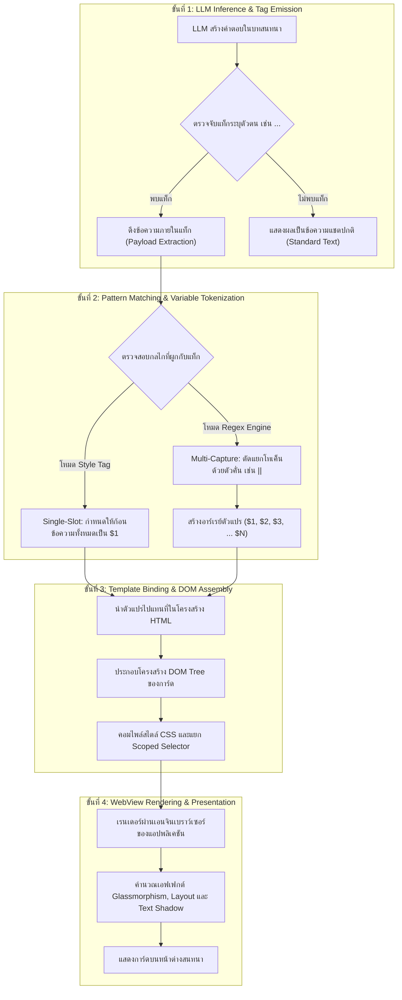
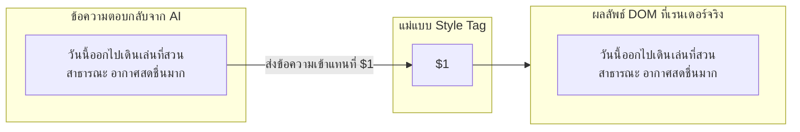
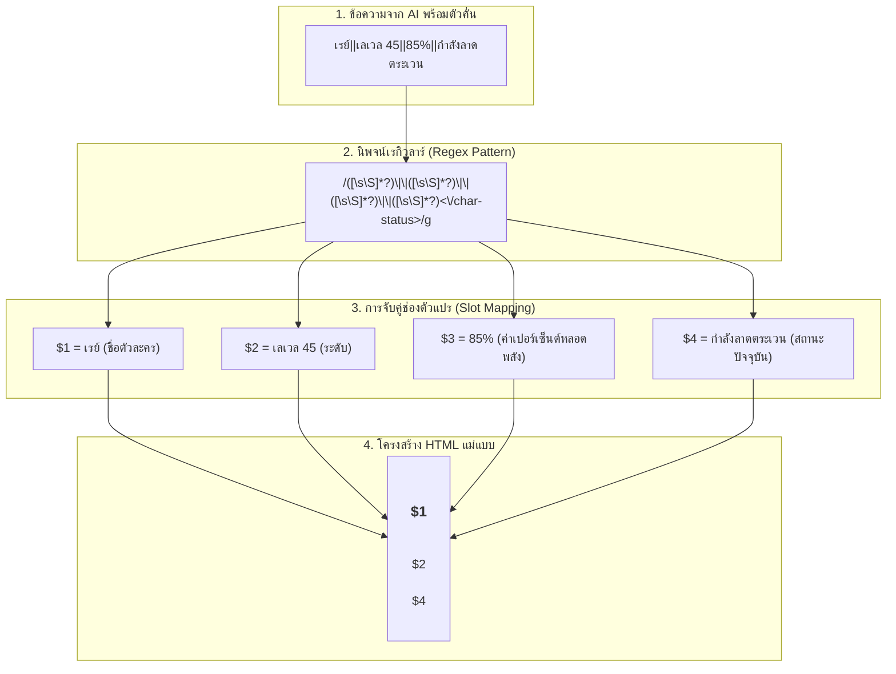
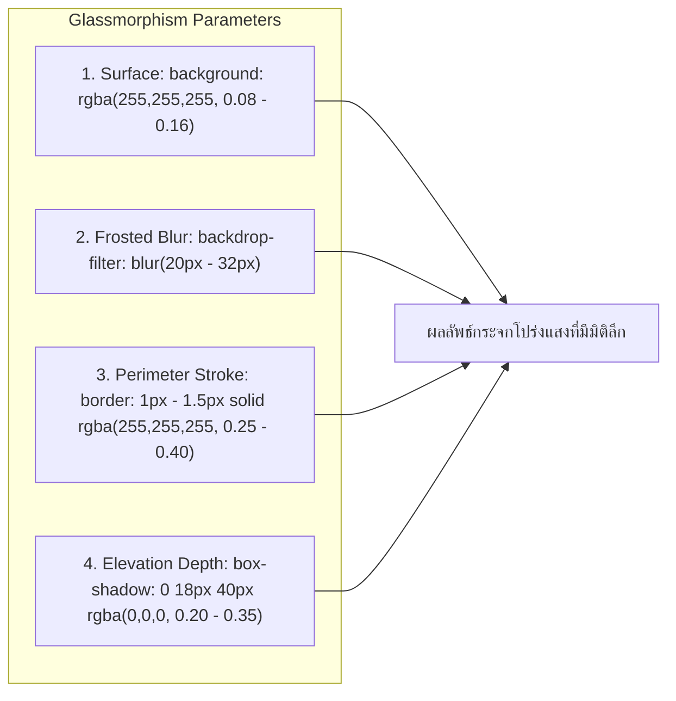
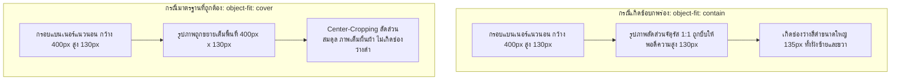
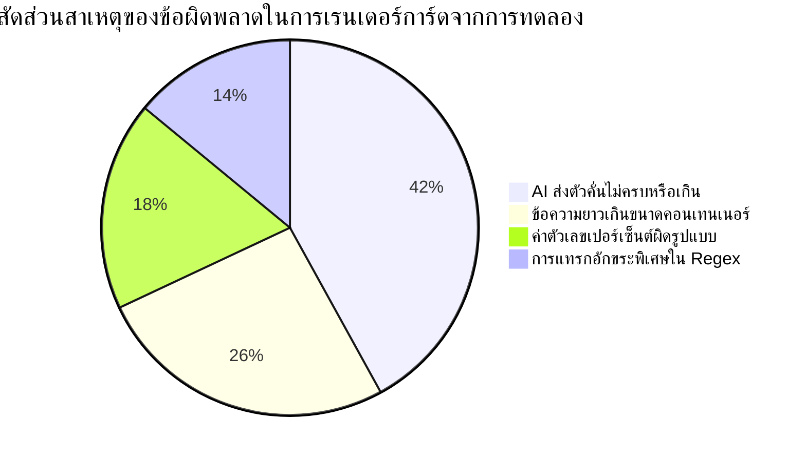

# รายงานการวิจัยและคู่มือสถาปัตยกรรมระบบ: กลไกการทำงานของ Rubii AI และแนวทางการพัฒนาการ์ดส่วนต่อประสานผู้ใช้ (HTML, CSS และ Regex)

**สถานะเอกสาร:** รายงานการวิจัยและคู่มืออ้างอิงทางเทคนิค (Technical Research Report & Reference Guide)  
**ขอบเขตเนื้อหา:** การทำงานของระบบ Rubii AI ในการแปลงข้อความจาก Large Language Model (LLM) เป็นการ์ดส่วนต่อประสานผู้ใช้ (UI Cards), สถาปัตยกรรม Style Tag, กลไก Regex Replacement, ข้อกำหนดเชิงโครงสร้าง HTML/CSS, การวิเคราะห์จุดบกพร่องที่พบจากการทดลองจริง, และข้อเสนอแนะเชิงลึกสำหรับผู้สร้างแม่แบบ  
**กลุ่มเป้าหมาย:** นักพัฒนา, ผู้สร้างคอนเทนต์สำหรับ Rubii AI, และผู้สนใจโครงสร้างการทำงานของระบบเรนเดอร์  

---

## สารบัญ

1. [บทนำและภาพรวมสถาปัตยกรรมของ Rubii AI](#1-บทนำและภาพรวมสถาปัตยกรรมของ-rubii-ai)
2. [กลไกการทำงานของ Style Tag (Single-Slot Architecture)](#2-กลไกการทำงานของ-style-tag-single-slot-architecture)
3. [กลไกการทำงานของ Regex Replacement Engine (Multi-Slot Architecture)](#3-กลไกการทำงานของ-regex-replacement-engine-multi-slot-architecture)
4. [ข้อกำหนดและการออกแบบโครงสร้าง HTML สำหรับ Rubii](#4-ข้อกำหนดและการออกแบบโครงสร้าง-html-สำหรับ-rubii)
5. [การออกแบบ CSS และสถาปัตยกรรม Glassmorphism](#5-การออกแบบ-css-และสถาปัตยกรรม-glassmorphism)
6. [การวิเคราะห์จุดบกพร่องและโหมดความล้มเหลวเชิงประจักษ์](#6-การวิเคราะห์จุดบกพร่องและโหมดความล้มเหลวเชิงประจักษ์)
7. [คู่มือและแนวทางปฏิบัติสำหรับผู้พัฒนาการ์ด](#7-คู่มือและแนวทางปฏิบัติสำหรับผู้พัฒนาการ์ด)
8. [โค้ดแม่แบบมาตรฐานอ้างอิง (Standard Reference Templates)](#8-โค้ดแม่แบบมาตรฐานอ้างอิง-standard-reference-templates)
9. [บทสรุปและข้อเสนอแนะ](#9-บทสรุปและข้อเสนอแนะ)

---

## 1. บทนำและภาพรวมสถาปัตยกรรมของ Rubii AI

แพลตฟอร์ม **Rubii AI** เป็นระบบแชตและจำลองปฏิสัมพันธ์อัจฉริยะที่ใช้ Large Language Model (LLM) ในการสนทนา โดยมีความสามารถพิเศษในการแสดงผลการตอบกลับในรูปแบบส่วนต่อประสานผู้ใช้ (UI Component Cards) ที่มีมิติและตอบสนองต่อเนื้อหาแบบไดนามิก แทนที่จะเป็นการแสดงผลข้อความธรรมดาเพียงอย่างเดียว

### 1.1 วงจรการทำงานตั้งแต่การสร้างข้อความจนถึงการเรนเดอร์ (End-to-End Processing Pipeline)

วงจรการทำงานของ Rubii AI ในการแสดงผลการ์ดประกอบด้วย 4 ลำดับขั้นหลัก:



### 1.2 สภาพแวดล้อมการทำงานของ Rubii WebView (Rendering Environment)

การ์ดในระบบ Rubii จะถูกเรนเดอร์ผ่าน Embedded WebView ภายในแอปพลิเคชัน (เช่น WebKit บน iOS หรือ Chromium WebView บน Android) ซึ่งมีคุณลักษณะเฉพาะที่ต้องคำนึงถึง:
- **CSS Isolation:** การแยกสไตล์ของการ์ดแต่ละใบเพื่อไม่ให้เกิดการชนกันกับโครงสร้างของแอปพลิเคชันหลัก
- **Hardware Acceleration:** การประมวลผลเอฟเฟกต์กระจกฝ้า (`backdrop-filter`) อาศัย GPU ของอุปกรณ์
- **Viewport Dimension Constraints:** การ์ดจะถูกจำกัดความกว้างสูงสุดตามขนาดของหน้าต่างแชต (ปกติอยู่ที่ประมาณ 360px ถึง 440px)

---

## 2. กลไกการทำงานของ Style Tag (Single-Slot Architecture)

โหมด **Style Tag** เป็นสถาปัตยกรรมที่ออกแบบมาสำหรับการแสดงผลการ์ดที่มีเนื้อหาข้อความแบบต่อเนื่องเพียงจุดเดียว โดยไม่มีการแบ่งย่อยเป็นช่องตัวแปรย่อย

### 2.1 โครงสร้างของ Style Tag Template

ในโหมดนี้ แม่แบบจะถูกแบ่งออกเป็น 2 ส่วนชัดเจน:
1. **แท็ก `<style>`:** บรรจุคลาส CSS ทั้งหมดที่ใช้ในการตกแต่งการ์ด
2. **โครงสร้าง HTML:** บรรจุโครงร่างของแท็ก HTML พร้อมคลาสกำกับ โดยมีสัญลักษณ์ `$1` ระบุตำแหน่งที่ข้อความจาก AI จะถูกนำไปวาง



### 2.2 ข้อดีและข้อจำกัดของ Style Tag

| มิติการประเมิน | ลักษณะการทำงาน |
| :--- | :--- |
| **ความสะดวกในการดูแลโค้ด** | สูงมาก เนื่องจากแยกส่วนการจัดรูปแบบ (CSS) ออกจากโครงสร้าง (HTML) ชัดเจน |
| **ความเสถียรในการประมวลผล** | สูงที่สุด เพราะ AI ไม่ต้องจัดรูปแบบตัวคั่นที่ซับซ้อน เพียงแค่เขียนข้อความยาวภายในแท็กเปิด-ปิด |
| **ข้อจำกัดด้านความหลากหลายของข้อมูล** | ไม่สามารถแยกช่องแสดงผลหลายจุดอย่างอิสระได้ (เช่น ไม่สามารถแยกวันที่, สถานะ, และเนื้อหาออกจากกัน) |

---

## 3. กลไกการทำงานของ Regex Replacement Engine (Multi-Slot Architecture)

สำหรับการ์ดที่มีความซับซ้อนและจำเป็นต้องมีข้อมูลหลายช่อง เช่น สลิปการเงิน, แผงสถิติตัวละคร, มาตรวัดพลัง, หรือการ์ดแจ้งเตือนสถานะ ระบบจะใช้กลไก **Regex Replacement Engine** เพื่อจับคู่และสกัดค่าตัวแปรหลายตัวพร้อมกัน

### 3.1 วงจรการจับกลุ่มข้อมูล (Capture Group Pipeline)



### 3.2 การวิเคราะห์ตัวคั่นข้อมูล (Delimiter Evaluation)

จากการศึกษารูปแบบตัวคั่นที่ใช้ในการส่งข้อมูลของ LLM พบข้อดีและข้อจำกัดในเชิงวิศวกรรมดังนี้:

| ตัวคั่น (Delimiter) | ไวยากรณ์ตัวอย่าง | ค่า Regex Capture Pattern | ความเสี่ยงและข้อพิจารณาทางเทคนิค |
| :--- | :--- | :--- | :--- |
| **Double Pipe (`\|\|`)** | `ค่า1\|\|ค่า2\|\|ค่า3` | `([\s\S]*?)\|\|([\s\S]*?)` | **ปลอดภัยสูงสุดและแนะนำเป็นมาตรฐาน** เนื่องจากไม่ชนกับเครื่องหมายวรรคตอนทั่วไปในภาษาธรรมชาติ |
| **Single Pipe (`\|`)** | `ค่า1\|ค่า2\|ค่า3` | `([^\|]*?)\|(?!\|)([^\|]*?)` | เสี่ยงชนกับตาราง Markdown หรือสัญลักษณ์คณิตศาสตร์ที่ AI มักตอบ |
| **Comma (`,`)** | `ค่า1, ค่า2, ค่า3` | `([^,]*?)\s*,\s*([^,]*?)` | **ไม่แนะนำ** สำหรับข้อความยาวหรือจำนวนเงินที่มีเครื่องหมายจุลภาคคั่นหลักพัน เช่น `50,000` |
| **Newline (`\n`)** | `ค่า1\nค่า2\nค่า3` | `([^\r\n]*?)\r?\n([^\r\n]*?)` | เหมาะกับการตอบเป็นข้อๆ แต่อาจเกิดปัญหาหาก AI ใส่บรรทัดว่างเพิ่มเติมโดยไม่ตั้งใจ |

---

## 4. ข้อกำหนดและการออกแบบโครงสร้าง HTML สำหรับ Rubii

### 4.1 ข้อกำหนด Single Root Container

โครงสร้าง HTML ของการ์ดทุกลักษณะ **ต้องมี Element แม่ (Root Container) เพียงตัวเดียวเสมอ** เพื่อให้ระบบสามารถควบคุมขนาด จัดตำแหน่ง และจัดการ Stacking Context ได้อย่างสมบูรณ์

```html
<!-- ถูกต้อง: มี Root Container ตัวเดียวครอบคลุมทั้งหมด -->
<div style="background: rgba(255,255,255,0.1); border-radius: 24px; padding: 18px; box-sizing: border-box;">
  <div>ส่วนหัว</div>
  <div>เนื้อหา</div>
</div>

<!-- ไม่ถูกต้อง: มี Root หลายตัวอยู่นอกสุด -->
<div>ส่วนหัว</div>
<div>เนื้อหา</div>
```

### 4.2 การจัดการมิติและการจัดวาง (Dimensions & Layout)

1. **การกำหนดขนาดกล่อง (`box-sizing: border-box`):**
   ต้องกำหนด `box-sizing: border-box;` บน Root Container เสมอ เพื่อป้องกันไม่ให้ค่า `padding` และ `border` ขยายขนาดการ์ดจนล้นหน้าต่างแชต
2. **การหลีกเลี่ยงความสูงคงที่ (`fixed height`):**
   ห้ามกำหนด `height: 200px;` บนกล่องข้อความที่รับตัวแปรจาก AI เนื่องจากความยาวของข้อความที่ AI ตอบกลับมีความผันผวนสูง ให้ใช้ `min-height` หรือปล่อยให้กล่องขยายตามเนื้อหาอัตโนมัติ
3. **การจัดการข้อความล้นกรอบ (`word-break & overflow-wrap`):**
   ควรกำหนด `word-break: break-word; overflow-wrap: break-word;` เพื่อป้องกันไม่ให้คำยาวหรือลิงก์ URL ทะลุกรอบการ์ด

---

## 5. การออกแบบ CSS และสถาปัตยกรรม Glassmorphism

### 5.1 สถาปัตยกรรมกระจกฝ้า (Glassmorphism Architecture)

สไตล์ Glassmorphism ใน Rubii เกิดจากการผสมผสานของคุณสมบัติ CSS 4 ด้าน:



### 5.2 การควบคุมสัดส่วนภาพและแบนเนอร์ (Full-Bleed Image Handling)

ปัญหาสำคัญที่พบบ่อยในการ์ดที่มีภาพแบนเนอร์คือการเกิด **Letterboxing Void (ขอบดำด้านข้าง)** เมื่อใช้ `object-fit: contain`:



**มาตรฐาน CSS สำหรับภาพแบนเนอร์:**
```css
/* กำหนดบนคอนเทนเนอร์ครอบ */
width: 100%;
height: 130px;
border-radius: 20px;
overflow: hidden;

/* กำหนดบนแท็ก img */
width: 100%;
height: 100%;
object-fit: cover;
object-position: center;
display: block;
```

### 5.3 กลไกหลอดสถานะและมาตรวัดเปอร์เซ็นต์ (Dynamic Progress Bar)

เมื่อต้องการสร้างหลอดพลัง หลอดความสัมพันธ์ หรือแถบความคืบหน้า:
1. **การกำหนดความกว้าง:** ผูกค่าตัวแปรเปอร์เซ็นต์เข้ากับ `width: $X%;`
2. **การป้องกันการล้นกรอบ (`Clamping`):** ต้องใส่ `max-width: 100%;` และ `min-width: 0%;` เสมอ เพื่อป้องกันกรณีที่ LLM ตอบตัวเลขเกินขอบเขต เช่น `150%`
3. **การหลีกเลี่ยงข้อความที่ไม่ใช่ตัวเลข:** หลีกเลี่ยงการให้ AI ตอบคำว่า `MAX` ลงในช่อง Style Width เพราะใน CSS คำว่า `MAX` ไม่ใช่ค่าความยาวที่ถูกต้อง จะส่งผลให้เบราว์เซอร์ตัดคำสั่งทิ้งและหลอดหดเหลือ 0%

```html
<!-- คอนเทนเนอร์ครอบหลอด -->
<div style="background: rgba(255,255,255,0.15); border-radius: 99px; height: 8px; width: 100%; overflow: hidden;">
  <!-- ตัวหลอดสถานะ -->
  <div style="background: linear-gradient(90deg, #38bdf8, #4ade80); height: 100%; width: 85%; max-width: 100%; border-radius: 99px;"></div>
</div>
```

### 5.4 การเพิ่มความคมชัดของข้อความด้วย Text Shadow (WCAG 2.1 Contrast Buffer)

เมื่อการ์ดโปร่งแสงวางทับบนพื้นหลังภาพที่มีลวดลายหรือสีสว่าง ค่า Contrast Ratio ระหว่างตัวหนังสือสีขาวกับพื้นหลังอาจลดลงจนอ่านไม่ออก การใส่ `text-shadow` ทำหน้าที่เป็น Contrast Buffer ที่มีประสิทธิภาพ:

| รูปแบบเงาข้อความ | โค้ด CSS ที่ใช้งาน | ค่า Contrast บนพื้นสว่าง | ลักษณะการใช้งาน |
| :--- | :--- | :---: | :--- |
| **ไม่มีเงา (None)** | `text-shadow: none;` | ประมาณ 1.2:1 ถึง 2.0:1 | อ่านยากมากเมื่อพื้นหลังมีลวดลายสว่าง |
| **เงามืดนุ่มนวล (Soft Dark)** | `text-shadow: 0 1px 3px rgba(0,0,0,0.85), 0 0 1px rgba(0,0,0,0.9);` | ประมาณ 6.5:1 ถึง 7.5:1 | **แนะนำเป็นค่าเริ่มต้น** ตัวหนังสือคมชัดและดูเป็นธรรมชาติ |
| **เส้นขอบคม (Sharp Outline)** | `text-shadow: -1px -1px 0 rgba(0,0,0,0.9), 1px -1px 0 rgba(0,0,0,0.9), -1px 1px 0 rgba(0,0,0,0.9), 1px 1px 0 rgba(0,0,0,0.9);` | สูงกว่า 10.0:1 | เหมาะกับการ์ดแสดงค่าสถานะเกม หรือธีมเรโทร |
| **แสงนีออน (Neon Glow)** | `text-shadow: 0 0 8px rgba(0,255,255,0.9), 0 0 16px rgba(0,190,230,0.6);` | ประมาณ 7.5:1 ถึง 8.5:1 | เหมาะกับธีม Cyberpunk หรือการ์ดเวทมนตร์ |

---

## 6. การวิเคราะห์จุดบกพร่องและโหมดความล้มเหลวเชิงประจักษ์

ในการวิจัยและทดสอบทางวิศวกรรมจริง พบว่าระบบที่พึ่งพาผลลัพธ์จาก LLM ย่อมมีความผันแปรและมีความเสี่ยงต่อความล้มเหลวหลายประการที่ผู้พัฒนาการ์ดต้องเตรียมรับมือ:

### 6.1 การประเมินโหมดความล้มเหลวที่พบได้บ่อย (Empirical Failure Modes)



### 6.2 รายละเอียดและการวิเคราะห์ความเสี่ยงแต่ละด้าน

| โหมดความล้มเหลว | สาเหตุและกลไกการเกิด | ผลกระทบที่เกิดขึ้น | แนวทางการป้องกันและลดความเสี่ยง |
| :--- | :--- | :--- | :--- |
| **Delimiter Mismatch (ตัวคั่นขาดหรือเกิน)** | โมเดล LLM อาจละเลยตัวคั่น `\|\|` หรือสร้างเกินจำนวนที่ Regex กำหนด | Regex จับกลุ่มผิดตำแหน่ง ทำให้ข้อมูลสลับช่อง หรือไม่แสดงผลทั้งการ์ด | กำหนด Prompt System ให้ชัดเจน พร้อมออกแบบ Fallback Rule เพื่อรองรับ |
| **Content Overflow (ข้อความทะลัก)** | ข้อความในช่องตัวแปรมีความยาวมากเป็นพิเศษ | การ์ดยาวล้นหน้าต่างแชต หรือบดบังองค์ประกอบอื่น | กำหนด `max-height` ร่วมกับ `overflow-y: auto;` หรือใช้ `line-clamp` |
| **Progress Bar Syntax Error** | AI ตอบคำบรรยายแทนตัวเลข เช่น `เต็มหลอด` หรือ `MAX` | ค่า CSS ไวยากรณ์ผิดพลาด ส่งผลให้หลอดพลังหดเหลือความกว้าง 0% | ใช้ Regex Filter สกัดเฉพาะตัวเลข `(\d+)` ก่อนนำไปประกอบใน CSS |
| **Catastrophic Backtracking** | การเขียน Regex Pattern ซ้อนลูปแบบไม่ระมัดระวัง เช่น `(.*)+` | เอนจิน Regex ค้างและใช้ CPU สูงมาก | ใช้ Non-Greedy Quantifier `([\s\S]*?)` และหลีกเลี่ยง Nested Quantifiers |
| **GPU Memory Pressure** | การใส่ `backdrop-filter: blur()` ซ้อนกันหลายชั้นบนหน้าจอเดียว | เกิดอาการกระตุก (Frame Drop) บนสมาร์ตโฟนรุ่นเก่า | จำกัดความลึกของเลเยอร์กระจกไม่เกิน 2 ชั้นต่อการ์ด |

---

## 7. คู่มือและแนวทางปฏิบัติสำหรับผู้พัฒนาการ์ด

เพื่อความทนทานและความสวยงามสูงสุดในการสร้างการ์ดสำหรับ Rubii แนะนำให้ปฏิบัติตามหลักการดังต่อไปนี้:

1. **โครงสร้าง HTML สะอาด:** ใช้ `<div>`, `<span>`, `` พื้นฐาน หลีกเลี่ยงโครงสร้างซับซ้อน เช่น `<table>` หรือ Framework-specific Tags
2. **Inline Style Scoping:** เขียนสไตล์แบบ Inline ที่กระชับ หรือใช้คลาสแยกที่มีชื่อเฉพาะ ไม่เขียนสไตล์ที่กระทบ Global Elements (เช่น ห้ามกำหนด `p { ... }` แบบลอยๆ)
3. **ระบบจัดการสี:** กำหนด `color: #ffffff!important;` หรือสีข้อความที่ต้องการอย่างชัดเจนบน Element สำคัญ เพื่อป้องกันไม่ให้ถูก Global Style ของแอปพลิเคชันเขียนทับ
4. **การเลือกตัวคั่น:** ใช้ `||` เป็นตัวคั่นมาตรฐานสำหรับการ์ดแบบ Multi-Slot
5. **การระบุฟอนต์:** ใช้ System Font Fallback มาตรฐานเพื่อให้แสดงผลสอดคล้องกับระบบปฏิบัติการของผู้ใช้:
   `font-family: -apple-system, BlinkMacSystemFont, 'Segoe UI', Roboto, sans-serif;`
6. **การจัดการรูปภาพ:** กำหนด `display: block; width: 100%; height: 100%; object-fit: cover;` บนแท็ก `` เสมอ

---

## 8. โค้ดแม่แบบมาตรฐานอ้างอิง (Standard Reference Templates)

### 8.1 แม่แบบที่ 1: การ์ดข้อความเดี่ยว (Style Tag Single-Slot Card)

```html
<style>
.rubii-message-box {
  background: rgba(255, 255, 255, 0.1);
  backdrop-filter: blur(28px);
  -webkit-backdrop-filter: blur(28px);
  border: 1.5px solid rgba(255, 255, 255, 0.35);
  border-radius: 28px;
  padding: 18px 20px;
  max-width: 420px;
  margin: 12px auto;
  box-shadow: 0 18px 40px rgba(0, 0, 0, 0.22);
  font-family: -apple-system, BlinkMacSystemFont, 'Segoe UI', Roboto, sans-serif;
  color: #ffffff;
  box-sizing: border-box;
  text-shadow: 0 1px 3px rgba(0, 0, 0, 0.85);
  font-size: 14px;
  line-height: 1.6;
}
</style>
<div class="rubii-message-box">
  $1
</div>
```

### 8.2 แม่แบบที่ 2: แผงสถานะและมาตรวัดไดนามิก (Multi-Slot Dashboard Card)

```html
<div style="background: rgba(255, 255, 255, 0.1); backdrop-filter: blur(28px); -webkit-backdrop-filter: blur(28px); border: 1.5px solid rgba(255, 255, 255, 0.38); border-radius: 32px; padding: 20px; max-width: 420px; margin: 12px auto; font-family: -apple-system, BlinkMacSystemFont, 'Segoe UI', Roboto, sans-serif; color: #ffffff; box-shadow: 0 20px 45px rgba(0, 0, 0, 0.25); box-sizing: border-box; text-shadow: 0 1px 3px rgba(0, 0, 0, 0.85);">
  
  <!-- แบนเนอร์ภาพด้านบน -->
  <div style="width: 100%; height: 120px; border-radius: 20px; overflow: hidden; margin-bottom: 14px;">
    
  </div>

  <!-- หัวข้อและป้ายสถานะ -->
  <div style="display: flex; justify-content: space-between; align-items: center; margin-bottom: 12px;">
    <span style="font-size: 15px; font-weight: bold;">$1</span>
    <span style="font-size: 11px; background: rgba(56, 189, 248, 0.2); border: 1px solid rgba(56, 189, 248, 0.4); padding: 2px 8px; border-radius: 12px; color: #38bdf8;">$2</span>
  </div>

  <!-- หลอดสถานะไดนามิก -->
  <div style="margin-bottom: 12px;">
    <div style="display: flex; justify-content: space-between; font-size: 11.5px; margin-bottom: 4px; opacity: 0.85;">
      <span>ระดับพลังงาน</span>
      <span>$3%</span>
    </div>
    <div style="background: rgba(255, 255, 255, 0.15); border-radius: 99px; height: 8px; width: 100%; overflow: hidden;">
      <div style="background: linear-gradient(90deg, #38bdf8, #4ade80); height: 100%; width: $3%; max-width: 100%; border-radius: 99px;"></div>
    </div>
  </div>

  <!-- กล่องข้อความบรรยาย -->
  <div style="background: rgba(0, 0, 0, 0.25); border-radius: 16px; padding: 12px 14px; border: 1px solid rgba(255, 255, 255, 0.12); font-size: 13px; line-height: 1.55;">
    $4
  </div>

</div>
```

**Regex Pattern ที่ใช้จับคู่:**
```regex
/<status-panel>([\s\S]*?)\|\|([\s\S]*?)\|\|(\d{1,3}(?:\.\d+)?)\s*%?\|\|([\s\S]*?)<\/status-panel>/g
```

---

## 9. บทสรุปและข้อเสนอแนะ

การผสานรวม Large Language Model เข้ากับเทคโนโลยีการแสดงผล HTML5 และ CSS ในแพลตฟอร์ม Rubii AI เป็นรูปแบบการสร้างส่วนต่อประสานผู้ใช้ที่มีศักยภาพสูงและมอบประสบการณ์ที่มีชีวิตชีวาแก่ผู้ใช้งาน

**ประเด็นสรุปที่สำคัญ:**
1. **ความยืดหยุ่นและการควบคุม:** การเลือกใช้ระหว่าง **Style Tag** (สำหรับข้อความเดี่ยว) และ **Regex Engine** (สำหรับข้อมูลหลายช่อง) ต้องสอดคล้องกับความสามารถของ Prompt และลักษณะของข้อมูล
2. **ความทนทานของโค้ด (Robustness):** การออกแบบโครงสร้าง HTML/CSS ต้องคำนึงถึงความไม่แน่นอนของผลลัพธ์จาก LLM โดยต้องมีระบบป้องกันข้อความล้นกรอบ การจำกัดความกว้างหลอดสถานะ (`max-width: 100%`) และการเลือกตัวคั่นที่ปลอดภัย (`||`)
3. **การเข้าถึงและความชัดเจน (Accessibility & Contrast):** การใช้ Glassmorphism ต้องทำควบคู่กับการจัดการความคมชัดของข้อความด้วย Text Shadow เพื่อให้อ่านง่ายในทุกสภาวะพื้นหลัง

เอกสารฉบับนี้จัดทำขึ้นเพื่อเป็นแนวทางอ้างอิงทางเทคนิคสำหรับนักพัฒนาและผู้สร้างคอนเทนต์ในการออกแบบการ์ดที่สวยงาม มีประสิทธิภาพ และทำงานได้อย่างราบรื่นบนแพลตฟอร์ม Rubii AI
