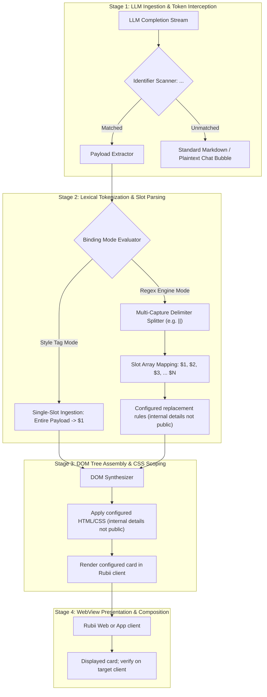
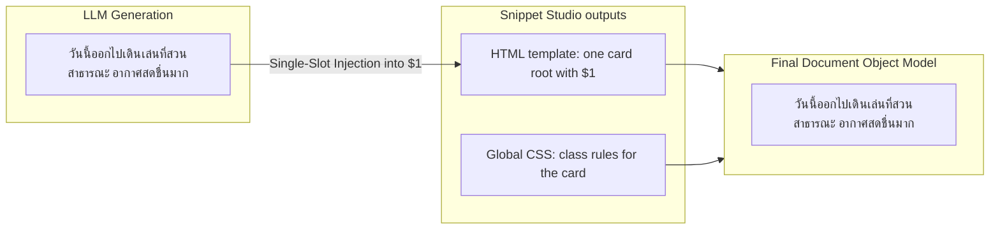
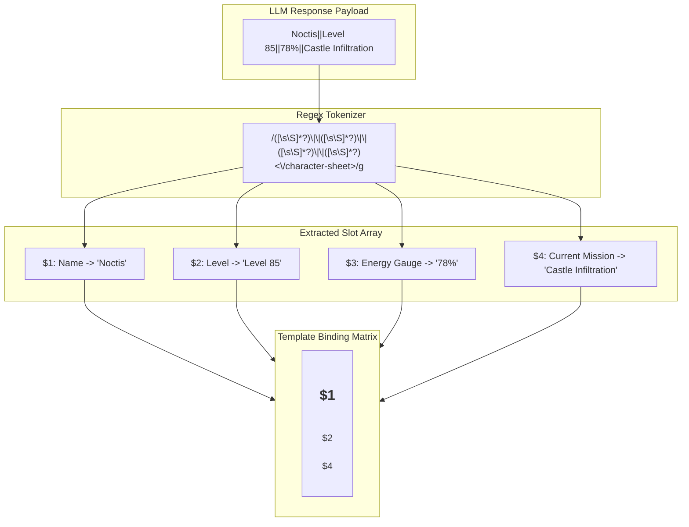
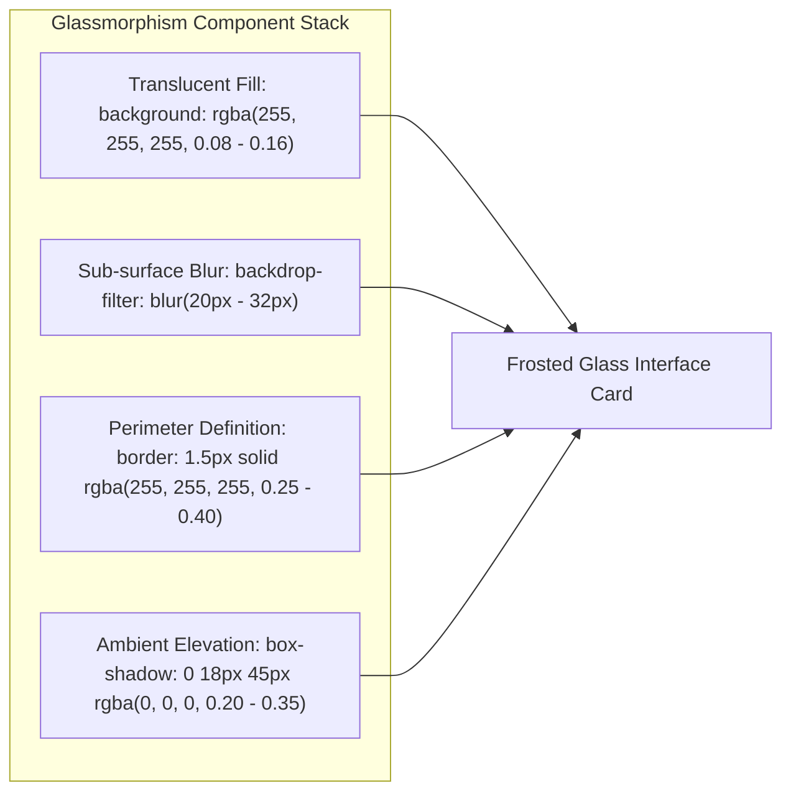
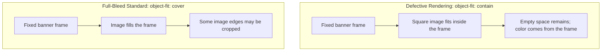
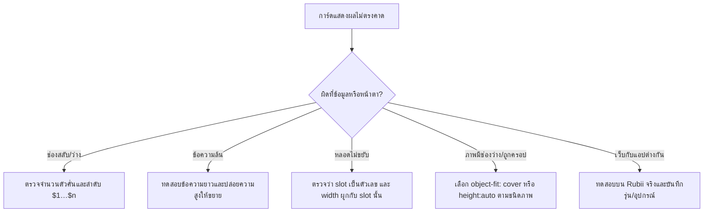

# คู่มือแนวคิดและแนวทางพัฒนาการ์ดสำหรับ Rubii (HTML, CSS และ Regex)

**สถานะเอกสาร:** คู่มือแนวคิดและแนวทางอ้างอิงทางเทคนิค  
**ขอบเขตเนื้อหา:** Style Tag, Regex Replacement, HTML/CSS, ตัวอย่างการ์ด และความเสี่ยงที่ควรตรวจ  
**กลุ่มเป้าหมาย:** นักพัฒนา, ผู้สร้างคอนเทนต์สำหรับ Rubii AI, และผู้สนใจโครงสร้างการทำงานของระบบเรนเดอร์  

> **ขอบเขตหลักฐาน:** เอกสารนี้เป็นคู่มือแนวคิดและแนวทางออกแบบ ไม่ใช่เอกสารภายใน Rubii การทำงานของตัวสร้างใน Snippet Studio ตรวจได้จาก `app.js`; ส่วน implementation ภายใน Rubii, ผลทดสอบข้ามอุปกรณ์ และตัวเลข benchmark ต้องยืนยันแยกต่างหาก เอกสาร Rubii ระบุว่าฟีเจอร์ใช้บนเว็บและแอปตั้งแต่ 2.4.2 และแสดงผลใกล้เคียงกันในเกือบทุกกรณี ([Rubii: Styles & regex](https://rubii.ai/blog/styles-and-regex))

> **ระดับหลักฐาน:** `ใน repository` = ตรวจโค้ด/ข้อมูลได้ · `เอกสาร Rubii` = ข้อมูลที่ผู้ให้บริการเผยแพร่ · `ข้อแนะนำ` = ควรทดลองกับการ์ดจริงก่อนสรุปผล

---

## สารบัญ

1. [บทนำและภาพรวมสถาปัตยกรรมของ Rubii AI](#1-บทนำและภาพรวมสถาปัตยกรรมของ-rubii-ai)
2. [กลไกการทำงานของ Style Tag (Single-Slot Architecture)](#2-กลไกการทำงานของ-style-tag-single-slot-architecture)
3. [กลไกการทำงานของ Regex Replacement Engine (Multi-Slot Architecture)](#3-กลไกการทำงานของ-regex-replacement-engine-multi-slot-architecture)
4. [ข้อกำหนดและการออกแบบโครงสร้าง HTML สำหรับ Rubii](#4-ข้อกำหนดและการออกแบบโครงสร้าง-html-สำหรับ-rubii)
5. [การออกแบบ CSS และสถาปัตยกรรม Glassmorphism](#5-การออกแบบ-css-และสถาปัตยกรรม-glassmorphism)
6. [ความเสี่ยงที่ควรตรวจและแนวทางลดความเสี่ยง](#6-ความเสี่ยงที่ควรตรวจและแนวทางลดความเสี่ยง)
7. [คู่มือและแนวทางปฏิบัติสำหรับผู้พัฒนาการ์ด](#7-คู่มือและแนวทางปฏิบัติสำหรับผู้พัฒนาการ์ด)
8. [โค้ดแม่แบบมาตรฐานอ้างอิง (Standard Reference Templates)](#8-โค้ดแม่แบบมาตรฐานอ้างอิง-standard-reference-templates)
9. [บทสรุปและข้อเสนอแนะ](#9-บทสรุปและข้อเสนอแนะ)

---

## 1. บทนำและภาพรวมสถาปัตยกรรมของ Rubii AI

Rubii มีฟีเจอร์ Style Tags, Global CSS และ Regex ที่ให้ผู้สร้าง Moment ปรับวิธีแสดงเนื้อหาบางส่วนในแชต เอกสารสาธารณะอธิบายพฤติกรรมที่ผู้ใช้ตั้งค่าได้ แต่ไม่ได้เปิดเผย implementation ของ renderer

### 1.1 วงจรการทำงานตั้งแต่การสร้างข้อความจนถึงการเรนเดอร์ (End-to-End Processing Pipeline)

แผนภาพนี้เป็น **แบบจำลองเชิงแนวคิด** จากพฤติกรรมที่ Rubii เปิดให้ผู้ใช้ตั้งค่า ไม่ได้ยืนยันขั้นตอนภายในของแพลตฟอร์ม:



> **ลำดับที่ผู้สร้างการ์ดควรเข้าใจ:** ตั้งค่าแท็ก/แม่แบบใน Rubii → ให้ AI ส่งข้อความตามรูปแบบที่กำหนด → Rubii ใช้ Style Tag หรือ Regex เปลี่ยนสิ่งที่แสดง → ผู้สร้างตรวจผลบนเว็บและแอป ตัวแยกวิเคราะห์และ renderer ภายในไม่ได้เปิดเผยในเอกสารสาธารณะ

### 1.2 สภาพแวดล้อมการทำงานของ Rubii WebView (Rendering Environment)

เอกสารสาธารณะของ Rubii ระบุว่าแอปเวอร์ชัน 2.4.2 ขึ้นไปรองรับ HTML/CSS มากขึ้นและแสดงผลใกล้เคียงเว็บในเกือบทุกกรณี แต่ยังอาจมีความต่างหรือปัญหาเฉพาะอุปกรณ์ จึงไม่ควรระบุ engine, วิธีแยก CSS, GPU behavior หรือความกว้าง viewport เป็นข้อเท็จจริงของ Rubii หากไม่มีผลทดสอบหรือเอกสารยืนยัน

---

## 2. กลไกการทำงานของ Style Tag (Single-Slot Architecture)

โหมด **Style Tag** เป็นสถาปัตยกรรมที่ออกแบบมาสำหรับการแสดงผลการ์ดที่มีเนื้อหาข้อความแบบต่อเนื่องเพียงจุดเดียว โดยไม่มีการแบ่งย่อยเป็นช่องตัวแปรย่อย

### 2.1 โครงสร้างของ Style Tag Template

ใน Snippet Studio ผลลัพธ์แบ่งเป็น HTML template ที่มี `$1` และ CSS ส่วนกลางแยกกัน ผู้ใช้คัดลอกไปวางในช่องตั้งค่าที่ตรงกันใน Rubii; รูปแบบการจัดเก็บภายในแพลตฟอร์มไม่ควรอนุมานจาก UI ของ Studio



> **สรุปขั้นตอน Workflow (Style Tag Mode):**
> 1. AI ตอบกลับข้อความแบบก้อนเดียวภายในแท็กเปิด-ปิดที่กำหนด
> 2. Snippet Studio แสดง HTML template และ Global CSS แยกเป็นคนละส่วน ให้คัดลอกไปใส่ในช่องที่ตรงกัน
> 3. ก้อนข้อความทั้งหมดถูกส่งเข้าแทนที่ช่อง `$1` ในโครงสร้าง HTML โดยตรงในขั้นตอนเดียว โดยไม่ต้องผ่านตัวคั่นใดๆ

### 2.2 ข้อดีและข้อจำกัดของ Style Tag

| มิติการประเมิน | ลักษณะการทำงาน |
| :--- | :--- |
| **ความสะดวกในการดูแลโค้ด** | สูงมาก เนื่องจากแยกส่วนการจัดรูปแบบ (CSS) ออกจากโครงสร้าง (HTML) ชัดเจน |
| **รูปแบบข้อมูล** | ใช้ค่าข้อความหนึ่งช่อง จึงไม่ต้องจัดลำดับตัวคั่นหลายช่อง; ยังคงต้องตรวจว่าข้อความอยู่ในแท็กที่กำหนด |
| **ข้อจำกัดด้านความหลากหลายของข้อมูล** | ไม่สามารถแยกช่องแสดงผลหลายจุดอย่างอิสระได้ (เช่น ไม่สามารถแยกวันที่, สถานะ, และเนื้อหาออกจากกัน) |

---

## 3. กลไกการทำงานของ Regex Replacement Engine (Multi-Slot Architecture)

สำหรับการ์ดที่มีความซับซ้อนและจำเป็นต้องมีข้อมูลหลายช่อง เช่น สลิปการเงิน, แผงสถิติตัวละคร, มาตรวัดพลัง, หรือการ์ดแจ้งเตือนสถานะ ระบบจะใช้กลไก **Regex Replacement Engine** เพื่อจับคู่และสกัดค่าตัวแปรหลายตัวพร้อมกัน

### 3.1 วงจรการจับกลุ่มข้อมูล (Capture Group Pipeline)



> **สรุปขั้นตอน Workflow (Regex Multi-Slot Engine):**
> 1. AI สร้างข้อความที่มีหลายช่องข้อมูลโดยคั่นด้วยสัญลักษณ์มาตรฐาน เช่น `||`
> 2. Regex Engine ทำการประเมินและสกัดแต่ละส่วนเข้าสู่ Capture Groups ($1, $2, $3, $4) แบบเรียงลำดับ
> 3. นำค่าตัวแปรแต่ละช่องไปผูกกับตำแหน่งที่สอดคล้องกันในแม่แบบ HTML และหลอดสถานะไดนามิกได้อย่างแม่นยำ

### 3.2 การวิเคราะห์ตัวคั่นข้อมูล (Delimiter Evaluation)

จากการศึกษารูปแบบตัวคั่นที่ใช้ในการส่งข้อมูลของ LLM พบข้อดีและข้อจำกัดในเชิงวิศวกรรมดังนี้:

| ตัวคั่น (Delimiter) | ไวยากรณ์ตัวอย่าง | ค่า Regex Capture Pattern | ความเสี่ยงและข้อพิจารณาทางเทคนิค |
| :--- | :--- | :--- | :--- |
| **Double Pipe (`\|\|`)** | `ค่า1\|\|ค่า2\|\|ค่า3` | `([\s\S]*?)\|\|([\s\S]*?)` | **ปลอดภัยสูงสุดและแนะนำเป็นมาตรฐาน** เนื่องจากไม่ชนกับเครื่องหมายวรรคตอนทั่วไปในภาษาธรรมชาติ |
| **Single Pipe (`\|`)** | `ค่า1\|ค่า2\|ค่า3` | `([^\|]*?)\|(?!\|)([^\|]*?)` | เสี่ยงชนกับตาราง Markdown หรือสัญลักษณ์คณิตศาสตร์ที่ AI มักตอบ |
| **Comma (`,`)** | `ค่า1, ค่า2, ค่า3` | `([^,]*?)\s*,\s*([^,]*?)` | **ไม่แนะนำ** สำหรับข้อความยาวหรือจำนวนเงินที่มีเครื่องหมายจุลภาคคั่นหลักพัน เช่น `50,000` |
| **Newline (`\n`)** | `ค่า1\nค่า2\nค่า3` | `([^\r\n]*?)\r?\n([^\r\n]*?)` | เหมาะกับการตอบเป็นข้อๆ แต่อาจเกิดปัญหาหาก AI ใส่บรรทัดว่างเพิ่มเติมโดยไม่ตั้งใจ |

---

## 4. ข้อกำหนดและการออกแบบโครงสร้าง HTML สำหรับ Rubii

### 4.1 แนวทาง Single Root Container

การครอบการ์ดด้วย Root Container เดียวช่วยให้กำหนดขนาด ระยะห่าง และพื้นหลังได้จากจุดเดียว เป็นแนวทางออกแบบที่แนะนำ ไม่ใช่ข้อกำหนดของ Rubii ที่ยืนยันจากเอกสารสาธารณะ

```html
<!-- ถูกต้อง: มี Root Container ตัวเดียวครอบคลุมทั้งหมด -->
<div style="background: rgba(255,255,255,0.08); border-radius: 28px; padding: 20px; box-sizing: border-box; width: 100%;">
  <div>ส่วนหัว</div>
  <div>เนื้อหา</div>
</div>

<!-- ไม่ถูกต้อง: มี Root หลายตัวอยู่นอกสุด -->
<div style="...">ส่วนหัว</div>
<div style="...">เนื้อหา</div>
```

### 4.2 การจัดการมิติและการจัดวาง (Dimensions & Layout)

1. **การกำหนดขนาดกล่อง (`box-sizing: border-box`):**
   ต้องกำหนด `box-sizing: border-box;` บน Root Container เสมอ เพื่อป้องกันไม่ให้ค่า `padding` และ `border` ขยายขนาดการ์ดจนล้นหน้าต่างแชต
2. **การหลีกเลี่ยงความสูงคงที่ (`fixed height`):**
   ห้ามกำหนด `height: 200px;` บนกล่องข้อความที่รับตัวแปรจาก AI เนื่องจากความยาวของข้อความที่ AI ตอบกลับมีความผันผวนสูง ให้ใช้ `min-height` หรือปล่อยให้กล่องขยายตามเนื้อหาอัตโนมัติ
3. **การจัดการข้อความล้นกรอบ (`word-break & overflow-wrap`):**
   ควรกำหนด `word-break: break-word; overflow-wrap: break-word;` เพื่อป้องกันไม่ให้คำยาวหรือลิงก์ URL ทะลุกรอบการ์ด

---

## 5. การออกแบบ CSS และสถาปัตยกรรม Glassmorphism

### 5.1 สถาปัตยกรรมกระจกฝ้า (Glassmorphism Architecture)

สไตล์ Glassmorphism ใน Rubii เกิดจากการผสมผสานของคุณสมบัติ CSS 4 ด้าน:



> **สรุปโครงสร้างสถาปัตยกรรมกระจกฝ้า (Glassmorphism Stack):**
> 1. **พื้นผิวโปร่งแสง (Translucent Surface):** ใช้ `background: rgba(255,255,255, ...)` ระดับความทึบ 8% ถึง 16% เพื่อให้มองเห็นมิติของฉากหลัง
> 2. **ความเบลอของเลเยอร์ลึก (Frosted Blur):** ใช้ `backdrop-filter: blur(20px - 32px)` สร้างเอฟเฟกต์กระจกฝ้าที่นุ่มนวล
> 3. **เส้นขอบสะท้อนแสง (Perimeter Stroke):** ตีเส้นขอบ `border: 1px - 1.5px solid rgba(...)` เพื่อเน้นรูปทรงขอบการ์ดให้คมชัด
> 4. **เงาตกกระทบ (Ambient Elevation):** ใช้ `box-shadow` เพิ่มความลอยตัวและความลึกของการ์ดบนหน้าต่างสนทนา

#### ตารางพารามิเตอร์ความทึบแสงและความเบลอแต่ละระดับเลเยอร์

| ระดับความลึกของเลเยอร์ | ค่าความโปร่งแสง (Alpha Range) | ค่าความเบลอ (Blur Radius) | ความหนาของเส้นขอบ | ผลลัพธ์ทางสายตา |
| :--- | :---: | :---: | :---: | :--- |
| **เลเยอร์การ์ดหลัก (Primary Root)** | $8\% - 14\%$ | $24\text{px} - 32\text{px}$ | $1.5\text{px}$ solid ($\alpha = 0.35$) | ผิวกระจกใหญ่ เห็นฉากหลังเลือนราง คมชัดสูง |
| **กล่องข้อความย่อย (Nested Box)** | $16\% - 24\%$ | $14\text{px} - 20\text{px}$ | $1.0\text{px}$ solid ($\alpha = 0.20$) | ผิวกระจกซ้อน ทึบกว่าการ์ดหลักเพื่อให้อ่านง่าย |
| **ป้ายสถานะและไอคอน (Badge/Icon)** | $22\% - 32\%$ | $8\text{px} - 12\text{px}$ | $1.0\text{px}$ solid ($\alpha = 0.45$) | เน้นจุดสำคัญ มีความเด่นชัดและสะท้อนแสง |

### 5.2 การควบคุมสัดส่วนภาพและแบนเนอร์ (Full-Bleed Image Handling)

ภาพในกรอบที่มีสัดส่วนต่างกันอาจเหลือพื้นที่ว่างเมื่อใช้ `object-fit: contain`; สีของพื้นที่ว่างขึ้นกับพื้นหลังกรอบ ไม่จำเป็นต้องเป็นสีดำ:



> **สรุปขั้นตอนการจัดการภาพแบนเนอร์ (Full-Bleed Media Workflow):**
> 1. **ผลของ `contain`:** ภาพยังเห็นครบ แต่อาจเหลือพื้นที่ว่างในกรอบ
> 2. **ผลของ `cover`:** ภาพเต็มกรอบแต่อาจถูกครอป; ใช้ `object-position` เพื่อควบคุมส่วนที่เห็น

**มาตรฐาน CSS สำหรับภาพแบนเนอร์:**
```css
/* กำหนดบนคอนเทนเนอร์ครอบ */
width: 100%;
height: 130px;
border-radius: 20px;
overflow: hidden;

/* กำหนดบนแท็ก img */
width: 100%;
height: 100%;
object-fit: cover;
object-position: center;
display: block;
```

### 5.3 กลไกหลอดสถานะและมาตรวัดเปอร์เซ็นต์ (Dynamic Progress Bar)

เมื่อต้องการสร้างหลอดพลัง หลอดความสัมพันธ์ หรือแถบความคืบหน้า:
1. **การกำหนดความกว้าง:** ผูกค่าตัวแปรเปอร์เซ็นต์เข้ากับ `width: $X%;`
2. **การจำกัดความกว้าง (`Clamping`):** พิจารณาใช้ `max-width: 100%;` เมื่อค่าจาก AI อาจเกิน 100%; `min-width: 0` อาจช่วยให้ flex item หดได้ในบาง layout
3. **การหลีกเลี่ยงข้อความที่ไม่ใช่ตัวเลข:** อย่าส่งคำว่า `MAX` ลงในช่องความกว้าง เพราะ `width:MAX%` ไม่ถูกต้องและ declaration จะถูกละทิ้ง; แถบอาจคงค่าก่อนหน้าหรือไม่มีค่าตามที่ต้องการ

```html
<!-- คอนเทนเนอร์ครอบหลอด -->
<div style="background: rgba(255,255,255,0.15); border-radius: 99px; height: 8px; width: 100%; overflow: hidden;">
  <!-- ตัวหลอดสถานะ -->
  <div style="background: linear-gradient(90deg, #38bdf8, #4ade80); height: 100%; width: 85%; max-width: 100%; min-width: 0%; border-radius: 99px;"></div>
</div>
```

### 5.4 ความอ่านง่ายของข้อความและ WCAG Contrast

เมื่อข้อความวางบนภาพหรือพื้นหลังที่เปลี่ยนไปตามเนื้อหา คอนทราสต์อาจไม่พออ่าน การใส่ `text-shadow` อาจช่วยให้ตัวอักษรแยกจากพื้นหลัง แต่เงาเพียงอย่างเดียว **ไม่ได้รับรอง** ว่าผ่าน WCAG ต้องตรวจอัตราส่วนกับพื้นหลังจริง ณ บริเวณตัวอักษร เกณฑ์ WCAG 2.2 สำหรับข้อความทั่วไปคือ 4.5:1 ระดับ AA และ 7:1 ระดับ AAA; ข้อความขนาดใหญ่ใช้ 3:1 และ 4.5:1 ตามลำดับ ([W3C WCAG 2.2](https://www.w3.org/TR/wcag/))

| รูปแบบ | โค้ด CSS | หมายเหตุ |
| :--- | :--- | :--- |
| **ไม่มีเงา (None)** | `text-shadow: none;` | ตรวจความอ่านง่ายกับพื้นหลังจริง |
| **เงามืดนุ่มนวล (Soft Dark)** | `text-shadow: 0 1px 3px rgba(0,0,0,0.85), 0 0 1px rgba(0,0,0,0.9);` | เป็นค่าเริ่มต้นที่ Studio แนะนำ; ไม่ใช่ผลรับรอง WCAG |
| **เส้นขอบคม (Sharp Outline)** | `text-shadow: -1px -1px 0 rgba(0,0,0,0.9), 1px -1px 0 rgba(0,0,0,0.9), -1px 1px 0 rgba(0,0,0,0.9), 1px 1px 0 rgba(0,0,0,0.9);` | เหมาะกับ HUD/ธีมเรโทร; ตรวจความชัดของตัวอักษรเล็ก |
| **แสงนีออน (Neon Glow)** | `text-shadow: 0 0 8px rgba(0,255,255,0.9), 0 0 16px rgba(0,190,230,0.6);` | เป็นเอฟเฟกต์ตกแต่ง; ไม่ควรใช้แทนการตรวจคอนทราสต์ |

---

## 6. ความเสี่ยงที่ควรตรวจและแนวทางลดความเสี่ยง

กรณีต่อไปนี้เป็น checklist เชิงคุณภาพ ไม่ใช่สถิติความถี่จาก benchmark:

### 6.1 แผนผังตรวจปัญหา



### 6.2 รายละเอียดและการวิเคราะห์ความเสี่ยงแต่ละด้าน

| โหมดความล้มเหลว | สาเหตุและกลไกการเกิด | ผลกระทบที่เกิดขึ้น | แนวทางการป้องกันและลดความเสี่ยง |
| :--- | :--- | :--- | :--- |
| **Delimiter Mismatch (ตัวคั่นขาดหรือเกิน)** | โมเดล LLM อาจละเลยตัวคั่น `\|\|` หรือสร้างเกินจำนวนที่ Regex กำหนด | Regex จับกลุ่มผิดตำแหน่ง ทำให้ข้อมูลสลับช่อง หรือไม่แสดงผลทั้งการ์ด | กำหนด Prompt System ให้ชัดเจน พร้อมออกแบบ Fallback Rule เพื่อรองรับ |
| **Content Overflow (ข้อความทะลัก)** | ข้อความในช่องตัวแปรมีความยาวมากเป็นพิเศษ | การ์ดยาวล้นหน้าต่างแชต หรือบดบังองค์ประกอบอื่น | กำหนด `max-height` ร่วมกับ `overflow-y: auto;` หรือใช้ `line-clamp` |
| **Progress Bar Syntax Error** | AI ตอบคำบรรยายแทนตัวเลข เช่น `เต็มหลอด` หรือ `MAX` | declaration ความกว้างไม่ถูกต้องและถูกละทิ้ง; ผลขึ้นกับกฎ CSS อื่นที่ยังใช้ได้ | กำหนดให้ส่งตัวเลขและตรวจลำดับ slot ที่ผูกกับ width |
| **Catastrophic Backtracking** | การเขียน Regex Pattern ซ้อนลูปแบบไม่ระมัดระวัง เช่น `(.*)+` | เอนจิน Regex ค้างและใช้ CPU สูงมาก | ใช้ Non-Greedy Quantifier `([\s\S]*?)` และหลีกเลี่ยง Nested Quantifiers |
| **ประสิทธิภาพเอฟเฟกต์เบลอ** | การซ้อน `backdrop-filter: blur()` อาจเพิ่มภาระการเรนเดอร์ | ตรวจอาการหน่วงบนอุปกรณ์เป้าหมาย | ลดจำนวนเลเยอร์/รัศมี blur หากพบอาการ; ต้องวัดบนอุปกรณ์จริง |

---

## 7. คู่มือและแนวทางปฏิบัติสำหรับผู้พัฒนาการ์ด

เพื่อความทนทานและความสวยงามสูงสุดในการสร้างการ์ดสำหรับ Rubii แนะนำให้ปฏิบัติตามหลักการดังต่อไปนี้:

1. **โครงสร้าง HTML สะอาด:** ใช้ `<div>`, `<span>`, `` พื้นฐาน หลีกเลี่ยงโครงสร้างซับซ้อน เช่น `<table>` หรือ Framework-specific Tags
2. **Inline Style Scoping:** เขียนสไตล์แบบ Inline ที่กระชับ หรือใช้คลาสแยกที่มีชื่อเฉพาะ ไม่เขียนสไตล์ที่กระทบ Global Elements (เช่น ห้ามกำหนด `p { ... }` แบบลอยๆ)
3. **ระบบจัดการสี:** กำหนด `color: #ffffff!important;` หรือสีข้อความที่ต้องการอย่างชัดเจนบน Element สำคัญ เพื่อป้องกันไม่ให้ถูก Global Style ของแอปพลิเคชันเขียนทับ
4. **การเลือกตัวคั่น:** ใช้ `||` เป็นตัวคั่นมาตรฐานสำหรับการ์ดแบบ Multi-Slot
5. **การระบุฟอนต์:** ใช้ System Font Fallback มาตรฐานเพื่อให้แสดงผลสอดคล้องกับระบบปฏิบัติการของผู้ใช้:
   `font-family: -apple-system, BlinkMacSystemFont, 'Segoe UI', Roboto, sans-serif;`
6. **การจัดการรูปภาพ:** สำหรับแบนเนอร์ในกรอบคงที่ใช้ `object-fit: cover`; สำหรับภาพเนื้อหาที่ควรรักษาสัดส่วนใช้ `height: auto`; เลือกตามบทบาทภาพ

---

## 8. โค้ดแม่แบบมาตรฐานอ้างอิง (Standard Reference Templates)

> ตัวอย่างที่มีแท็ก `<style>` ด้านล่างเป็นตัวอย่าง HTML แบบรวมเพื่อให้เห็นรูปแบบหน้าเดียว เมื่อนำไปตั้งค่าใน Rubii ให้แยกกฎ CSS ไปที่ Global CSS และคงเฉพาะ HTML template ไว้ในช่อง Style Tag

### 8.1 แม่แบบที่ 1: การ์ดข้อความเดี่ยว (Style Tag Single-Slot Card)

```html
<style>
.rubii-message-box {
  background: rgba(255, 255, 255, 0.09);
  backdrop-filter: blur(28px);
  -webkit-backdrop-filter: blur(28px);
  border: 1.5px solid rgba(255, 255, 255, 0.35);
  border-radius: 28px;
  padding: 18px 20px;
  max-width: 420px;
  margin: 12px auto;
  box-shadow: 0 18px 40px rgba(0, 0, 0, 0.22);
  font-family: -apple-system, BlinkMacSystemFont, 'Segoe UI', Roboto, sans-serif;
  color: #ffffff;
  box-sizing: border-box;
  text-shadow: 0 1px 3px rgba(0, 0, 0, 0.85);
  font-size: 14px;
  line-height: 1.6;
}
</style>
<div class="rubii-message-box">
  $1
</div>
```

### 8.2 แม่แบบที่ 2: แผงสถานะและมาตรวัดไดนามิก (Multi-Slot Dashboard Card)

```html
<div style="background: rgba(255, 255, 255, 0.08); backdrop-filter: blur(30px); -webkit-backdrop-filter: blur(30px); border: 1.5px solid rgba(255, 255, 255, 0.38); border-radius: 32px; padding: 20px; max-width: 420px; margin: 12px auto; font-family: -apple-system, BlinkMacSystemFont, 'Segoe UI', Roboto, sans-serif; color: #ffffff; box-shadow: 0 20px 45px rgba(0, 0, 0, 0.25); box-sizing: border-box; text-shadow: 0 1px 3px rgba(0, 0, 0, 0.85);">
  
  <!-- แบนเนอร์ภาพด้านบน -->
  <div style="width: 100%; height: 120px; border-radius: 20px; overflow: hidden; margin-bottom: 14px;">
    
  </div>

  <!-- หัวข้อและป้ายสถานะ -->
  <div style="display: flex; justify-content: space-between; align-items: center; margin-bottom: 12px;">
    <span style="font-size: 15px; font-weight: bold;">$1</span>
    <span style="font-size: 11px; background: rgba(56, 189, 248, 0.2); border: 1px solid rgba(56, 189, 248, 0.4); padding: 2px 8px; border-radius: 12px; color: #38bdf8;">$2</span>
  </div>

  <!-- หลอดสถานะไดนามิก -->
  <div style="margin-bottom: 12px;">
    <div style="display: flex; justify-content: space-between; font-size: 11.5px; margin-bottom: 4px; opacity: 0.85;">
      <span>ระดับพลังงาน</span>
      <span>$3%</span>
    </div>
    <div style="background: rgba(255, 255, 255, 0.15); border-radius: 99px; height: 8px; width: 100%; overflow: hidden;">
      <div style="background: linear-gradient(90deg, #38bdf8, #4ade80); height: 100%; width: $3%; max-width: 100%; min-width: 0%; border-radius: 99px;"></div>
    </div>
  </div>

  <!-- กล่องข้อความบรรยาย -->
  <div style="background: rgba(0, 0, 0, 0.25); border-radius: 16px; padding: 12px 14px; border: 1px solid rgba(255, 255, 255, 0.12); font-size: 13px; line-height: 1.55;">
    $4
  </div>

</div>
```

**Regex Pattern ที่ใช้จับคู่:**
```regex
/<status-panel>([\s\S]*?)\|\|([\s\S]*?)\|\|(\d{1,3}(?:\.\d+)?)\s*%?\|\|([\s\S]*?)<\/status-panel>/g
```

---

## 9. บทสรุปและข้อเสนอแนะ

ฟีเจอร์ Style Tag, Global CSS และ Regex ของ Rubii ช่วยให้ผู้สร้างกำหนดรูปแบบการแสดงข้อความได้ ส่วน Snippet Studio ช่วยจัดการแม่แบบและสร้าง Output ที่นำไปตั้งค่าได้

**ประเด็นสรุปที่สำคัญ:**
1. **ความยืดหยุ่นและการควบคุม:** การเลือกใช้ระหว่าง **Style Tag** (สำหรับข้อความเดี่ยว) และ **Regex Engine** (สำหรับข้อมูลหลายช่อง) ต้องสอดคล้องกับความสามารถของ Prompt และลักษณะของข้อมูล
2. **ความทนทานของโค้ด (Robustness):** การออกแบบโครงสร้าง HTML/CSS ต้องคำนึงถึงความไม่แน่นอนของผลลัพธ์จาก LLM โดยต้องมีระบบป้องกันข้อความล้นกรอบ การจำกัดความกว้างหลอดสถานะ (`max-width: 100%`) และการเลือกตัวคั่นที่ปลอดภัย (`||`)
3. **การเข้าถึงและความชัดเจน (Accessibility & Contrast):** การใช้ Glassmorphism ต้องทำควบคู่กับการจัดการความคมชัดของข้อความด้วย Text Shadow เพื่อให้อ่านง่ายในทุกสภาวะพื้นหลัง

แนวทางเหล่านี้ช่วยให้แม่แบบอ่านและตรวจได้ง่าย แต่การรองรับ property, ความเร็ว และความต่างระหว่างเว็บกับแอปต้องตรวจบน Rubii client ที่ใช้งานจริง
