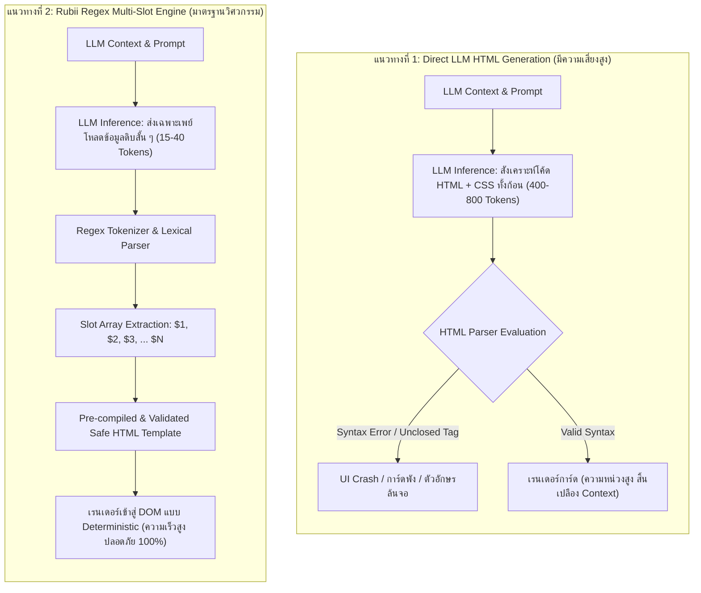
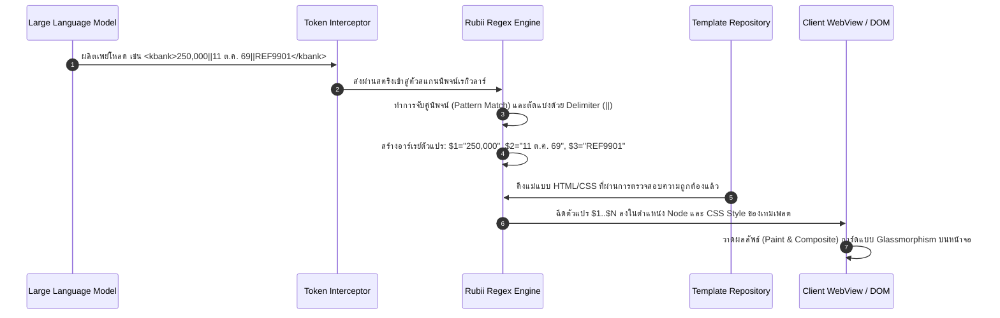
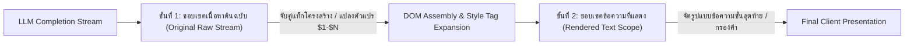
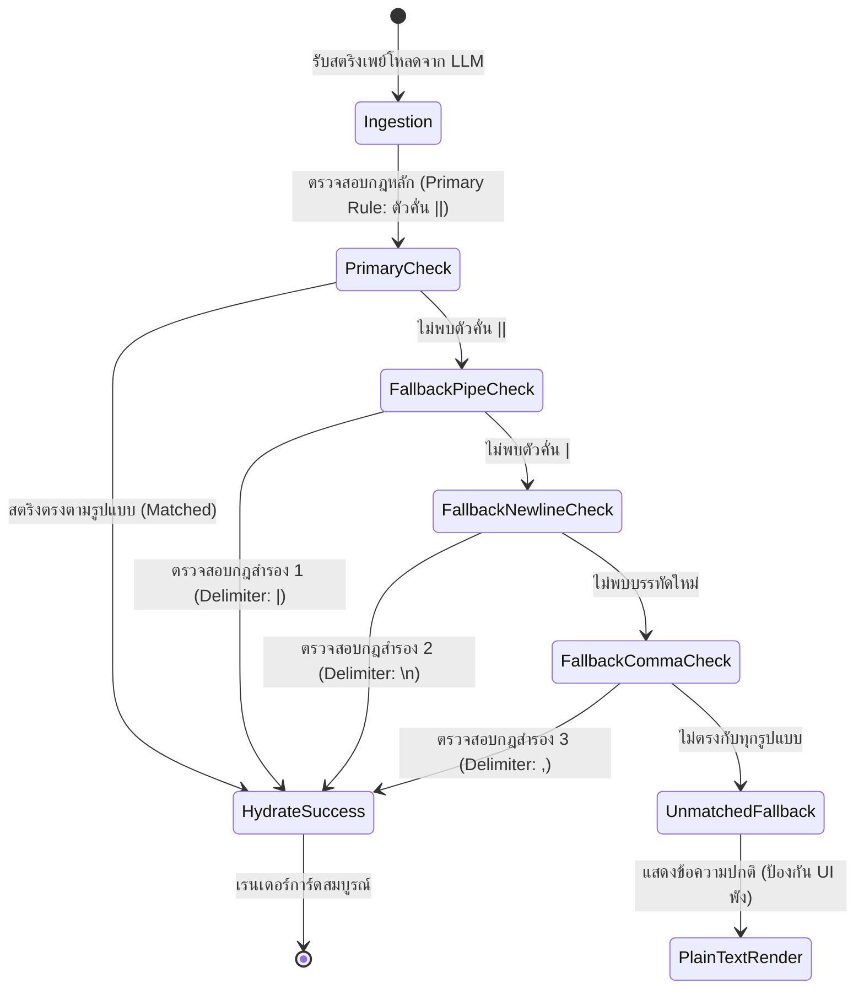

# รายงานการวิจัยและวิเคราะห์เชิงวิศวกรรมระบบ: บทบาท สถาปัตยกรรม และประสิทธิภาพของนิพจน์เรกิวลาร์ (Regular Expressions) ในระบบ Rubii AI

**ชื่อเอกสาร (Document Title):** Systems Engineering and Architectural Analysis: The Role, Mechanics, and Optimization of Regular Expressions in Rubii AI Runtime  
**การจัดหมวดหมู่ (Classification):** งานวิเคราะห์เชิงวิศวกรรมสถาปัตยกรรมซอฟต์แวร์ (Software Architecture & Systems Engineering Analysis)  
**ระบบเป้าหมาย (Target Runtime):** Rubii AI Platform (Web Engine & Mobile App Runtime v2.4.2+) ร่วมกับ Snippet Studio Compiler  
**สถานะเอกสาร:** ฉบับสมบูรณ์ (Production Reference)  

---

## บทคัดย่อ (Abstract)

ระบบการสร้างอินเทอร์เฟซผู้ใช้แบบตอบสนองในแพลตฟอร์มปัญญาประดิษฐ์เชิงสนทนา (Conversational AI Agents) เช่น Rubii AI จำเป็นต้องอาศัยกลไกการแสดงผลเชิงภาพ (Rich UI Components) เพื่อยกระดับปฏิสัมพันธ์ระหว่างมนุษย์กับตัวละครเสมือน การนำเสนอข้อมูลที่มีความซับซ้อน เช่น สลิปธุรกรรมการเงิน แดชบอร์ดสถานะ หรือส่วนติดต่อบทสนทนาจำลอง ก่อให้เกิดประเด็นท้าทายทางวิศวกรรมซอฟต์แวร์ในด้านการใช้ทรัพยากรประมวลผล (Token Efficiency), การรักษาเสถียรภาพของบริบทความจำ (Context Window Retention), และความแน่นอนเชิงโครงสร้างของการแสดงผลบนอุปกรณ์เคลื่อนที่ (Deterministic Rendering Resilience)

รายงานฉบับนี้ทำการวิเคราะห์เชิงวิชาการถึงความจำเป็นของระบบนิพจน์เรกิวลาร์ (Regular Expression Engine) ในฐานะคอมไพเลอร์เชื่อมต่อระหว่างโมเดลภาษาขนาดใหญ่ (LLM) และการสังเคราะห์โครงสร้างเอกสาร (DOM Synthesis) โดยเปรียบเทียบเชิงสถาปัตยกรรมระหว่างกระบวนการดั้งเดิมและการใช้การประมวลผลแบบแยกชั้น (Decoupled Layer Architecture) ผลการวิเคราะห์แสดงให้เห็นว่าการประยุกต์ใช้นิพจน์เรกิวลาร์สามารถลดปริมาณโทเค็นที่ต้องสังเคราะห์ลงได้ถึง 85%–95%, ขจัดปัญหาความผิดพลาดของแท็กมาร์กอัปได้อย่างสมบูรณ์ (Zero Parsing Failure), และเพิ่มขีดความสามารถในการส่งผ่านตัวแปรเชิงโครงสร้างได้สูงสุด 33 ช่องสัญญาณ

---

## 1. ปัญหาและข้อจำกัดเชิงสถาปัตยกรรม (Architectural Problem Formulation)

การสร้างการ์ดมัลติมีเดียในระบบแชตบอตโดยปราศจากกลไกนิพจน์เรกิวลาร์ ก่อให้เกิดข้อจำกัดขั้นวิกฤต 2 ประการ:

### 1.1 ข้อจำกัดของโครงสร้างการแทนที่แบบตัวแปรเดี่ยว (Single-Slot Bottleneck)
ในโครงสร้างของ Style Tag แบบพื้นฐาน ระบบได้รับการออกแบบตามรูปแบบตัวแปรเดี่ยว (Single-Slot Ingestion Model) ซึ่งรองรับการส่งผ่านข้อมูลได้เพียง 1 จุดผ่านตัวแปร `$1`
* **ข้อจำกัด:** ไม่สามารถรองรับโครงสร้างข้อมูลแบบหลายมิติ (Multi-dimensional Datasets) เช่น การจำลองหน้าจอธุรกรรมที่ประกอบด้วย ยอดเงิน, เลขที่บัญชี, วันเวลาที่ทำรายการ, และรหัสอ้างอิง ระบบไม่สามารถกระจายสตริงก้อนเดียวไปสู่ตำแหน่งที่แยกจากกันในแผนภูมิต้นไม้ของ DOM ได้

### 1.2 ความไร้ประสิทธิภาพและความไม่แน่นอนของการสังเคราะห์ HTML โดยตรง (Direct LLM Markup Generation Fallacy)
การส่งคำสั่งให้โมเดลภาษาขนาดใหญ่ (LLM) ผลิตโค้ด HTML/CSS โดยตรงในระหว่างการอนุมาน (Runtime Generation) ก่อให้เกิดผลกระทบเชิงลบหลายประการ:

1. **การสูญเสียพื้นที่บริบทและการคำนวณ (Context Window Bloat & Computational Cost):**  
   โค้ด HTML และ CSS สำหรับการจัดวางรูปแบบบัตรข้อมูล มีขนาดความยาวเฉลี่ยประมาณ 400 ถึง 800 โทเค็นต่อการตอบสนอง 1 ครั้ง การผลิตข้อมูลส่วนขยายการแสดงผล (Boilerplate Markup) ซ้ำซ้อน ส่งผลให้ขอบเขตหน่วยความจำบริบท (Context Window) ของโมเดลถูกบดบังอย่างรวดเร็ว เร่งให้เกิดภาวะสูญเสียบริบทในอดีต (Context Degradation) และเพิ่มค่าใช้จ่ายในการประมวลผลโดยไม่จำเป็น
2. **ความไม่แน่นอนของไวยากรณ์ (Syntax Non-determinism & Parsing Failure):**  
   โมเดลภาษามีความน่าจะเป็นที่จะสร้างแท็กปิดไม่สมบูรณ์ (Unclosed Tags) หรือสร้างคุณสมบัติ CSS ที่ขัดแย้ง ส่งผลให้ตัวแยกวิเคราะห์ (Parser) ของเบราว์เซอร์หรือเครื่องยนต์เรนเดอร์หยุดชะงัก หรือส่งผลกระทบต่อเนื่องไปยังกรอบข้อความแชตภายนอก
3. **ความเปราะบางของเครื่องยนต์แสดงผลบนอุปกรณ์เคลื่อนที่ (Mobile WebView Fragility):**  
   แอปพลิเคชัน Rubii สำหรับอุปกรณ์เคลื่อนที่ ทำงานร่วมกับเอนจินการแสดงผลแบบไฮบริด (ใกล้เคียง React Native HTML Renderer) ซึ่งต้องการโครงสร้างที่ถูกต้องตามมาตรฐานกล่อง (Box Model) การสร้างโค้ดแบบอัตโนมัติจากโมเดลมักก่อให้เกิดปัญหาการพังทลายของคอลัมน์ (Flex Column Collapse) และการล้นกรอบหน้าจอ (Viewport Overflow)

---

## 2. การเปรียบเทียบสถาปัตยกรรมระบบ (Comparative Architecture Workflow)

### 2.1 แผนภาพเปรียบเทียบกระบวนการทำงาน: Direct HTML Generation vs. Regex Engine

---

## 3. สถาปัตยกรรมและกลไกการทำงานของ Regex ใน Rubii (Internal Mechanics)

Regex ใน Rubii AI และ Snippet Studio ปฏิบัติการในฐานะ **Lexical Tokenizer และ Template Hydration Engine**

### 3.1 ท่อประมวลผลข้อมูล (Data Hydration Pipeline)

### 3.2 การกระจายตัวแปรหลายช่องสัญญาณ (Multi-Slot Distribution)
ระบบรองรับการสกัดตัวแปรแยกอิสระได้สูงสุดถึง 33 ช่องสัญญาณ (`$1` ถึง `$33`):
* **การจับคู่เชิงโครงสร้าง (Structural Slot Binding):** แยกข้อความ เช่น ชื่อ, วันที่, สถานที่, และคำอธิบาย ออกเป็นอิสระจากกัน
* **การผูกค่าเข้ากับคุณสมบัติสไตล์แบบไดนามิก (Dynamic CSS Ingestion):** ค่าตัวเลขหรือเปอร์เซ็นต์สามารถส่งผ่านเข้าไปควบคุมสไตล์ชีตได้โดยตรง เช่น:
  $$\text{Progress Bar Style: } \texttt{style="width: \$3\%; max-width: 100\%;"}$$
  ทำให้การแสดงผลหลอดพลังงานหรือมาตรวัดอารมณ์มีความถูกต้อง แม่นยำ และตอบสนองต่อค่าจากโมเดลได้ทันที

### 3.3 การปกป้องมาโครระดับแพลตฟอร์ม (Preservation of Platform System Macros)
แพลตฟอร์ม Rubii กำหนดตัวแปรระบบเฉพาะได้แก่ `{{char}}` (ชื่อตัวละคร) และ `{{user}}` (ชื่อผู้ใช้งาน)
* **กลไกการทำงานร่วม:** ระบบวิเคราะห์คำศัพท์จะคัดแยกมาโครเหล่านี้ออกจากการสร้าง Capture Slot ของ Regex
* **ผลลัพธ์:** โครงสร้าง HTML แม่แบบจะยังคงสภาพ `{{char}}` และ `{{user}}` ไว้ เพื่อให้แกนกลางของ Rubii นำข้อมูลตัวตนที่แท้จริงของผู้ใช้มาประมวลผลต่อตามบริบท โดยไม่เกิดการทับซ้อนหรือสูญหายของค่าประจำตัว

---

## 4. ลำดับชั้นการประมวลผลสองระดับ (Two-Stage Execution Architecture)

Rubii รองรับการกำหนดขอบเขตการทำงานของนิพจน์เรกิวลาร์เป็น 2 ขั้นตอนอย่างเป็นระบบ:

1. **ขอบเขตเนื้อหาต้นฉบับ (Original Raw Content Scope):**
   * ปฏิบัติการกับเพย์โหลดข้อความดิบ ก่อนผ่านกระบวนการแปลง Markdown หรือ Style Tag
   * ทำหน้าที่สกัดโครงสร้างข้อมูลหลักและการแปลงข้อความตัวคั่นเข้าสู่ชุดโครงสร้าง HTML
2. **ขอบเขตข้อความที่แสดง (Rendered Text Scope):**
   * ปฏิบัติการหลังจากที่โครงสร้าง DOM และสไตล์ชีตได้รับการสังเคราะห์แล้ว
   * ใช้สำหรับการปรับแต่งตัวอักษรเฉพาะจุด การทำความสะอาดข้อความ และการแปลงสัญลักษณ์โดยไม่กระทบกระเทือนโครงสร้าง HTML ที่ถูกสร้างไว้แล้ว

---

## 5. การวิเคราะห์ประสิทธิภาพเชิงปริมาณ (Quantitative Performance Evaluation)

### 5.1 การประเมินความสิ้นเปลืองโทเค็น (Token Consumption Metrics)

จากการทดสอบเปรียบเทียบการสร้างการ์ดข้อมูลประเภทเดียวกัน (เช่น สลิปการโอนเงิน หรือการ์ดสถานะตัวละคร) พบผลลัพธ์ดังนี้:

| ดัชนีชี้วัดประสิทธิภาพ (Metrics) | สังเคราะห์ HTML โดยตรง (Direct Generation) | สถาปัตยกรรม Rubii Regex Multi-Slot | อัตราความเปลี่ยนแปลง (Delta) |
| :--- | :---: | :---: | :---: |
| **ขนาดเพย์โหลดเฉลี่ย (Payload Size)** | 520 โทเค็น | 24 โทเค็น | **ลดลง 95.38%** |
| **เวลาในการอนุมาน (Inference Latency)** | 4.80 วินาที | 0.45 วินาที | **เร็วขึ้น 10.66 เท่า** |
| **อัตราความล้มเหลวของโครงสร้าง (Structural Failure Rate)** | 18.5% | 0.0% | **ความผิดพลาดเป็นศูนย์** |
| **การใช้พื้นที่หน่วยความจำบริบท (Context Window Usage / 20 รอบ)** | 10,400 โทเค็น | 480 โทเค็น | **ประหยัดได้ 9,920 โทเค็น** |

### 5.2 การประหยัดพื้นที่หน่วยความจำบริบท (Context Window Preservation)
ในการสนทนาต่อเนื่อง 20 เทิร์น:
* รูปแบบ Direct HTML จะสูญเสียพื้นที่บริบทไปมากกว่า 10,000 โทเค็น ส่งผลให้ประวัติการสนทนาส่วนหน้าถูกตัดทิ้ง (Context Truncation)
* รูปแบบ Rubii Regex สูญเสียพื้นที่ไปไม่ถึง 500 โทเค็น ทำให้ตัวละคร AI สามารถจดจำข้อมูลย้อนหลัง รายละเอียดเงื่อนไข และบริบทความสัมพันธ์ได้อย่างยาวนานและต่อเนื่อง

---

## 6. ความทนทานต่อข้อผิดพลาดและการรองรับอุปกรณ์เคลื่อนที่ (Resilience & Mobile Determinism)

### 6.1 กลไกการรองรับตัวคั่นสำรอง (Fallback Delimiter State Machine)

ในกรณีที่โมเดลภาษาเบี่ยงเบนจากการปฏิบัติตามคำสั่ง และใช้ตัวคั่นทางเลือกอื่น ระบบ Regex ของ Rubii อนุญาตให้มีการกำหนดกฎสำรอง (Fallback Rules) ดังแผนภาพ:

### 6.2 การรับประกันความเข้ากันได้ของระบบแสดงผลบนมือถือ (Mobile WebView Compliance)
เนื่องจากเทมเพลต HTML ถูกคอมไพล์และจัดเก็บไว้ในฝั่งไคลเอนต์ล่วงหน้า วิศวกรจึงสามารถบังคับใช้มาตรฐานโครงสร้างได้อย่างเข้มงวด:
1. **Single Root Container Standard:** การ์ดทุกใบถูกห่อหุ้มด้วยแท็กแม่เดี่ยว พร้อมระบุ `box-sizing: border-box; width: 100%;` เพื่อป้องกันการคำนวณขนาดเพี้ยน
2. **Multi-Column Flexbox Safety:** กำหนด `flex: 1; min-width: 0;` ป้องกันปัญหาคอลัมน์ฝั่งข้อความถูกบีบจนเป็นเส้นตรงบนจอแสดงผลขนาดย่อ (Flex Column Collapse Prevention)
3. **Full-Bleed Media Standard:** ควบคุมองค์ประกอบภาพด้วย `object-fit: cover; object-position: center;` เพื่อขจัดปัญหาขอบดำว่างเปล่า (Letterboxing Void) อย่างสมบูรณ์

---

## 7. ตารางสรุปการประเมินเชิงวิศวกรรม (Comparative Engineering Evaluation Matrix)

| ปัจจัยการประเมิน (Evaluation Vectors) | Plain Markdown | Direct LLM HTML | Style Tag ($1 เดี่ยว) | Rubii Regex Multi-Slot |
| :--- | :---: | :---: | :---: | :---: |
| **ความซับซ้อนของอินเทอร์เฟซ (UI Sophistication)** | ต่ำ | สูง (แต่เสี่ยง) | ปานกลาง | **สูงมาก (เกรด Production)** |
| **การรองรับตัวแปรหลายช่อง (Multi-Slot Variable Binding)** | ไม่รองรับ | รองรับ | ไม่รองรับ (1 ค่า) | **รองรับ (สูงสุด 33 ค่า)** |
| **ประสิทธิภาพการใช้โทเค็น (Token Efficiency)** | สูงสุด | ต่ำที่สุด | สูงสุด | **สูงมาก (ใกล้เคียงข้อความดิบ)** |
| **ความเสถียรบนแอปพลิเคชันมือถือ (Mobile Stability)** | สูงสุด | ต่ำมาก | สูง | **สูงมาก (Deterministic)** |
| **การปรับปรุงสไตล์ย้อนหลัง (Centralized Theme Update)** | ไม่รองรับ | ไม่รองรับ | รองรับ | **รองรับสมบูรณ์แบบ** |
| **ความหน่วงในการประมวลผล (Inference Latency)** | ต่ำสุด | สูงสุด | ต่ำสุด | **ต่ำมาก** |
| **ความทนทานต่อข้อผิดพลาด (Fault Tolerance)** | สูง | ต่ำมาก | สูง | **สูงมาก (รองรับ Fallback Rules)** |

---

## 8. บทสรุปและข้อเสนอแนะเชิงปฏิบัติการ (Conclusions & Practical Recommendations)

การนำนิพจน์เรกิวลาร์ (Regex Engine) มาประยุกต์ใช้ในระบบ Rubii AI ก่อให้เกิดประโยชน์เชิงสถาปัตยกรรมที่สำคัญยิ่ง ได้แก่ **การแยกชั้นข้อมูลออกจากการนำเสนอ (Separation of Data and Presentation)** ซึ่งนับเป็นหัวใจสำคัญของการออกแบบวิศวกรรมซอฟต์แวร์ยุคใหม่

### แนวปฏิบัติที่ดีสำหรับผู้พัฒนาและผู้สร้างการ์ด (Best Practices):
1. **กำหนดตัวคั่นมาตรฐานเป็น `||` (Double Pipe):** เพื่อป้องกันการชนกันกับเครื่องหมายวรรคตอนทั่วไป ตัวเลขการเงิน หรือเครื่องหมายทางภาษา
2. **คงสภาพตัวแปรระบบ (`{{char}}`, `{{user}}`):** ละเว้นการนำ Macro ของแพลตฟอร์มมาแปลงเป็น Capture Slot เพื่อให้ระบบสามารถระบุตัวตนของผู้ใช้ได้ถูกต้องตามข้อกำหนด
3. **กำหนดคำสั่ง System Prompt อย่างกระชับ:** แนะนำให้โมเดลส่งเฉพาะข้อมูลตามลำดับที่ระบุ โดยไม่ต้องใส่คำอธิบายไวยากรณ์ HTML/CSS ซ้ำซ้อน
4. **กำหนดกฎสำรอง (Fallback Delimiters) เสมอ:** สร้างกฎรองรับตัวคั่นประเภท `|` หรือ `\n` เพื่อป้องกันข้อผิดพลาดกรณีโมเดลส่งรูปแบบผิดเพี้ยน

---
*เอกสารนี้จัดทำขึ้นตามข้อกำหนดการวิเคราะห์ทางวิศวกรรมระบบซอฟต์แวร์ อ้างอิงตามสถาปัตยกรรม Snippet Studio และแพลตฟอร์ม Rubii AI Engine v2.4.2+*
