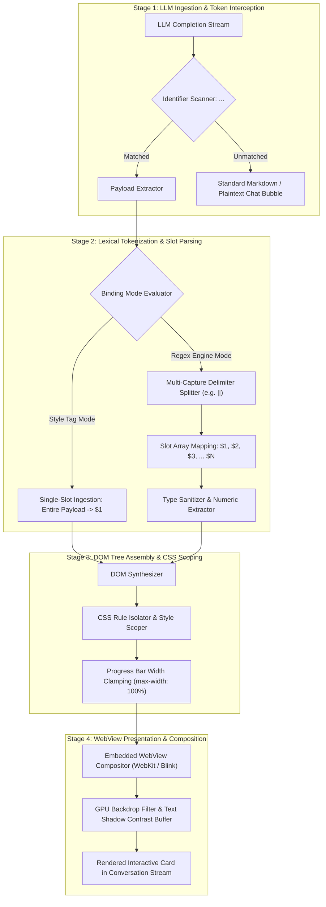
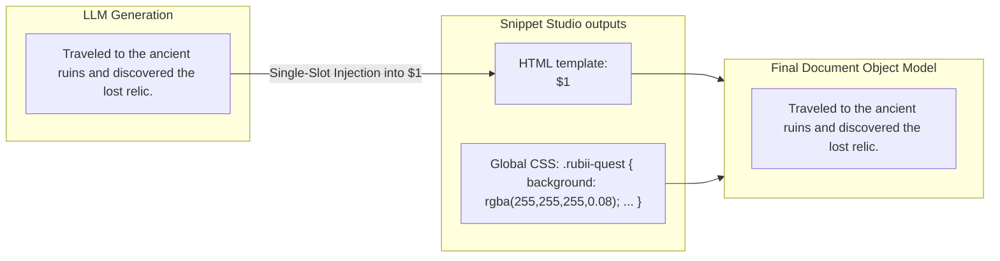
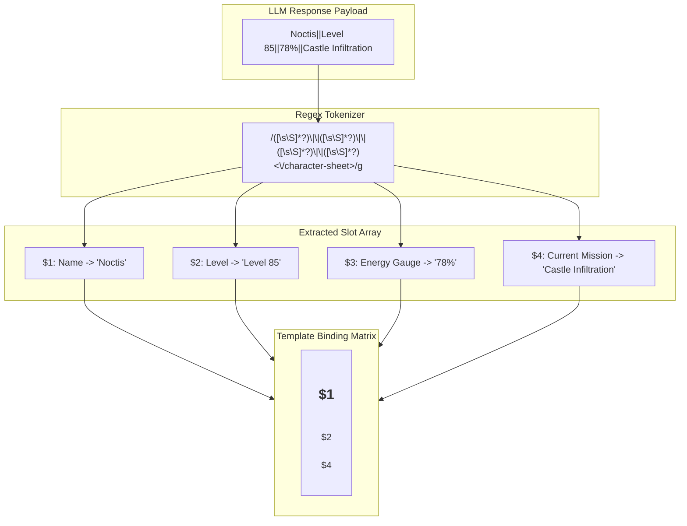
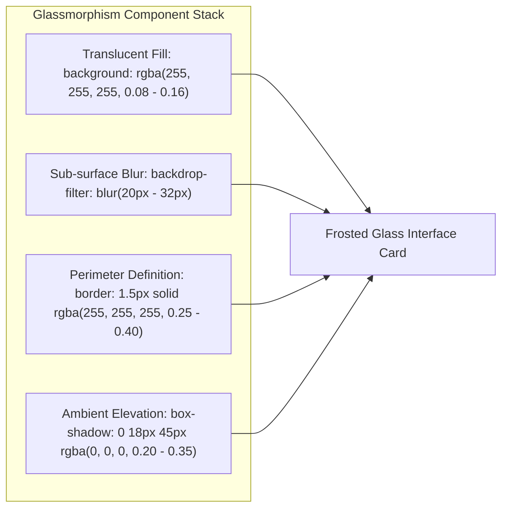
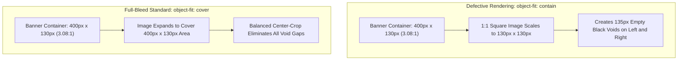
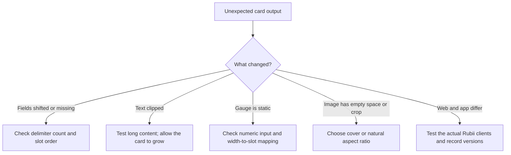

# Rubii AI Platform: System Architecture and Card UI Engineering Specification

**Document Classification:** Engineering Reference and Design Guidance  
**Target Platform:** Snippet Studio outputs for Rubii AI  
**Authoring Context:** System Architecture, Lexical Parsing, CSS Stacking, and Accessibility Engineering  
**Scope:** User-facing Style Tag/Regex concepts, practical HTML/CSS guidance, qualitative failure risks, and reference templates  

> **Evidence scope:** Snippet Studio behavior can be checked against this repository. Rubii's internal renderer is not available here; its flow is a conceptual model based on public documentation. Cross-device results and all benchmark values require a reproducible test record. Rubii says Styles & Regex are available on web and app version 2.4.2+, with app rendering close to web in almost all cases ([official article](https://rubii.ai/blog/styles-and-regex)).

---

## Executive Summary

Rubii provides Style Tags, Global CSS, and Regex rules that let Moment authors change how selected chat content is displayed. Public documentation describes this user-facing behavior, but does not expose the renderer's internal implementation.

This guide explains the two configuration patterns (single-slot Style Tag and Regex replacement), practical HTML/CSS choices, dynamic gauges, and risks to check. Examples are design guidance, not verified guarantees about every Rubii client.

---

## Table of Contents

1. [System Architecture and Rendering Pipeline](#1-system-architecture-and-rendering-pipeline)
2. [Style Tag System (Single-Slot Architecture)](#2-style-tag-system-single-slot-architecture)
3. [Regex Replacement Engine (Multi-Slot Architecture)](#3-regex-replacement-engine-multi-slot-architecture)
4. [HTML Structural Constraints and DOM Synthesis](#4-html-structural-constraints-and-dom-synthesis)
5. [Advanced CSS Engineering and Glassmorphism](#5-advanced-css-engineering-and-glassmorphism)
6. [Failure Risks and Resilience Guidance](#6-failure-risks-and-resilience-guidance)
7. [Card Developer Best Practices and Guidelines](#7-card-developer-best-practices-and-guidelines)
8. [Standard Production Reference Templates](#8-standard-production-reference-templates)
9. [Conclusion and Architectural Roadmap](#9-conclusion-and-architectural-roadmap)

---

## 1. System Architecture and Rendering Pipeline

### 1.1 End-to-End Processing Architecture

The following diagram is a conceptual model of the user-facing flow, not a confirmed internal execution pipeline:



### 1.2 Runtime and Compatibility Notes

Rubii's public article states that the app supports more HTML/CSS from version 2.4.2 and renders close to the web in almost all cases. This repository does not establish the WebView engine, viewport range, GPU behavior, or script sandbox policy; verify specific properties on the clients you support.

---

## 2. Style Tag System (Single-Slot Architecture)

The **Style Tag** architecture is engineered for cards containing a single dynamic narrative or monolithic message payload.

### 2.1 Structural Separation

In the Snippet Studio workflow, the HTML template and Global CSS are separate outputs. The template uses a selected `$1` slot; paste each output into its corresponding Rubii setting. This describes the Studio output path, not Rubii's internal storage format.



### 2.2 Operational Characteristics

| Evaluation Vector | Style Tag Architecture Profile |
| :--- | :--- |
| **Input shape** | One selected content slot; no delimiter between multiple fields is needed. |
| **Prompt coordination** | Fewer values to order than a multi-slot Regex rule; output still needs review. |
| **Multiple independent fields** | Use Regex when separate values must map to separate template locations. |

---

## 3. Regex Replacement Engine (Multi-Slot Architecture)

For complex data structures—such as financial transaction slips, gaming status sheets, health meters, and telemetry dashboards—the **Regex Replacement Engine** tokenizes composite strings into distinct capture groups ($1 to $N).

### 3.1 Multi-Capture Tokenization Pipeline



### 3.2 Delimiter Evaluation and Trade-off Matrix

Delimiter choice affects how easy it is to keep values separate. The notes below are qualitative guidance, not scores from a comparative benchmark:

| Delimiter | Example | Consideration |
| :--- | :--- | :--- |
| **Double pipe (`||`)** | `Val1||Val2||Val3` | Useful when the text values are unlikely to contain `||`; explain order clearly in the prompt. |
| **Single pipe (`|`)** | `Val1|Val2|Val3` | May collide with tables or prose that uses pipe characters. |
| **Comma (`,`)** | `Val1, Val2, Val3` | Can collide with commas inside prose or numbers such as `50,000`. |
| **Newline** | One value per line | Readable, but extra blank lines or wrapped formatting need consideration. |

---

## 4. HTML Structural Constraints and DOM Synthesis

### 4.1 The Single Root Container Mandate

Using one root `<div>` is a useful template guideline because it gives the card one place for width, spacing, and background rules. This is a design recommendation, not a verified Rubii platform mandate.

```html
<!-- CORRECT: Single root encapsulating container with border-box model -->
<div style="background: rgba(255,255,255,0.08); border-radius: 28px; padding: 20px; box-sizing: border-box; width: 100%;">
  <div>Header Section</div>
  <div>Body Section</div>
</div>

<!-- INCORRECT: Sibling roots cause stacking context failure -->
<div style="...">Header Section</div>
<div style="...">Body Section</div>
```

### 4.2 Dynamic Length Tolerance and Flow Control

Because LLM completion lengths vary widely based on prompt context, card containers must adhere to dynamic sizing rules:
1. **Avoid Fixed Heights:** Never declare `height: 250px;` on text-containing blocks. Use `min-height` or allow natural content-driven expansion.
2. **Word Wrapping Defense:** Apply `word-break: break-word; overflow-wrap: break-word;` to all text blocks to prevent long continuous strings (hashes, transaction IDs, URLs) from overflowing card margins.
3. **Box Model Sizing:** Explicitly specify `box-sizing: border-box;` on the root container so padding and borders do not expand the card beyond its parent frame.

---

## 5. Advanced CSS Engineering and Glassmorphism

### 5.1 Glassmorphism Layer Architecture

Rubii cards achieve their signature visual depth through a four-component glassmorphism stack:



#### Layer Opacity and Blur Parameter Matrix

| Structural Layer | Opacity (Alpha Range) | Blur Radius | Border Stroke | Visual Function |
| :--- | :---: | :---: | :---: | :--- |
| **Primary Root Card** | $8\% - 14\%$ | $24\text{px} - 32\text{px}$ | $1.5\text{px}$ solid ($\alpha = 0.35$) | Establishes overall card geometry and background depth. |
| **Nested Content Box** | $16\% - 24\%$ | $14\text{px} - 20\text{px}$ | $1.0\text{px}$ solid ($\alpha = 0.20$) | Enhances legibility of core dynamic text. |
| **Badges & Micro-UI** | $22\% - 32\%$ | $8\text{px} - 12\text{px}$ | $1.0\text{px}$ solid ($\alpha = 0.45$) | Draws focal attention to status indicators and tags. |

### 5.2 Elimination of Letterbox Voids in Media Layouts

When variable aspect ratio images (e.g., $1:1$ square avatars or $4:3$ thumbnails) are loaded into fixed landscape banner containers ($3.2:1$), using `object-fit: contain` results in severe letterboxing artifacts:



**Standard Full-Bleed Media CSS Declaration:**
```css
/* Container Frame */
width: 100%;
height: 130px;
border-radius: 20px;
overflow: hidden;

/* Image Element */
width: 100%;
height: 100%;
object-fit: cover;
object-position: center;
display: block;
```

### 5.3 Dynamic Gauges and Width Clamping

For progress indicators (HP, MP, affection meters, battery bars, progress meters):
- **Dynamic Variable Injection:** `width: $X%;`
- **Boundary Clamping:** To limit a bar if a value exceeds $100\%$ (e.g. `125%`), a template can include:
  `style="width: $X%; max-width: 100%; min-width: 0%;"`
- **Syntax Fault Defense:** LLMs occasionally output non-numeric descriptive strings like `MAX` instead of `100`. In CSS, `width: MAX%;` is an invalid property declaration, causing the browser engine to discard the rule and collapse the gauge to $0\%$. Templates should handle numeric extraction cleanly.

### 5.4 Typography and WCAG 2.1 Contrast Buffering

Text contrast ratio ($C$) is defined as:

$$C = \frac{L_1 + 0.05}{L_2 + 0.05}$$

Where $L_1$ and $L_2$ are the lighter and darker relative luminance values. WCAG 2.2 requires at least 4.5:1 for normal text at AA and 7:1 at AAA; large text uses 3:1 and 4.5:1 respectively. A `text-shadow` can help separate text from a background, but does not guarantee these ratios. Measure against the actual pixels behind the text ([W3C WCAG 2.2](https://www.w3.org/TR/wcag/)).

The Snippet Studio presets can help separate text from nearby image details, but they do not establish WCAG conformance without measuring the rendered text and background:

| Preset | CSS rule | Use |
| :--- | :--- | :--- |
| **None** | `text-shadow: none;` | Check text against the actual background. |
| **Soft Dark** | `text-shadow: 0 1px 3px rgba(0,0,0,0.85), 0 0 1px rgba(0,0,0,0.9);` | A Studio preset that may improve legibility; not a WCAG pass by itself. |
| **Sharp Outline** | `text-shadow: -1px -1px 0 rgba(0,0,0,0.9), 1px -1px 0 rgba(0,0,0,0.9), -1px 1px 0 rgba(0,0,0,0.9), 1px 1px 0 rgba(0,0,0,0.9);` | A decorative option for HUD/retro themes; check small text. |
| **Neon Glow** | `text-shadow: 0 0 8px rgba(0,255,255,0.9), 0 0 16px rgba(0,190,230,0.6);` | A decorative effect; do not treat it as contrast validation. |

---

## 6. Failure Risks and Resilience Guidance

The following are qualitative risks to check; this document does not include a reproducible benchmark or measured failure distribution:



### 6.1 Failure Mode Breakdown and Mitigation Strategies

| Failure Class | Root Cause Mechanism | Observable UI Defect | Architectural Mitigation Strategy |
| :--- | :--- | :--- | :--- |
| **Delimiter Omission** | Model omits or adds a `||` separator. | Slots may shift or fail to match. | State the exact order; use a single slot when separate fields are unnecessary. |
| **Regex backtracking** | Patterns with nested quantifiers (e.g. `(.*)+`) may do excessive work on non-matching input. | Slow matching for some patterns and inputs. | Prefer simple patterns such as `([\s\S]*?)` and avoid nested repetition. |
| **Syntax Invalidation** | Model emits non-numeric strings (`Full`, `MAX`, `Unknown`) into numeric CSS slots. | Progress bars render at $0\%$ width because the browser rejects invalid unit syntax. | Add client-side numeric sanitization regex `(\d{1,3}(?:\.\d+)?)` prior to style injection. |
| **Blur performance** | Several large `backdrop-filter` regions may increase rendering cost. | Check for visible lag on target devices. | Reduce blur area or layers if testing shows a problem. |
| **Text Clipping** | Fixed containers with `overflow: hidden` receive $500+$ word generations. | Truncated message payloads without scroll affordance. | Apply `min-height` with auto-expanding layout or controlled `line-clamp` rules. |

---

## 7. Card Developer Best Practices and Guidelines

To ensure maximum visual quality, rendering performance, and runtime resilience, card developers should adhere to the following ten principles:

1. **Maintain Single-Root DOM Trees:** Wrap all card elements within a single enclosing `<div>` with `box-sizing: border-box;`.
2. **Adopt Double Pipe Delimiters:** Use `||` as the canonical delimiter for multi-slot templates.
3. **Enforce Width Clamping on Meters:** Always include `max-width: 100%; min-width: 0%;` alongside dynamic percentage values.
4. **Use Full-Bleed Media Declarations:** Configure all embedded imagery with `display: block; width: 100%; height: 100%; object-fit: cover;`.
5. **Declare Robust Font Fallbacks:** Specify standard system font stacks:  
   `font-family: -apple-system, BlinkMacSystemFont, 'Segoe UI', Roboto, Helvetica, Arial, sans-serif;`
6. **Apply Defensive Word Breaking:** Declare `word-break: break-word; overflow-wrap: break-word;` on all user-facing text nodes.
7. **Ensure Text Legibility via Shadows:** When applying custom background imagery or translucency, apply a default `text-shadow` (e.g. Soft Dark).
8. **Scope CSS Rules Strictly:** Never declare unqualified element selectors (such as global `p { ... }` or `div { ... }`) in Style Tag definitions.
9. **Specify Explicit Text Colors:** Include explicit `color: #ffffff!important;` declarations on key typography nodes to prevent host theme style bleed.
10. **Test with Extreme Payloads:** Validate card rendering with both minimal (1-word) and extreme (500-word) content payloads prior to production deployment.

---

## 8. Standard Production Reference Templates

### 8.1 Reference Template 1: Style Tag Single-Slot Narrative Card

```html
<style>
.rubii-narrative-card {
  background: rgba(255, 255, 255, 0.09);
  backdrop-filter: blur(28px);
  -webkit-backdrop-filter: blur(28px);
  border: 1.5px solid rgba(255, 255, 255, 0.35);
  border-radius: 32px;
  padding: 22px 24px;
  max-width: 420px;
  margin: 12px auto;
  box-shadow: 0 20px 45px rgba(0, 0, 0, 0.22);
  font-family: -apple-system, BlinkMacSystemFont, 'Segoe UI', Roboto, sans-serif;
  color: #ffffff;
  box-sizing: border-box;
  text-shadow: 0 1px 3px rgba(0, 0, 0, 0.85);
  font-size: 14px;
  line-height: 1.65;
  word-break: break-word;
}
</style>
<div class="rubii-narrative-card">
  $1
</div>
```

---

### 8.2 Reference Template 2: Multi-Slot Telemetry Dashboard Card

```html
<div style="background: rgba(255, 255, 255, 0.08); backdrop-filter: blur(30px); -webkit-backdrop-filter: blur(30px); border: 1.5px solid rgba(255, 255, 255, 0.36); border-radius: 32px; padding: 20px; max-width: 420px; margin: 12px auto; font-family: -apple-system, BlinkMacSystemFont, 'Segoe UI', Roboto, sans-serif; color: #ffffff; box-shadow: 0 20px 45px rgba(0, 0, 0, 0.25); box-sizing: border-box; text-shadow: 0 1px 3px rgba(0, 0, 0, 0.85);">
  
  <!-- Media Banner Header -->
  <div style="width: 100%; height: 130px; border-radius: 20px; overflow: hidden; margin-bottom: 14px;">
    
  </div>

  <!-- Header & Status Badge -->
  <div style="display: flex; justify-content: space-between; align-items: center; margin-bottom: 12px;">
    <span style="font-size: 15px; font-weight: 700; letter-spacing: 0.2px;">$1</span>
    <span style="font-size: 11px; background: rgba(56, 189, 248, 0.18); border: 1px solid rgba(56, 189, 248, 0.45); padding: 3px 9px; border-radius: 12px; color: #38bdf8; font-weight: 600;">$2</span>
  </div>

  <!-- Dynamic Gauge Meter -->
  <div style="margin-bottom: 12px;">
    <div style="display: flex; justify-content: space-between; font-size: 11.5px; margin-bottom: 5px; opacity: 0.85;">
      <span>Synchronization Level</span>
      <span>$3%</span>
    </div>
    <div style="background: rgba(255, 255, 255, 0.14); border-radius: 99px; height: 8px; width: 100%; overflow: hidden;">
      <div style="background: linear-gradient(90deg, #38bdf8, #4ade80); height: 100%; width: $3%; max-width: 100%; min-width: 0%; border-radius: 99px; transition: width 0.4s ease;"></div>
    </div>
  </div>

  <!-- Core Message Body Box -->
  <div style="background: rgba(0, 0, 0, 0.24); border-radius: 18px; padding: 13px 15px; border: 1px solid rgba(255, 255, 255, 0.12); font-size: 13px; line-height: 1.55; word-break: break-word;">
    $4
  </div>

</div>
```

**Associated Regex Engine Pattern:**
```regex
/<telemetry-panel>([\s\S]*?)\|\|([\s\S]*?)\|\|(\d{1,3}(?:\.\d+)?)\s*%?\|\|([\s\S]*?)<\/telemetry-panel>/g
```

---

## 9. Conclusion and Architectural Roadmap

The Rubii AI card rendering paradigm demonstrates that combining Large Language Model semantic reasoning with standards-compliant HTML5 and CSS3 presentation engines creates highly engaging, dynamic conversational interfaces.

Clear slot order, flexible layouts, and measured contrast make cards easier to review and maintain. Compatibility and performance still depend on the actual Rubii client and should be checked on the web and app versions used by the audience.
