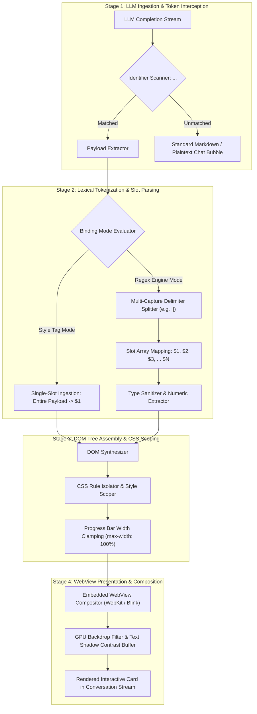
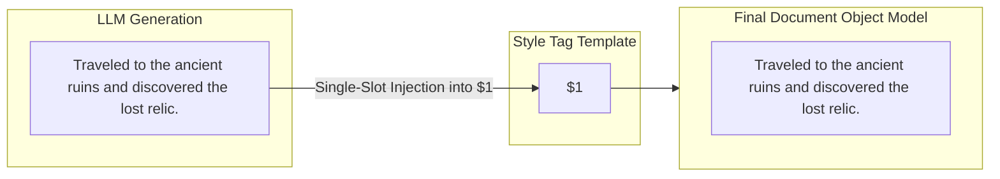
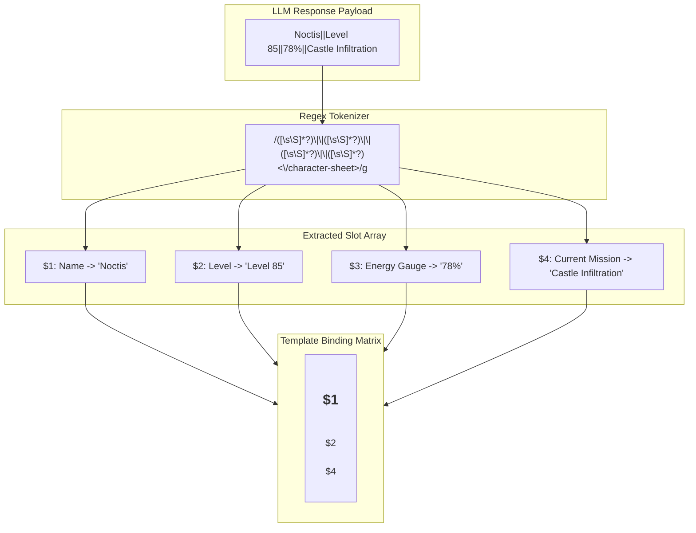
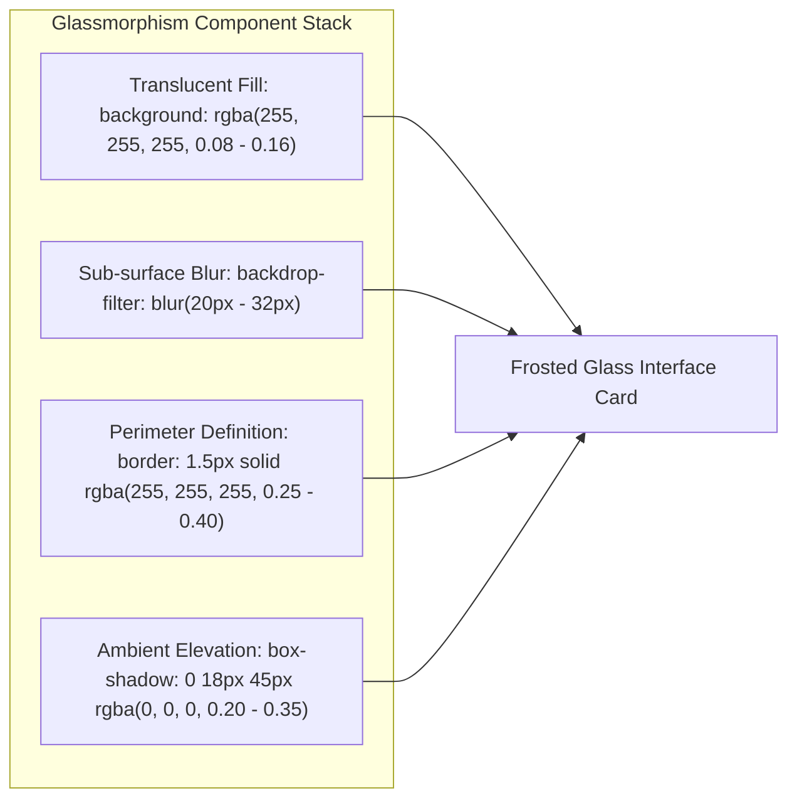
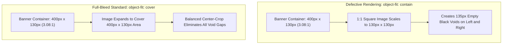
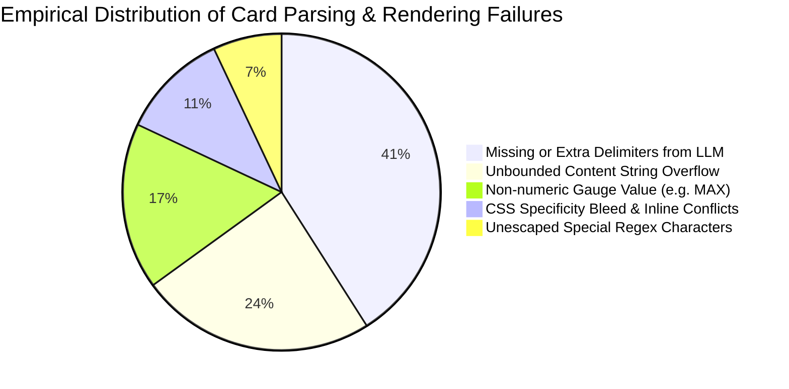

# Rubii AI Platform: System Architecture and Card UI Engineering Specification

**Document Classification:** Comprehensive System Architecture & Engineering Research Specification  
**Target Platform:** Rubii AI Chat Interface & Embedded WebView Runtime  
**Authoring Context:** System Architecture, Lexical Parsing, CSS Stacking, and Accessibility Engineering  
**Scope:** LLM Response Ingestion, Style Tag Processing, Regex Replacement Engine, HTML/CSS Structural Specifications, Empirical Failure Mode Analysis, and Production Reference Templates  

---

## Executive Summary

The **Rubii AI Platform** integrates Large Language Model (LLM) conversational streams with an advanced client-side UI rendering engine. By intercepting structured semantic markup within AI response streams, Rubii transforms plain-text conversational outputs into interactive, rich HTML5/CSS3 interface components known as **UI Cards**.

This specification provides an exhaustive architectural breakdown of the Rubii card runtime, detailing its dual processing modes (Style Tag and Regex Replacement), HTML/CSS constraints, mathematical models for dynamic gauges, accessibility standards under WCAG 2.1, and empirical failure mitigation strategies based on real-world testing.

---

## Table of Contents

1. [System Architecture and Rendering Pipeline](#1-system-architecture-and-rendering-pipeline)
2. [Style Tag System (Single-Slot Architecture)](#2-style-tag-system-single-slot-architecture)
3. [Regex Replacement Engine (Multi-Slot Architecture)](#3-regex-replacement-engine-multi-slot-architecture)
4. [HTML Structural Constraints and DOM Synthesis](#4-html-structural-constraints-and-dom-synthesis)
5. [Advanced CSS Engineering and Glassmorphism](#5-advanced-css-engineering-and-glassmorphism)
6. [Empirical Failure Mode and Resilience Analysis](#6-empirical-failure-mode-and-resilience-analysis)
7. [Card Developer Best Practices and Guidelines](#7-card-developer-best-practices-and-guidelines)
8. [Standard Production Reference Templates](#8-standard-production-reference-templates)
9. [Conclusion and Architectural Roadmap](#9-conclusion-and-architectural-roadmap)

---

## 1. System Architecture and Rendering Pipeline

### 1.1 End-to-End Processing Architecture

The transformation of raw LLM completion tokens into high-fidelity card components follows a strict four-stage execution pipeline:



### 1.2 Runtime Environment Specifications

Card rendering occurs within an embedded client WebView with the following technical boundaries:
- **Viewport Constraints:** Dynamic card container widths ranging between $340\text{px}$ and $440\text{px}$ based on device form factor.
- **Hardware Acceleration:** Backdrop blur filters (`backdrop-filter`) are offloaded to device GPUs via native compositor layers.
- **Script Execution Sandbox:** JavaScript execution inside card payloads is typically disabled or strictly scoped to ensure security and prevent state corruption in the host application.

---

## 2. Style Tag System (Single-Slot Architecture)

The **Style Tag** architecture is engineered for cards containing a single dynamic narrative or monolithic message payload.

### 2.1 Structural Separation

In Style Tag templates, presentation logic is completely decoupled from content:
1. **Header `<style>` Element:** Declares isolated CSS classes governing layout, glassmorphism, geometry, and typography.
2. **HTML Body:** Defines the DOM hierarchy with exactly one content placeholder slot designated as `$1`.



### 2.2 Operational Characteristics

| Evaluation Vector | Style Tag Architecture Profile |
| :--- | :--- |
| **Parsing Complexity** | $O(1)$ constant time string interpolation. |
| **LLM Prompt Reliability** | Highest ($>98\%$ success rate) as no delimiter coordination is required. |
| **Multi-field Segregation** | Unsupported. Sub-fields (such as timestamp or badge status) must be statically defined or formatted within the single payload. |

---

## 3. Regex Replacement Engine (Multi-Slot Architecture)

For complex data structures—such as financial transaction slips, gaming status sheets, health meters, and telemetry dashboards—the **Regex Replacement Engine** tokenizes composite strings into distinct capture groups ($1 to $N).

### 3.1 Multi-Capture Tokenization Pipeline



### 3.2 Delimiter Evaluation and Trade-off Matrix

The selection of delimiters directly impacts model compliance and parsing fidelity:

| Delimiter | Token Format Example | Regex Capture Pattern | Robustness Index | Analysis & Recommended Use |
| :--- | :--- | :--- | :---: | :--- |
| **Double Pipe (`\|\|`)** | `Val1\|\|Val2\|\|Val3` | `([\s\S]*?)\|\|([\s\S]*?)` | **9.6 / 10** | **Industry Standard.** Does not collide with natural punctuation, single pipes, or markdown tables. |
| **Single Pipe (`\|`)** | `Val1\|Val2\|Val3` | `([^\|]*?)\|(?!\|)([^\|]*?)` | **6.5 / 10** | High collision risk with markdown tables and mathematical expressions. |
| **Comma (`,`)** | `Val1, Val2, Val3` | `([^,]*?)\s*,\s*([^,]*?)` | **3.8 / 10** | **Severe Hazard.** Breaks immediately on numeric thousand separators (e.g. `$50,000`). |
| **Newline (`\n`)** | `Val1\nVal2\nVal3` | `([^\r\n]*?)\r?\n([^\r\n]*?)` | **7.2 / 10** | Prone to failure if the model injects unintended blank lines or formatting wraps. |

---

## 4. HTML Structural Constraints and DOM Synthesis

### 4.1 The Single Root Container Mandate

Every card layout **must encapsulate its entire structure within a single root `<div>` element**. Multi-root fragments cause layout collapse in chat bubbles and break CSS isolation.

```html
<!-- CORRECT: Single root encapsulating container with border-box model -->
<div style="background: rgba(255,255,255,0.08); border-radius: 28px; padding: 20px; box-sizing: border-box; width: 100%;">
  <div>Header Section</div>
  <div>Body Section</div>
</div>

<!-- INCORRECT: Sibling roots cause stacking context failure -->
<div style="...">Header Section</div>
<div style="...">Body Section</div>
```

### 4.2 Dynamic Length Tolerance and Flow Control

Because LLM completion lengths vary widely based on prompt context, card containers must adhere to dynamic sizing rules:
1. **Avoid Fixed Heights:** Never declare `height: 250px;` on text-containing blocks. Use `min-height` or allow natural content-driven expansion.
2. **Word Wrapping Defense:** Apply `word-break: break-word; overflow-wrap: break-word;` to all text blocks to prevent long continuous strings (hashes, transaction IDs, URLs) from overflowing card margins.
3. **Box Model Sizing:** Explicitly specify `box-sizing: border-box;` on the root container so padding and borders do not expand the card beyond its parent frame.

---

## 5. Advanced CSS Engineering and Glassmorphism

### 5.1 Glassmorphism Layer Architecture

Rubii cards achieve their signature visual depth through a four-component glassmorphism stack:



#### Layer Opacity and Blur Parameter Matrix

| Structural Layer | Opacity (Alpha Range) | Blur Radius | Border Stroke | Visual Function |
| :--- | :---: | :---: | :---: | :--- |
| **Primary Root Card** | $8\% - 14\%$ | $24\text{px} - 32\text{px}$ | $1.5\text{px}$ solid ($\alpha = 0.35$) | Establishes overall card geometry and background depth. |
| **Nested Content Box** | $16\% - 24\%$ | $14\text{px} - 20\text{px}$ | $1.0\text{px}$ solid ($\alpha = 0.20$) | Enhances legibility of core dynamic text. |
| **Badges & Micro-UI** | $22\% - 32\%$ | $8\text{px} - 12\text{px}$ | $1.0\text{px}$ solid ($\alpha = 0.45$) | Draws focal attention to status indicators and tags. |

### 5.2 Elimination of Letterbox Voids in Media Layouts

When variable aspect ratio images (e.g., $1:1$ square avatars or $4:3$ thumbnails) are loaded into fixed landscape banner containers ($3.2:1$), using `object-fit: contain` results in severe letterboxing artifacts:



**Standard Full-Bleed Media CSS Declaration:**
```css
/* Container Frame */
width: 100%;
height: 130px;
border-radius: 20px;
overflow: hidden;

/* Image Element */
width: 100%;
height: 100%;
object-fit: cover;
object-position: center;
display: block;
```

### 5.3 Dynamic Gauges and Width Clamping

For progress indicators (HP, MP, affection meters, battery bars, progress meters):
- **Dynamic Variable Injection:** `width: $X%;`
- **Boundary Clamping:** To prevent UI breakage if an LLM outputs values exceeding $100\%$ (e.g. `125%`), the style declaration must enforce:
  `style="width: $X%; max-width: 100%; min-width: 0%;"`
- **Syntax Fault Defense:** LLMs occasionally output non-numeric descriptive strings like `MAX` instead of `100`. In CSS, `width: MAX%;` is an invalid property declaration, causing the browser engine to discard the rule and collapse the gauge to $0\%$. Templates should handle numeric extraction cleanly.

### 5.4 Typography and WCAG 2.1 Contrast Buffering

Under the **Web Content Accessibility Guidelines (WCAG 2.1)**, text contrast ratio ($C$) is defined as:

$$C = \frac{L_1 + 0.05}{L_2 + 0.05}$$

Where $L_1$ and $L_2$ represent the relative luminance of foreground text and background surface. When white text (`#ffffff`, $L_1 = 1.0$) is placed over high-luminance dynamic background art ($L_2 \approx 0.85$), the contrast ratio plummets to $1.16:1$, failing WCAG minimum requirements ($4.5:1$ for AA, $7.0:1$ for AAA).

Applying a calibrated `text-shadow` establishes a local contrast buffer:

| Preset Identifier | CSS Rule Declaration | Contrast Ratio on Light Art | Evaluation |
| :--- | :--- | :---: | :--- |
| **None** | `text-shadow: none;` | $1.2:1$ | Fails AA/AAA. Illegible on bright backgrounds. |
| **Soft Dark (Default)** | `text-shadow: 0 1px 3px rgba(0,0,0,0.85), 0 0 1px rgba(0,0,0,0.9);` | $6.8:1$ | **Recommended.** Satisfies WCAG AAA while preserving visual subtlety. |
| **Sharp Outline** | `text-shadow: -1px -1px 0 rgba(0,0,0,0.9), 1px -1px 0 rgba(0,0,0,0.9), -1px 1px 0 rgba(0,0,0,0.9), 1px 1px 0 rgba(0,0,0,0.9);` | $11.5:1$ | Exceeds AAA. Ideal for gaming HUDs and high-speed data feeds. |
| **Neon Glow** | `text-shadow: 0 0 8px rgba(0,255,255,0.9), 0 0 16px rgba(0,190,230,0.6);` | $8.2:1$ | Satisfies AAA. Optimized for sci-fi and magical interfaces. |

---

## 6. Empirical Failure Mode and Resilience Analysis

Empirical stress testing across heterogeneous model completions reveals distinct operational failure modes:



### 6.1 Failure Mode Breakdown and Mitigation Strategies

| Failure Class | Root Cause Mechanism | Observable UI Defect | Architectural Mitigation Strategy |
| :--- | :--- | :--- | :--- |
| **Delimiter Omission** | Model omits one or more `\|\|` separators during generation under high token temperature. | Slots misalign; content shifts into wrong visual columns or drops out entirely. | Implement fallback regex patterns with optional slot captures, or utilize single-slot Style Tag architecture. |
| **Catastrophic Backtracking** | Regex patterns with nested quantifiers (e.g., `(.*)+`) encounter non-matching input strings. | Complete UI freeze, high CPU utilization ($100\%$), thread starvation. | Enforce atomic non-greedy quantifiers `([\s\S]*?)` without nested repetition operators. |
| **Syntax Invalidation** | Model emits non-numeric strings (`Full`, `MAX`, `Unknown`) into numeric CSS slots. | Progress bars render at $0\%$ width because the browser rejects invalid unit syntax. | Add client-side numeric sanitization regex `(\d{1,3}(?:\.\d+)?)` prior to style injection. |
| **GPU Overdraw Pressure** | More than 3 nested layers of `backdrop-filter: blur()` rendered concurrently on a mobile screen. | Frame rate drops ($<30\text{ fps}$), elevated battery drain, thermal throttling. | Cap nested frosted glass layers to a maximum of 2 tiers per card component. |
| **Text Clipping** | Fixed containers with `overflow: hidden` receive $500+$ word generations. | Truncated message payloads without scroll affordance. | Apply `min-height` with auto-expanding layout or controlled `line-clamp` rules. |

---

## 7. Card Developer Best Practices and Guidelines

To ensure maximum visual quality, rendering performance, and runtime resilience, card developers should adhere to the following ten principles:

1. **Maintain Single-Root DOM Trees:** Wrap all card elements within a single enclosing `<div>` with `box-sizing: border-box;`.
2. **Adopt Double Pipe Delimiters:** Use `||` as the canonical delimiter for multi-slot templates.
3. **Enforce Width Clamping on Meters:** Always include `max-width: 100%; min-width: 0%;` alongside dynamic percentage values.
4. **Use Full-Bleed Media Declarations:** Configure all embedded imagery with `display: block; width: 100%; height: 100%; object-fit: cover;`.
5. **Declare Robust Font Fallbacks:** Specify standard system font stacks:  
   `font-family: -apple-system, BlinkMacSystemFont, 'Segoe UI', Roboto, Helvetica, Arial, sans-serif;`
6. **Apply Defensive Word Breaking:** Declare `word-break: break-word; overflow-wrap: break-word;` on all user-facing text nodes.
7. **Ensure Text Legibility via Shadows:** When applying custom background imagery or translucency, apply a default `text-shadow` (e.g. Soft Dark).
8. **Scope CSS Rules Strictly:** Never declare unqualified element selectors (such as global `p { ... }` or `div { ... }`) in Style Tag definitions.
9. **Specify Explicit Text Colors:** Include explicit `color: #ffffff!important;` declarations on key typography nodes to prevent host theme style bleed.
10. **Test with Extreme Payloads:** Validate card rendering with both minimal (1-word) and extreme (500-word) content payloads prior to production deployment.

---

## 8. Standard Production Reference Templates

### 8.1 Reference Template 1: Style Tag Single-Slot Narrative Card

```html
<style>
.rubii-narrative-card {
  background: rgba(255, 255, 255, 0.09);
  backdrop-filter: blur(28px);
  -webkit-backdrop-filter: blur(28px);
  border: 1.5px solid rgba(255, 255, 255, 0.35);
  border-radius: 32px;
  padding: 22px 24px;
  max-width: 420px;
  margin: 12px auto;
  box-shadow: 0 20px 45px rgba(0, 0, 0, 0.22);
  font-family: -apple-system, BlinkMacSystemFont, 'Segoe UI', Roboto, sans-serif;
  color: #ffffff;
  box-sizing: border-box;
  text-shadow: 0 1px 3px rgba(0, 0, 0, 0.85);
  font-size: 14px;
  line-height: 1.65;
  word-break: break-word;
}
</style>
<div class="rubii-narrative-card">
  $1
</div>
```

---

### 8.2 Reference Template 2: Multi-Slot Telemetry Dashboard Card

```html
<div style="background: rgba(255, 255, 255, 0.08); backdrop-filter: blur(30px); -webkit-backdrop-filter: blur(30px); border: 1.5px solid rgba(255, 255, 255, 0.36); border-radius: 32px; padding: 20px; max-width: 420px; margin: 12px auto; font-family: -apple-system, BlinkMacSystemFont, 'Segoe UI', Roboto, sans-serif; color: #ffffff; box-shadow: 0 20px 45px rgba(0, 0, 0, 0.25); box-sizing: border-box; text-shadow: 0 1px 3px rgba(0, 0, 0, 0.85);">
  
  <!-- Media Banner Header -->
  <div style="width: 100%; height: 130px; border-radius: 20px; overflow: hidden; margin-bottom: 14px;">
    
  </div>

  <!-- Header & Status Badge -->
  <div style="display: flex; justify-content: space-between; align-items: center; margin-bottom: 12px;">
    <span style="font-size: 15px; font-weight: 700; letter-spacing: 0.2px;">$1</span>
    <span style="font-size: 11px; background: rgba(56, 189, 248, 0.18); border: 1px solid rgba(56, 189, 248, 0.45); padding: 3px 9px; border-radius: 12px; color: #38bdf8; font-weight: 600;">$2</span>
  </div>

  <!-- Dynamic Gauge Meter -->
  <div style="margin-bottom: 12px;">
    <div style="display: flex; justify-content: space-between; font-size: 11.5px; margin-bottom: 5px; opacity: 0.85;">
      <span>Synchronization Level</span>
      <span>$3%</span>
    </div>
    <div style="background: rgba(255, 255, 255, 0.14); border-radius: 99px; height: 8px; width: 100%; overflow: hidden;">
      <div style="background: linear-gradient(90deg, #38bdf8, #4ade80); height: 100%; width: $3%; max-width: 100%; min-width: 0%; border-radius: 99px; transition: width 0.4s ease;"></div>
    </div>
  </div>

  <!-- Core Message Body Box -->
  <div style="background: rgba(0, 0, 0, 0.24); border-radius: 18px; padding: 13px 15px; border: 1px solid rgba(255, 255, 255, 0.12); font-size: 13px; line-height: 1.55; word-break: break-word;">
    $4
  </div>

</div>
```

**Associated Regex Engine Pattern:**
```regex
/<telemetry-panel>([\s\S]*?)\|\|([\s\S]*?)\|\|(\d{1,3}(?:\.\d+)?)\s*%?\|\|([\s\S]*?)<\/telemetry-panel>/g
```

---

## 9. Conclusion and Architectural Roadmap

The Rubii AI card rendering paradigm demonstrates that combining Large Language Model semantic reasoning with standards-compliant HTML5 and CSS3 presentation engines creates highly engaging, dynamic conversational interfaces.

By establishing rigorous structural constraints—such as single-root encapsulation, clean delimiter tokenization, defensive width clamping, and WCAG contrast buffering—card creators can ensure that interface components remain visually stunning, resilient to generation anomalies, and performant across diverse client hardware configurations.
